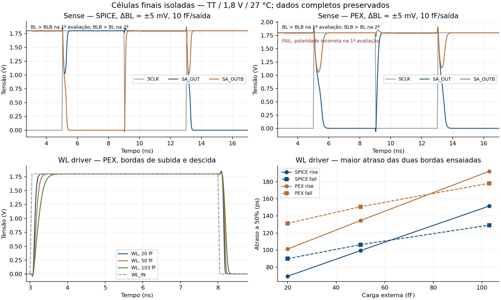

# F1-04 — Ensaios isolados das variantes finais de sense amplifier e WL driver

Data: 11/11/2026. Branch: `verification/phase1-final-isolated`.
Base conferida: `826978ab73a7335fa245f4e4d0f021ad6cf94dea`, igual ao remoto
`feature/phase2-direct-abutment` no início do trabalho; árvore inicialmente limpa.

**Resultado: WL driver aprovado nos seis casos isolados; sense esquemático
aprovado nos 12 casos, sense PEX aprovado em oito e reprovado em quatro.** A
falha ocorre com diferencial de 5 mV e foi reproduzida sem mudar a célula.
A rastreabilidade das duas variantes foi obtida, mas **F1-04 não é declarada
integralmente encerrada pelos critérios desta tarefa**. Não houve redesenho.

## 1. Pendência e referências

A [auditoria independente, seção 6](https://github.com/leofernandesc/Open-source-sram-memory-compiler/blob/b2236b69f23194ea068663677a492e9fe3f26091/docs/official_audit/07_independent_final_review.md#6-simulação-isolada-e-variantes-finais)
identificou falta de vínculo inequívoco entre bancada executada, netlist final
e resultado isolado. O item F1-04 da
[auditoria técnica anterior](https://github.com/leofernandesc/Open-source-sram-memory-compiler/blob/b2236b69f23194ea068663677a492e9fe3f26091/docs/official_audit/04_technical_evidence_audit.md)
distingue essa lacuna da demonstração de funcionamento em integração.
Os arquivos 01–07 das auditorias não foram modificados nem incorporados de
outra branch. O relatório 07 foi consultado diretamente no objeto Git indicado.

Foram consultados o [seletor atual](../release/phase1_current.json), o
[manifesto keeper](../release/phase1_keeper/manifest.json), os dois registros
físicos congelados e os SPICE, PEX e esquemáticos que eles vinculam.

## 2. Identidade das células realmente simuladas

Todos os arquivos abaixo coincidem com os hashes do manifesto. Cada bancada
inclui uma cópia **byte a byte** do SPICE ou PEX selecionado (`dut.spice`),
sem reescrita do subcircuito ou substituição por modelo comportamental.

| Célula / arquivo | SHA-256 |
|---|---|
| Sense SCH | `3ac166bcdc614f493da8388f15a658c2c5b38c1351fa78242637b5eb015e931e` |
| Sense SPICE | `52f80d154ddddef14438fdb6196fac8adb78ad67cc3173a461c66710616e5147` |
| Sense PEX | `ab60dc3ccfdcd7430ed169db89b6285757f3c035ffe94ec0d5774ecb3f56b653` |
| WL SCH | `4e1772f6c22825b77589035d949ed8fdd20c0aed6dad4a7aee2358a52508de67` |
| WL SPICE | `843808b94414be032d114590c2c6d9a787ed5b13ed1c26dd4eba4b9173d68bdd` |
| WL PEX | `c6d099c1c7db764b88eb357bcde0bba9b1a53de91466b912442e8c1a767935f6` |

Fontes: [sense](../release/phase1/cells/sense_amp/sense_amp.spice),
[sense PEX](../release/phase1/cells/sense_amp/sense_amp_pex.spice),
[WL](../release/phase1/cells/wl_driver/wl_driver.spice),
[WL PEX](../release/phase1/cells/wl_driver/wl_driver_pex.spice).

- Sense: sete MOS, L = 0,15 µm; PMOS do latch W = 1,89 µm, NMOS e tail
  W = 0,975 µm, PMOS de amostragem W = 2 µm. A geometria PEX tem NMOS
  W = 0,98 µm, quantização já registrada no LVS congelado; não é igualdade
  matemática com 0,975 µm. O PEX contém 76 resistores e 61 capacitores locais.
- WL: quatro MOS, L = 0,15 µm, primeiro estágio P/N W = 1,68 µm e segundo
  estágio P/N W = 5,04 µm. O PEX contém 47 resistores e 25 capacitores locais.
- Pinos formais conferidos: sense `VDD VSS BL BLB SCLK SA_OUT SA_OUTB`;
  WL `VDD VSS WL_IN WL`. Os nomes dos subcircuitos PEX são preservados.
- Os hashes `source_sha256`/`pex_sha256` dos
  [registros físicos do sense](../release/phase1/verification/sense_amp/result.json)
  e [WL](../release/phase1/verification/wl_driver/result.json) coincidem com
  as fontes executadas. Nenhum DRC/LVS foi refeito ou alterado.

## 3. Evidências históricas examinadas

| Evidência | Conclusão de uso |
|---|---|
| [Sense characterization](../sims/sense_amp_characterization_pvt.csv), 330 linhas | SCH `ad8f819a9c95b5aa9405ded08fd7860a0eafc557b15fd5d1b5c8f30446dc8483`, draft 1,26/0,65 µm. Não comprova a variante final |
| [Capacitância do sense scale1p5](../sims/sense_scale1p5_pex_input_capacitance_provenance_20261008.csv), 360 linhas | Hash PEX `ab60dc3…` correto; é medida de capacitância de entrada, não prova isolada de regeneração e polaridade |
| [G7 read](../sims/g7_read_requal_latch_t0_20261008.csv), 60 linhas | Identifica as variantes finais, mas é integração. Preservado como evidência contextual |
| [WL smoke SCH](../sims/wl_driver_smoke_tt.csv) e [PEX](../sims/wl_driver_pex_smoke_tt.csv), duas linhas cada | Não registram hashes suficientes para atribuição inequívoca ao sizing final |
| [Runner smoke](../sims/run_leaf_peripheral_smoke.py) e [sense histórico](../sims/run_sense_amp_characterization.py) | Caminhos/condições históricos não bastam para atribuir resultados antigos à seleção congelada; o draft WL usa 0,42/0,84 µm |

Não foi encontrada prova isolada funcional completa que eliminasse os dois
ensaios solicitados. Não se afirma que essa atividade jamais tenha ocorrido;
registra-se a falta da cadeia documental específica examinada.

## 4. Ambiente, critérios e preservação

Execução no container EDA existente `sram-xschem`, ngspice **44.2 com KLU**,
`ngspice -n -b bench.spice`. SKY130A, `.lib .../libs.tech/ngspice/sky130.lib.spice tt`,
VDD = 1,8 V, temperatura = 27 °C. O recibo preserva versão nativa e hashes
de **319 arquivos** do fechamento transitivo de includes do PDK; há arquivos
de outros corners nesse inventário conservador, mas somente TT foi simulado.

Antes da campanha: aproximadamente 3.472 MiB de RAM disponível, 2.118 MiB de
swap livre e 5.200 MiB de disco livre. Houve nova checagem antes de cada caso;
as simulações ngspice foram sequenciais, com uma thread e timeout de 120 s/caso.
Método Gear, `reltol=1e-5`, passo máximo 5 ps, rampas externas de 50 ps,
rampa de alimentação de 1 ns. Sem `.ic`, `.nodeset`, `uic`, reset ou fontes
em nós internos. Apenas entradas externas e capacitores de carga nas saídas.

Os critérios foram gravados em `criteria.json` antes das execuções:

- LOW entre −0,18 e 0,18 V; HIGH entre 1,62 e 1,98 V nas janelas de avaliação.
- Sense na amostragem: erro de cada saída em relação à bitline ≤10 mV e
  diferencial com **sinal correto e amplitude ≥ metade** do diferencial imposto.
  Assim, duas saídas iguais ou uma saída estável errada não passam.
- Sense regenerando: polaridade correta, duas saídas nos níveis requeridos e
  resolução até 3 ns depois do cruzamento de 0,9 V de SCLK.
- WL: níveis estáveis não inversores antes/depois das duas subidas e descidas;
  propagação a 50% entre 0 e 2 ns e slew 10–90% positivo até 2 ns.

Esses prazos são critérios desta bancada, não especificações de Fmax ou do top.
Nenhum limite foi afrouxado após observar falhas.

## 5. Bancadas e erro de estímulo preservado

### Sense

VDD sobe entre 0 e 1 ns. SCLK fica baixo para amostragem. Aos 3 ns, BL/BLB
recebem o diferencial; SCLK sobe aos 5 ns. A regeneração é observada entre
8 e 8,5 ns, com estabilidade verificada até 8,8 ns para medir resolução.
SCLK baixa aos 9 ns; o diferencial é invertido aos 10 ns; a segunda avaliação
começa aos 13 ns e é observada entre 16 e 16,5 ns, até 16,8 ns para resolução.
Cada execução exerce as duas polaridades e a recuperação da fase anterior.

Matriz: duas vistas × três diferenciais (5/50/200 mV) × duas polaridades
iniciais × duas cargas (2/10 fF **em cada saída**) = **24 execuções, 48 avaliações**.
Entrada alta sempre 1,8 V; entrada baixa 1,795, 1,75 ou 1,60 V, conforme o caso.

### WL e correção da bancada

`nominal_v1` utilizou `PULSE` com período de 8 ns. A fonte iniciava um terceiro
pulso aos 19 ns, enquanto o verificador esperava LOW entre 19 e 19,5 ns.
Os seis casos WL acusaram corretamente essa inconsistência entre estímulo e
expectativa. Não é falha atribuível ao driver. As quatro bordas anteriores
e os respectivos níveis passaram; a evidência original permanece com FAIL.

Em `nominal_v2`, somente essa fonte foi substituída por PWL de **dois pulsos
explícitos**, subindo aos 3 e 11 ns e descendo aos 8 e 16 ns. A última janela
LOW e todos os limites originais foram mantidos. Os seis casos WL foram
novamente simulados. Os 24 ensaios sense, cujos decks não mudaram, foram
reaproveitados byte a byte, incluindo as falhas, com `reused_from` explícito.
O script histórico exato está em `development_runner_v1.py`, vinculado ao
recibo original por SHA-256; não se reescreveu o resultado anterior.

## 6. Carga do wordline driver

As cargas externas são **20, 50 e 103 fF**, somadas aos parasitas próprios
da vista PEX quando esta é utilizada.

Uma linha de oito bitcells apresenta 16 gates de acesso W/L = 0,60/0,15 µm,
como definido no manifesto. Uma estimativa geométrica de primeira ordem usa
`toxe = 4,148 nm` do modelo TT `sky130_fd_pr__nfet_01v8__tt.pm3.spice`:

`Cox ≈ ε0 × 3,9 / toxe ≈ 8,32 fF/µm²`

`16 × 0,60 × 0,15 × Cox ≈ 12,0 fF`.

O ensaio de 20 fF acrescenta aproximadamente 8 fF como **orçamento de teste**
para efeitos de borda/overlap e conexões. Esse acréscimo não é extração nem
limite garantido: capacitância de gate depende do bias e o fio real pode
exceder tal orçamento. 50 fF é uma carga intermediária de comparação.
103 fF aproxima o valor histórico de 102,873935496 fF de uma linha física
de oito bits, documentado em
[combined PEX](row_decoder_capture_combined_pex_20261009.md#full-row-load-and-bench-scope).
É referência da **geometria anterior**, não medição da matriz com abutment.

Portanto há uma carga estimada a partir dos 16 gates e uma comparação com
carga representativa da linha antiga, sem afirmar que qualquer delas seja
a capacitância real da nova linha. Não foi executada nova extração do array.

## 7. Resultados do sense

| Vista | Diferencial | Casos PASS / total | Avaliações corretas / total | Resolução das avaliações corretas (ns) |
|---|---:|---:|---:|---:|
| Esquemático | 5 mV | 4/4 | 8/8 | 0,173–0,309 |
| Esquemático | 50 mV | 4/4 | 8/8 | 0,113–0,189 |
| Esquemático | 200 mV | 4/4 | 8/8 | 0,077–0,133 |
| PEX | 5 mV | **0/4** | **4/8** | 0,401–0,531 somente para a polaridade correta |
| PEX | 50 mV | 4/4 | 8/8 | 0,301–0,451 |
| PEX | 200 mV | 4/4 | 8/8 | 0,210–0,287 |

Os intervalos combinam cargas de 2 e 10 fF e as duas avaliações. Um caso só
passa se ambas passarem. A ausência de resolução correta fica `null` no JSON
e vazia no CSV, sem inventar um atraso para uma decisão errada.
As saídas finais, entradas, SCLK, erro de amostragem e resolução **de cada
avaliação** estão em [metrics.csv](../reports/phase1/final_isolated_20261111/nominal_v2/metrics.csv).

### Falha PEX em 5 mV e reprodução independente

Com BL = 1,8 V e BLB = 1,795 V, o esperado é SA_OUT HIGH e SA_OUTB LOW.
O PEX termina em **SA_OUT ≈1,08 µV e SA_OUTB ≈1,8 V**, a polaridade oposta.
Com o diferencial invertido, ele resolve corretamente para esse mesmo estado.
A falha aparece nas duas cargas e nas duas ordens de avaliação; não depende
apenas da partida ou de iniciar a bancada com uma determinada polaridade.

O erro de amostragem é de dezenas de µV, muito menor que 5 mV. Antes de
SCLK subir, o diferencial de saída tem o sinal correto. Exemplo, carga 2 fF:

| Instante | Situação | Δ(SA_OUT − SA_OUTB), passo máximo 5 ps | Passo máximo 1 ps |
|---|---|---:|---:|
| 4,9 ns | SCLK baixo, amostragem | +5,004 mV | +5,004 mV |
| 5,1 ns | Após subida de SCLK | −18,016 mV | −17,968 mV |
| 8,5 ns | Decisão regenerada | Aproximadamente −1,8 V | Aproximadamente −1,8 V |

O [reprodutor dirigido](../tools/reproduce_phase1_sense_failure.py) executou
novamente o caso crítico com os mesmos parâmetros e depois com passo máximo
de **1 ps** e `reltol=1e-6`. As duas execuções completaram normalmente e
reproduziram a polaridade errada. Resultado:
[FAIL_REPRODUCED](../reports/phase1/final_isolated_20261111/sense_reproduction/results.json).
Não é timeout, erro de execução, ausência de inicialização artificial ou
simples seleção de uma amostra antes da convergência final.

**Interpretação delimitada:** a seleção PEX apresenta uma limitação de decisão
dinâmica para o diferencial de 5 mV sob este common-mode, slew e cargas. A
inversão do sinal ocorre na transição para regeneração. A diferença em relação
ao esquemático é compatível com desequilíbrio dinâmico dos parasitas da folha;
essa é uma hipótese, não isolamento comprovado de um resistor/capacitor causal.
Não se removeu RC, não se modificou o PEX e não se mediu offset estático ou
estatístico. Não se define a partir disso um diferencial mínimo garantido.

50 e 200 mV passaram nas duas polaridades. Isso não apaga os FAIL de 5 mV,
nem demonstra defeito em todos os pontos de operação da SRAM integrada.
Uma decisão de aceitar uma faixa nominal mais limitada exige explicitação
e revisão da equipe; **não foi feita retroativamente nesta campanha**.

## 8. Resultados do WL driver

Seis casos finais: duas vistas × três cargas, **seis PASS, zero FAIL**.
Foram observadas duas subidas e duas descidas em cada caso, com saída total
não inversora, HIGH/LOW válidos e desativação após retirada do comando.

| Carga | SCH maior tPLH (ps) | SCH maior tPHL (ps) | PEX maior tPLH (ps) | PEX maior tPHL (ps) | PEX maior slew subida / descida (ps) |
|---:|---:|---:|---:|---:|---:|
| 20 fF | 69,4 | 90,0 | 101,2 | 131,3 | 88,1 / 56,6 |
| 50 fF | 99,4 | 106,3 | 134,6 | 150,7 | 156,1 / 79,8 |
| 103 fF | 151,5 | 129,1 | 192,2 | 178,2 | 278,4 / 117,5 |

Propagação: diferença entre cruzamentos interpolados de 0,9 V na entrada e
saída. Slew: 0,18→1,62 V na subida e 1,62→0,18 V na descida. Os máximos vêm
das duas bordas de cada tipo. São medições nominais com passo adaptativo
limitado a 5 ps, não precisão metrológica sub-ps nem fechamento de timing.

## 9. Verificação das evidências e controles negativos

O [runner](../tools/run_phase1_final_isolated.py) mantém os transientes completos,
sem decimação, em `waveform.dat.gz`. Cada arquivo preserva o payload original
do `wrdata`, inclusive cabeçalho, com hash do conteúdo descomprimido.
O replay verifica número nativo de linhas, término temporal, monotonicidade,
valores finitos, netlist, deck esperado, modelos e hashes. Recalcula os
critérios diretamente dos dados; não confia apenas no status anterior.

Em `nominal_v2` há **30 casos distintos, 396 verificações funcionais: 388 PASS
e oito FAIL**, estas provenientes das quatro decisões PEX erradas de 5 mV
(polaridade/níveis e prazo de resolução correta). Controles negativos são
separados: duas adulterações em memória por caso, saída com polaridade trocada
e saída travada em HIGH, **60 rejeições esperadas**. Não são 60 novas simulações.

Os [seis testes do recibo](../tools/test_phase1_final_isolated.py) passaram:
replay original; contador adulterado; DUT alterado mesmo após recalcular seu
hash de artefato; log ausente; transiente truncado; e saídas trocadas mesmo
após recalcular hashes dos dados. São cinco tentativas negativas e um replay
positivo, feitas em cópias descartáveis. Fontes aprovadas nunca foram adulteradas.

O verificador retorna **PASS_EVIDENCE_INTEGRITY** com `functional_status=FAIL`
e quatro casos falhos. Integridade não significa aprovação funcional.
Transcrições: [verificação](../reports/phase1/final_isolated_20261111/verification.txt)
e [testes adversariais](../reports/phase1/final_isolated_20261111/checker_tests.txt).
Os logs nativos preservam os carriage returns das mensagens de progresso do
ngspice. Eles provocam avisos de whitespace no `git diff --check`; não foram
normalizados para conservar os bytes efetivamente produzidos pela ferramenta.

Contagem de execuções: 30 originais em v1; seis repetições WL corrigidas em v2;
duas reproduções do sense, total **38 invocações ngspice**, não 38 casos
independentes. v2 conserva exatamente os 24 ensaios sense originais e os seis
WL novos; não soma repetição como cobertura adicional.

## 10. Evidência visual e reprodução



Dados da figura: casos `sa_*_d5_p+1_c10` e `wl_*_c20/c50/c103` de v2.
O FAIL do sense PEX está indicado na própria figura. Gerador:
[plot_phase1_final_isolated.py](../tools/plot_phase1_final_isolated.py).

[Índice dos resultados](../reports/phase1/final_isolated_20261111/README.md)
e [recibo consolidado](../reports/phase1/final_isolated_20261111/nominal_v2/results.json).
Os decks, logs e transientes completos são versionados; não dependem de raws
locais ocultos. A reprodução elétrica requer o PDK correspondente.

Reprodução completa em diretório novo, sem reaproveitamento:

```sh
./tools/sram-eda python3 tools/run_phase1_final_isolated.py \
  --output reports/phase1/final_isolated_fresh
```

É esperado exit code **1** se a falha funcional for reproduzida; isso difere
de `FAIL_EXECUTION`, que registra erro de ferramenta, timeout ou dados incompletos.
O comando realmente utilizado para o consolidado foi:

```sh
./tools/sram-eda python3 tools/run_phase1_final_isolated.py \
  --output reports/phase1/final_isolated_20261111/nominal_v2 \
  --reuse-sense-from reports/phase1/final_isolated_20261111/nominal_v1
```

Replay sem simular, testes e reprodução dirigida em novas saídas:

```sh
./tools/sram-eda python3 tools/run_phase1_final_isolated.py \
  --output reports/phase1/final_isolated_20261111/nominal_v2 --verify
./tools/sram-eda python3 tools/test_phase1_final_isolated.py \
  --evidence reports/phase1/final_isolated_20261111/nominal_v2
./tools/sram-eda python3 tools/reproduce_phase1_sense_failure.py \
  --evidence reports/phase1/final_isolated_20261111/nominal_v2 \
  --output reports/phase1/final_isolated_sense_reproduction
```

O pacote inclui hashes próprios em `package_checksums.sha256` e os recibos
de execução, sem modificar manifestos ou checksums oficiais.

## 11. Parecer e limitações

- **WL driver:** comprovação funcional isolada obtida agora para as duas vistas,
  três cargas e condições declaradas. A lacuna específica de sua variante final
  está tecnicamente resolvida.
- **Sense:** identidade e execução isolada agora rastreáveis; aprovação nominal
  em 50/200 mV e no esquemático em 5 mV; **falha PEX em 5 mV reproduzida**.
  Não se concede aprovação integral da matriz definida antes da execução.
- **F1-04:** documentação de execução complementada, mas fechamento integral
  **pendente**, dado o critério desta tarefa de resultados funcionais aprovados.
  A equipe deve discutir a limitação em pequeno diferencial e a faixa de entrada
  requerida antes de decidir se há necessidade de mudança física. Não se propõe
  redimensionamento como consequência automática desses dados.
- Não houve alterações em células congeladas, seletores, manifestos, auditorias
  históricas, gerador, layout com abutment ou resultados anteriores. A única
  correção implementada foi em uma **bancada nova** desta rodada.
- Os novos ensaios não provam a execução histórica da atividade no cronograma
  original da Fase 1 e não substituem aprovação formal dos orientadores.
- Não são caracterização de offset/mismatch/yield, PVT, Fmax, confiabilidade ou
  timing do sistema. Os RC locais da PEX selecionada foram preservados, mas não
  houve nova extração RC da matriz nem transferência das margens do layout antigo
  ao novo. As fontes ideais e cargas lumped são limitações explícitas da bancada.

Nenhuma falha foi ocultada ou convertida em PASS para encerrar a pendência.
