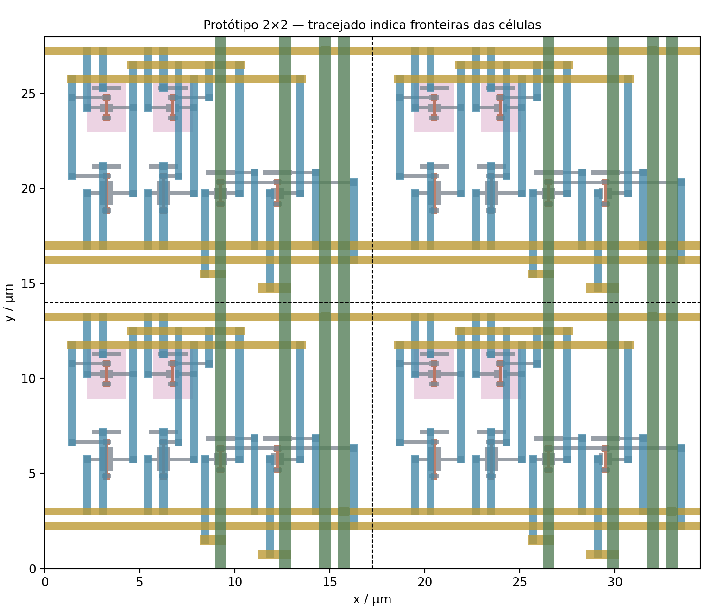
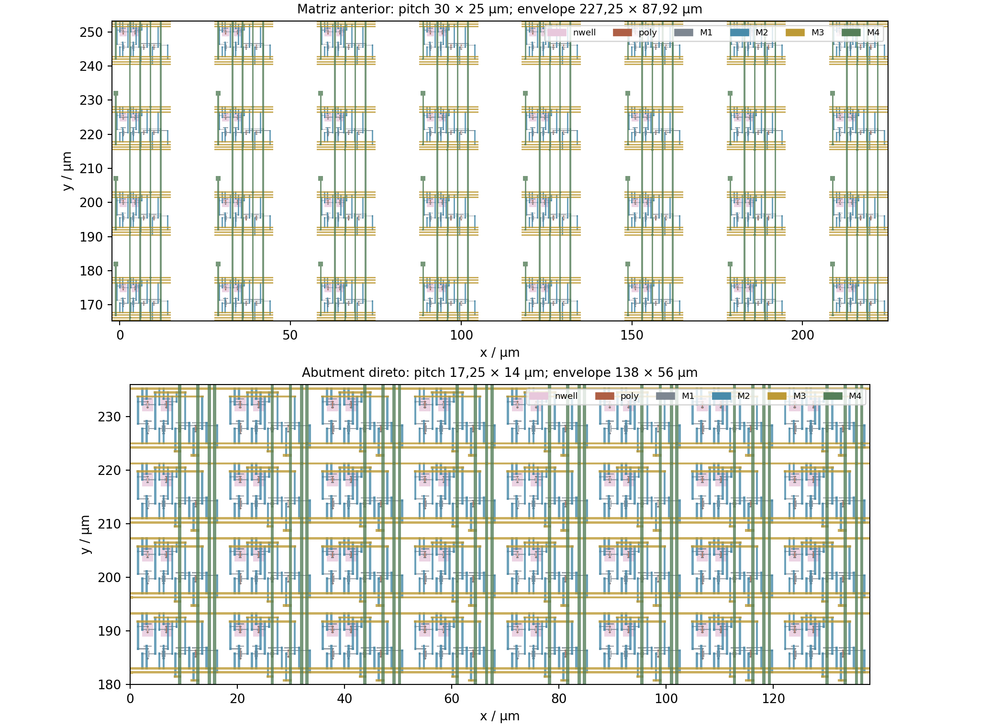
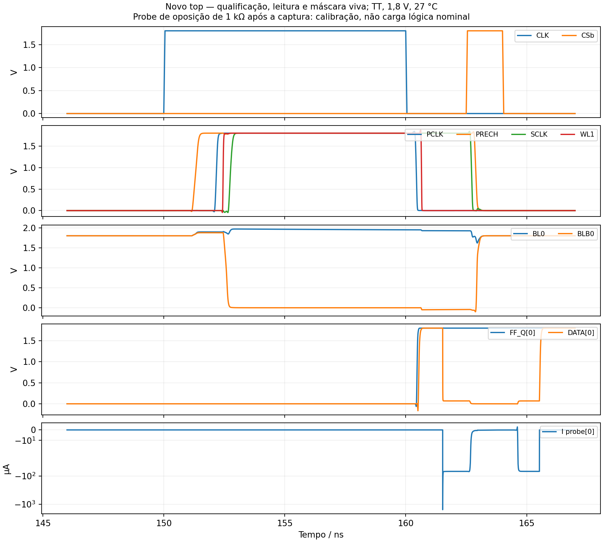

# SRAM 4×8 — revisão física com abutment direto

Data: 11/11/2026. Branch `feature/phase2-direct-abutment`, criada de
`3d148806ba16fcf6d9c5e46d1cefb975dfcc11d6`. **Candidato independente**;
os seletores oficiais das Fases 1 e 2 continuam apontando para a implementação
anterior. Não houve merge, mudança nos PRs ou alteração dos artefatos congelados.

A proposta oficial, p.4, item 10, pede encostamento em linhas e colunas.
Seu PDF foi conferido pelo hash
`59021f96db0202678b9ec4c9f6195fceeb95cfd60a8ecf5c5a3845a72c332644`.
As auditorias [04](https://github.com/leofernandesc/Open-source-sram-memory-compiler/blob/b2236b6/docs/official_audit/04_technical_evidence_audit.md),
[06](https://github.com/leofernandesc/Open-source-sram-memory-compiler/blob/b2236b6/docs/official_audit/06_phase2_technical_verdict.md)
e [07](https://github.com/leofernandesc/Open-source-sram-memory-compiler/blob/b2236b6/docs/official_audit/07_independent_final_review.md)
identificam corretamente a ausência desse método na versão espaçada.

## Estratégia física

Nova [bitcell](../physical/phase2_direct_abutment/bitcell_6t_abut.mag):
**17,25 × 14 µm**, orientação R0, fronteira `(0,0)..(3450,2800)` em unidades
de 5 nm. Não se limitou a reduzir o pitch da célula antiga:

- Geometria de **20 tipos de camadas até via2**, inclusive dispositivos,
  wells, taps, difusões, poly, contatos e metal1/2, preservada exatamente
  por uma translação de `(450,3050)` unidades. Topologia 6T e W/L preservados:
  PU=0,42 µm, PD=1,26 µm, acesso=0,60 µm, L=0,15 µm.
- As barras metal3 dos nós Q/QB foram limitadas ao interior da célula;
  não podem unir o armazenamento de colunas vizinhas.
- WL e alimentação atravessam as fronteiras horizontais em metal3.
  BL, BLB e alimentação atravessam as fronteiras verticais em metal4.
  Os contatos via3 ficam deslocados dos via2 existentes.
- A altura de 14 µm acomoda as terminações metálicas com separação de borda.
  Os condutores atingem as fronteiras reais; não há vão entre instâncias.
  Não se exige compartilhamento de difusão: isolamento e regras de borda
  são verificados pelo DRC do conjunto.

[Gerador da célula/2×2](../tools/run_direct_abutment.py) e
[gerador do fabric](../tools/generate_direct_abutment_fabric.py) são novos.
O segundo lê o bbox físico qualificado para calcular os pitches. Os periféricos
mantêm seus espaçamentos seguros, com fanout específico para o núcleo compacto:
M3/M4 para BL/BLB, escapes independentes de WL e alimentação escalonada.
Decoder 33 MOS, keepers, WL/write drivers, precharge, sense, RTL e taps
24/40/60/80 não foram modificados. O binding HD anterior é entrada lógica
inalterada, não uma evidência física reutilizada para aprovar a nova geometria.

## Gate 2×2 e integração

O [gate do protótipo](../physical/phase2_direct_abutment/pilot_gate.json)
foi fechado **antes** de iniciar a integração 4×8.

| Objeto/evidência nova | Resultado |
|---|---|
| [Célula revisada](../reports/direct_abutment/20261111/leaf_v2/results.json) | DRC full=0; LVS expandido dos 6 MOS |
| [Matriz 2×2](../reports/direct_abutment/20261111/pilot_v2/results.json) | 34,5×28 µm; DRC=0; LVS dos 24 MOS |
| [GDS 2×2 reimportado](../reports/direct_abutment/20261111/pilot_stream_v1/results.json) | DRC=0/LVS; 14 conexões de fronteira; duas WL e dois pares BL/BLB distintos; topologia de cada 6T conferida independentemente |
| [Elétrica 2×2](../reports/direct_abutment/20261111/pilot_electrical_v1/results.json) | 104 checks, zero falhas; escrita, reescrita, leitura diferencial, retenção e preservação da outra linha |
| [Fabric 4×8](../reports/phase2/direct_abutment_20261111/fabric_v3/results.json) | DRC=0/LVS dos 401 MOS; GDS reimportado também aprovado |
| [Top roteado](../reports/phase2/direct_abutment_20261111/layout_v1/results.json) | DRC=0/LVS expandido dos 1.493 MOS |
| [GDS final reimportado](../reports/phase2/direct_abutment_20261111/gds_v1/results.json) | DRC=0/LVS; mesma referência elétrica das folhas e HD, sem black boxes funcionais |
| [GLS da nova netlist roteada](../reports/phase2/direct_abutment_20261111/gls_v1/results.json) | 15.619 checks; modelo funcional de fabric, sem caracterização de timing |

No teste 2×2, drivers externos ideais, 10 fF por bitline, TT/1,8 V/27 °C;
as bitcells são extraídas do novo GDS. Não há `.ic` ou `.nodeset`. Esse piloto
não representa sense amplifier ou captura de saída, testados no top completo.

## Verificação elétrica do novo top

**Campanha concluída: 1.740 verificações, incluindo 72 bits lidos, zero falhas.**
O ngspice terminou nativamente e os checks foram recalculados a partir do raw
completo, com 40.459 linhas e identidade criptográfica conferida. Outros
444 screens de pré-carga/captura passaram sobre o mesmo transiente; não são
444 operações adicionais. A [auditoria final](../reports/phase2/direct_abutment_20261111/audit_v1/results.json)
confirma também 32 bits, 16 gates de acesso por WL, 180 conexões nas fronteiras,
20 FF, oito tri-states e os 80 inversores de atraso preservados.

Foi preparada uma [fixture](../reports/phase2/direct_abutment_20261111/fixture_v1/results.json)
diretamente da nova extração, preservando todos os MOS e suas junções.
`PREPARED_EXTRACTED_FIXTURE` significa somente preparação, sem PASS elétrico.
A [campanha integrada](../reports/phase2/direct_abutment_20261111/qualification_v1/results.json)
tem 18 ciclos/370 ns: duas capturas inativas; escritas AA/55/0F/F0 nas quatro
linhas; leitura de todas; reescritas complementares nas linhas 0/1; leituras
consecutivas, inclusive repetição da linha 3; idle/retorno; máscara viva e
handoffs de barramento com guardas de estímulo de 0,3/0,6 ns.

São reutilizados **os estímulos e verificadores**, não seus resultados antigos.
Os critérios anteriores de fases, FF_D/FF_Q, armazenamento conhecido,
preservação das outras linhas e corrente do mestre são mantidos. A calibração
usa probe de oposição de 1 kΩ e piso de 50 µA, fora da janela de leitura
normal. Não equivale a uma carga lógica nominal suportada ou leakage garantido.

| Medida da campanha nova | Observação nominal |
|---|---:|
| PRECH80% liberado → WE20% ativo | 211,3..212,2 ps |
| WL80% ativa → SCLK20% | 238,5..244,5 ps |
| WL20% liberada → próxima PRECH80% | 2,1963..2,1976 ns |
| WE20% liberado → próxima PRECH80% | 2,2906..2,2908 ns |
| Menor janela válida em DOUT_RAW antes da captura local | 7,4368 ns |
| Menor janela válida em FF_D antes da captura local | 7,2402 ns |
| DATA novo após descida pública, nos 44 bits que comutaram | 0,4888..0,5509 ns |
| Desabilitação observável sob probe, após CSb50% | 0,1331..0,1842 ns |
| Reabilitação de condução sob probe, após CSb50% | 0,6288..0,6319 ns |

Método: cruzamentos interpolados 20/50/80%, passo máximo 10 ps e validade
baixo −0,18..0,36 V / alto 1,44..1,98 V. O envelope FF usa a referência
Liberty TT/25 °C contra o ensaio SPICE a 27 °C, não STA qualificado. A janela
posterior inspecionada de 2 ns não é hold mínimo. Os intervalos de I/O sob
probe são medidas de observabilidade, não limites garantidos de turnaround.
Diferenças em relação às campanhas antigas também incluem padrões e bits
observados distintos; não se atribui ganho/perda de timing somente à compactação.

O [ensaio geral de 710 ns](../reports/phase2/direct_abutment_20261111/access_v1/results.json)
foi interrompido por custo de execução e substituído pela campanha consolidada.
A [classificação da interrupção](../reports/phase2/direct_abutment_20261111/access_v1/interruption.json)
é preservada: não há aprovação dessa tentativa nem falha física inferida dela.
Nenhum limiar elétrico foi relaxado para acomodar resultados.

## Área: distinguir matriz, pitch e top

| Medida | Layout anterior | Novo candidato |
|---|---:|---:|
| Célula / µm | 17,25×12,92 | 17,25×14 |
| Pitch / µm | 30×25 | 17,25×14 |
| Envelope das 32 células / µm | 227,25×87,92 | 138×56 |
| Área desse envelope / µm² | 19.979,82 | 7.728 |
| Orçamento 8×4 pitches / µm² | 24.000 | 7.728 |
| Fabric com periféricos / µm | 367,5×238,5 | 367,5×238,5 |
| Floorplan do top / µm | 540×380 | 540×380 |

Redução do **envelope geométrico da matriz: aproximadamente 61,3%**.
Comparar orçamentos de pitches dá 67,8%, mas inclui espaços externos à última
linha/coluna da versão anterior; não é a mesma medida. O top não diminuiu:
periféricos/fanout e floorplan não foram otimizados nesta alteração.

## Tentativas rejeitadas e correções

Os resultados anteriores desta rodada são preservados em diretórios próprios:

- `leaf_v1`: geometria em memória aprovada, mas MAG salvo antes das rotas
  superiores. Artefato rejeitado por disposição explícita; `leaf_v2` salva
  a revisão completa e é o input efetivamente qualificado no piloto.
- `pilot_v1`: DRC=0, LVS reprovado por portas do pai associadas a `space`
  sobre geometria somente dos filhos. Landings locais corretos resolvem
  a exportação em `pilot_v2`; não se avançou com o LVS reprovado.
- `fabric_v1`: espaçamento M5 insuficiente e contato de alimentação largo
  tocando a outra rede. Trilhas/landings foram separados e escalonados.
- `fabric_v2`: DRC=0, LVS detectou WL0 interrompida onde via3/via4 se
  sobrepunham. Deslocar o escape superior separou os contatos; `fabric_v3`
  passou DRC/LVS e reimportação antes do roteamento do top.

Nenhuma correção exigiu alterar dispositivo, dimensionamento ou topologia 6T.
O auditor da biblioteca antiga confirmou os 3.020 artefatos indexados
([preservação](../reports/phase2/direct_abutment_20261111/preservation_v1/phase1_handoff.json)).
Cinco adulterações em cópias descartáveis foram rejeitadas: alias de linhas,
alias de colunas, largura incorreta, curto de alimentação e vão de 10 nm.

## Figuras de evidência

Os desenhos abaixo são polígonos dos GDS reais; o tracejado do 2×2 é anotação
de fronteira. As ondas são do raw completo da campanha nova. As identidades
estão em [sources.json](../reports/phase2/direct_abutment_20261111/figures_v1/sources.json).







## Reprodução e limites

Ambiente utilizado: `tools/sram-eda`, SKY130A/open_pdks já instalado, Magic
8.3.684, Netgen 1.5.293, OpenROAD ee9759486, ngspice 44.2 KLU. Operações
sequenciais; OMP/BLAS/ngspice com uma thread. Nenhuma instalação volumosa.

Usar sempre **pastas novas**. A revisão e o gate 2×2 versionados podem ser
auditados sem reconstrução; o gerador valida seus hashes. Para reproduzir o
fluxo completo, substitua os caminhos de saída e passe os novos reports aos
estágios seguintes:

```sh
./tools/sram-eda python3 tools/generate_direct_abutment_fabric.py --output reports/phase2/direct_abutment_20261111/reproduced_new/fabric
./tools/sram-eda python3 tools/run_phase2_place.py --route --fabric-report reports/phase2/direct_abutment_20261111/reproduced_new/fabric --binding-report reports/phase2/physical_binding --output reports/phase2/direct_abutment_20261111/reproduced_new/route
./tools/sram-eda python3 tools/finish_phase2_layout.py --route-report reports/phase2/direct_abutment_20261111/reproduced_new/route --output reports/phase2/direct_abutment_20261111/reproduced_new/layout
./tools/sram-eda python3 tools/verify_phase2_gds.py --layout-report reports/phase2/direct_abutment_20261111/reproduced_new/layout --output reports/phase2/direct_abutment_20261111/reproduced_new/gds
./tools/sram-eda python3 tools/prepare_abutment_fixture.py --gds-report reports/phase2/direct_abutment_20261111/reproduced_new/gds --layout-report reports/phase2/direct_abutment_20261111/reproduced_new/layout --output reports/phase2/direct_abutment_20261111/reproduced_new/fixture
./tools/sram-eda python3 tools/run_abutment_campaign.py --campaign qualification --fixture-report reports/phase2/direct_abutment_20261111/reproduced_new/fixture --gds-report reports/phase2/direct_abutment_20261111/reproduced_new/gds --design-json reports/phase2/direct_abutment_20261111/reproduced_new/layout/routed_reference.json --output reports/phase2/direct_abutment_20261111/reproduced_new/qualification
```

Não executar extração detalhada ou campanhas adicionais para apenas conferir
identidades. Os raws completos são locais/ignorados em `build/`; hashes,
estímulos, logs, recortes e scripts são versionados. Reanálise integral exige
esses raws ou regeneração, sem atribuir ao clone dados que não possui.

As simulações desta revisão são **TT, 1,8 V, 27 °C, clock 20 ns**. A extração
inclui conectividade e junções, **sem RC distribuído das novas interconexões**.
O PEX antigo não qualifica este roteamento; margens antigas não são herdadas.
As medições novas são nominais, não Fmax, timing externo garantido,
robustez PVT ou qualificação de fabricação. A adoção oficial do candidato
depende de revisão posterior da equipe.

## Estado da entrega

Os oito critérios desta implementação foram demonstrados no escopo nominal:
célula compatível, gate 2×2, matriz 4×8 sem gap, conectividade, GDS/DRC/LVS,
funcionalidade elétrica, comparação documentada e preservação dos originais.
O [manifesto próprio](../physical/phase2_direct_abutment/candidate.json) identifica
o candidato e os dados locais. **Não há seleção automática como referência
oficial**, merge ou alteração dos PRs existentes.
