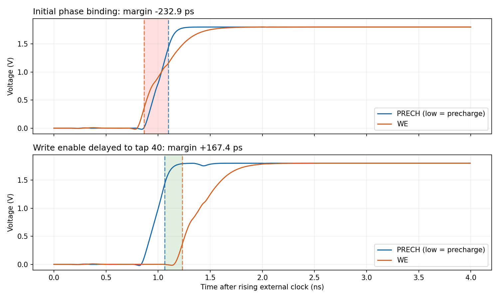
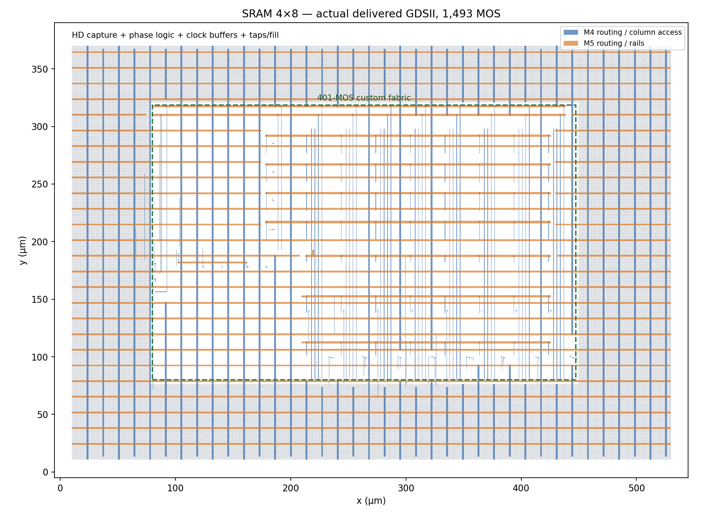
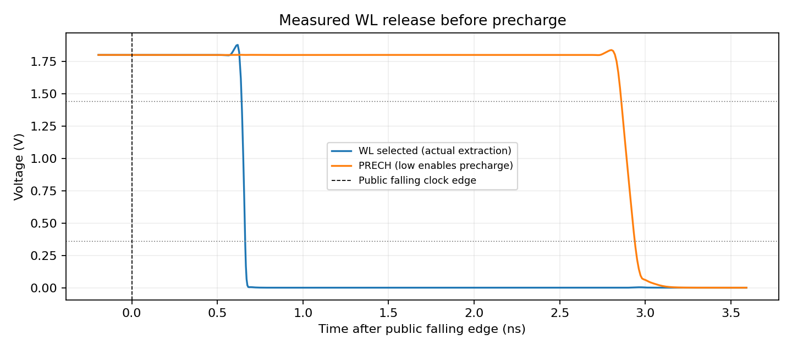

# Phase 2 execution checkpoints

Execution branch: `integration/phase2-4x8`, based on published digital commit
`3b0675b6fe42c79561be6e710e328ce95b8b6f81`. No history rewrite or publication
is performed by the execution tools. Existing Phase 1 PR dependency remains.

The approved plan is implemented in these gates:

1. Environment inventory and resource budget.
2. [Digital/physical contract](../specs/phase2_physical_interface.md).
3. Isolated mapped tri-state, then full SKY130HD synthesis and zero-delay GLS.
4. Small custom/standard-cell physical pilot, DRC/LVS and negative controls.
5. Python 4x8 connectivity generator, independent topology audit and tiling.
6. Real electrical access, phase generation, startup and capture checks.
7. OpenROAD integration; final GDS reimport, DRC/LVS and electrical repeat.

Run synthesis and GLS using `./scripts/run_synth.sh`. Reports are written to
`reports/phase2/digital_checkpoint`; use `--output reports/phase2/local/...`
for disposable reruns. Builds use unique ignored `build/phase2` directories.
PDK Liberty TT/25C/1.8V is used for technology mapping; power-aware functional
Verilog models are run at zero delay. These are not 25C electrical measurements.
The planned transistor benchmark TT/27C/1.8V is a distinct experimental point.

The existing tool image is `isaiassh/unic-cass-tools:1.0.7`, not the historical
1.1.0 tag mentioned in older environment notes. Actual tools/PDK views are
inventoried instead of inferring capability from the tag. Yosys/OpenROAD were
already installed under `/opt`; the launcher now exposes their versioned bins.

Do not declare Phase 2 complete from F2-DIG or the custom core alone. Keep
CORE and F2-FIS distinct. No characterized clock target is introduced by GLS.
Resource preflight is required before physical routing/SPICE/installation;
preserve approved receipts, run one heavy job at a time and never prune user
data or unrelated Docker images/services automatically.

## Measured checkpoints — 2026-11-03

Current report locations are selected by
[`physical/phase2/checkpoints.json`](../physical/phase2/checkpoints.json).
This is a work-in-progress selector, not a release approval.

| Checkpoint | Recorded evidence | Boundary |
|---|---|---|
| SKY130HD synthesis / GLS | 20 FF, 8 real tri-states, one custom macro; 15,619 checks | Power-aware zero-delay models, functional storage substitute |
| RTL regression repeated | 154,303 checks; 6 depth guards; 6 deliberate mutants | All four behavioral depths and 4x8 wrapper |
| Custom/standard-cell pilot | DRC 0, W/L/terminal LVS; GDS reimport DRC/LVS; gate and W defects rejected | Six-MOS routing pilot, not whole SRAM |
| Selected-leaf fabric | 401 MOS, DRC 0, expanded LVS, exported/reimported GDS DRC/LVS | Row qualification, data complements and phase/capture binding are separate |
| Ideal-phase full-array fixture | 96 read-bit checks pass with actual HD FF load | Investigates a phase window; does not qualify physical phase generation |
| Mapped physical phases/capture | 128 read-bit checks and 321 protocol checks, zero failures | TT/1.8V/27C, schematic interconnect, fixed experimental 20-ns clock |
| Full routed top-level | Magic DRC 0; expanded transistor LVS; 1,493 extracted MOS | Custom fabric plus HD capture, phases, CTS, taps, fillers and PDN |
| Delivered GDS reimport | DRC 0 and unique W/L/body/model LVS in a clean Magic process | Checks the actual exported geometry |
| Routed functional GLS | 15,619 checks / 2,504 transactions, all controls and addresses | Actual powered routed netlist; GLS-only fabric substitute |
| Final GDS-extracted electrical matrix | 128 read-bit + 392 protocol/capture/bus checks, zero failures | TT/1.8 V/27 C, actual junctions and CTS; no wire R/C |
| Final evidence audit | Four plausible corruptions rejected; 109 Python tests; frozen Phase 1 preserved | Raw-trace reconciliation, distinct digital/core/top acceptance |
| Full-top LEF | 16 named pins, all 46 access regions inside actual GDS metal; OpenROAD parser passes | Geometry-only abstract, 540 by 380 um |

The mapped access campaign uses 32 real 6T cells, the selected 33-MOS decoder,
all selected peripherals and actual HD gate/FF transistor models. It includes
two inactive conditioning cycles, a first unwritten read without a known-data
expectation, distinct words at all addresses, 00/FF/AA/55 across the four rows,
inactive-cycle recovery and all six inactive/invalid control combinations.
The latter preserve storage and pass high/low external bus probes through
1 kohm. This bus-release check is not a leakage-current characterization.
No bitcell/FF internal initial condition, reset or per-cycle sense forcing is
used. The minimum startup duration and statistical power-up behavior remain
uncharacterized.

The output capture checks use the actual FF input/clock probes. They compare
data stability with the conservative maximum setup/positive-hold entries in
the HD TT/25C Liberty table (0.6206849 ns and 0.1409486 ns) during the TT/27C
transistor campaign. This is an experimental reference-envelope screen,
not complete SRAM STA, PVT qualification or a new public timing contract.

## Phase-control correction and waveform evidence

The initial write enable used the tap-24 clock-release path. Correct readback
alone did not expose a control problem: WE passed 20% while PRECH had not yet
reached its 80% released level. The measured guard was **-232.897 ps**.
The physical binding now qualifies WRITE_Q and CLK with delay tap 40, ahead
of tap-60 decoder evaluation. The pilot guard becomes **+167.388 ps** and the
full campaign reports no sampled write/precharge overlap.



The plotted traces and raw hashes are retained in the selected phase-guard
report. Positive nominal guard does not establish all-corner/noise margin.
The six frozen leaves were not changed to implement this correction.

## Physical routing work

The generated 367.5 by 238.5 um fabric is translated consistently in GDS and
LEF to a positive origin. Pin-access pads and routing obstructions are derived
from actual geometry, on the 5-nm manufacturing grid. No custom delay arcs or
pin capacitances are invented in its internal interface-only Liberty.

The route flow reserves tap sites before placement, creates pin access before
global guides, and protects the explicit 80-stage physical delay chain.
CTS is restricted to CLK; phase/control nets must not be balanced as register
clocks. An earlier automatic clock-root trial attempted to balance PCLK and
inserted 43 delay buffers; it is not the selected candidate.

The installed platform's merged HD routing LEF adds mcon keepouts absent from
the basic PDK abstract. Before using it, the flow checks all relevant master
footprints and routing pin geometries for equality and requires that original
routing obstructions are never removed. Nonrouted well/body marker differences
are explicitly recorded. Actual transistor masks and parameters still come
from the unchanged PDK GDS/MAG/SPICE and require expanded LVS.

Full routed GDS DRC/LVS, reimport and electrical repetition remain separate
mandatory gates. Successful placement, leaf-fabric checks or schematic access
do not close F2-FIS. Detailed RC PEX and complete characterization are deferred.

## Completed physical integration and export correction

The routing obstruction subtraction initially left a 5-nm closed ring around
M4 macro pin accesses. The router could reach neither those pins nor their
connected register endpoints. Exporting the complete real pad and checking
for enclosing obstructions fixed access without changing any leaf geometry
or restricting standard-cell FF pins. The selected route is `route_macro_access`;
earlier failed route trials are diagnostic evidence, not delivery candidates.

The first Magic import also omitted technology-LEF via definitions and used
abstract filler/tap views. Its DRC output had eight **categories**, not eight
individual errors, and export was incomplete. The finishing flow now loads
technology vias and real HD MAG cells, annotates their LEF pin information,
preserves original HD GDS references, and rejects import/export errors even
when Magic exits zero. The corrected full import and clean GDS reimport both
pass DRC and LVS. There are 1,493 MOS before Netgen's legal parallel reduction;
the 401 frozen leaf devices are included in this total.

The final electrical runner uses the flat MOS circuit from the reimported GDS,
retains extracted junction dimensions and locates probes through `.ext`
equivalences. It checks every digital signal-pin group (182 nets) against the
routed reference, rejecting splits/shorts. HDL is never used to repair extracted
connectivity. Safe node renaming changes observation names only. No wire R/C
network is extracted in this flow, and no known bitcell state is imposed.

Reproduction entrypoint: `./scripts/run_phase2.sh <action> [options]`. Actions
are explicit so requesting help or an audit never starts a long SPICE/physical
run. The selected final actions are:

```sh
./scripts/run_phase2.sh layout --output reports/phase2/local/layout
./scripts/run_phase2.sh gds --layout-report reports/phase2/local/layout --output reports/phase2/local/gds
./scripts/run_phase2.sh gls --layout-report reports/phase2/local/layout --output reports/phase2/local/gls
# Long transistor simulation; the short pilot is available with --quick.
./scripts/run_phase2.sh extracted-access --gds-report reports/phase2/local/gds --layout-report reports/phase2/local/layout --output reports/phase2/local/access
```

The final campaign and raw-data audit now pass in the declared nominal
experiment. This does not establish Fmax, all-corner robustness, detailed
RC timing or foundry reliability qualification.



The full-array footprint is 540 by 380 um; this experimental floorplan has
not been optimized for area or power. The overview renders actual M4/M5
polygons and standard-cell footprints. It is a visual aid, not a DRC report.

## Routed clock arrival and release checks

The first GDS-extracted pilot recovered all eight written bits but failed
three inherited `low_phase_wordlines` checks. These used a fixed 0.5-ns
release deadline after the public clock edge. Measured WL release was about
0.663 ns while precharge conduction began about 2.86 ns, leaving about
2.2 ns of positive release guard. The original failed receipt remains in
`extracted_access_pilot_bound`; a separate `extracted_release_review` records
the unchanged raw-waveform analysis and its current checker identity.

The criterion is now the electrical ordering explicitly required by the
contract: WL and WE must release before precharge conduction, and reset/
precharge must finish before the next access. Negative tests reject real
WL/precharge overlap and failure to complete precharge. Correct readback
alone cannot approve this check. No transistor or layout change was made
to address the inherited checker deadline.



The first full extracted campaign was interrupted before completion because
the simulator spawned eight OpenMP workers despite a SPICE `.options` thread
setting. It is an aborted resource trial, not evidence of circuit failure.
The selected `extracted_access_singlethread` run sets `num_threads` in the
ngspice control block and limits OpenMP/BLAS through the process environment;
the actual process was checked to have one worker. Its resource snapshot and
the transitive hashes of 319 PDK include files are recorded before simulation.

## Local delivery and remaining boundaries

The current artifact index is
[`physical/phase2/delivery.json`](../physical/phase2/delivery.json). It is a
**local review candidate**, not a Git publication or an advisor/team signoff.
The independently reconciled current gate receipt is
[`reports/phase2/review_20261104/acceptance/results.json`](../reports/phase2/review_20261104/acceptance/results.json):
F2-DIG passes mapped functional GLS, CORE passes integrated nominal access,
and F2-FIS passes the experimental 4x8 geometry/electrical scope.

The index separates the 401-MOS custom fabric GDS/LEF from the full 1,493-MOS
SRAM GDS/LEF/DEF/powered Verilog/flat extracted SPICE and Magic view. The
fabric's fabrication geometry was also compared with its actual subcell in
the final GDS. Only M3 text/pin and cell-boundary annotation differences occur;
the installed PDK technology map identifies these nonfabrication layers.
No fabrication-layer XOR difference was found at 1-nm comparison precision.

The original electrical matrix has 35 cycles over 710 ns and 128 read-bit checks.
All 392 protocol checks pass, including output FF setup/hold reference
envelopes, WL/WE versus precharge exclusion, precharge readiness and 96
high/low weak-drive bus probes. The original 109 Python checks cover the accumulated
regression/verification flow; its four real-data corruption negatives are
separate. These are historical counts; the review below supersedes the current
acceptance gate. No bitcell initial condition is imposed.

The complete 53,309,999-byte transient is retained losslessly in
[`reports/phase2/portable_raw/waveform.dat.gz`](../reports/phase2/portable_raw/waveform.dat.gz)
(12,227,547 bytes), together with its uncompressed identity and small build
inputs needed for review. A separate portability check simulated the absence
of ignored build files and obtained the same 128/392 checks through the
compressed archive. This was tested in the local PDK/container environment;
it is not a claim that the flow was executed on Windows.

Finish/review commands after a new successful full extracted run:

```sh
./scripts/run_phase2.sh pack-raw
./scripts/run_phase2.sh evidence-guards
./scripts/run_phase2.sh audit
./scripts/run_phase2.sh package
```

The physical generator delivered here targets 4x8. The RTL regression covers
depths 4, 8, 16 and 32; physical generation of the other depths is not part of
this delivered prototype. Phase 3/full-project work still includes detailed
wire R/C PEX, PVT/statistical characterization, an approved timing contract,
Fmax/characterized Liberty and broader generator configurations. Phase 1's
explicit model-coverage/reliability limitation remains in force. Final Phase
2 closure requires the team's/advisors' review of this declared scope.

## Technical audit and controlled polish — 2026-11-04

The [audit report](phase2_review_20261104.md),
[requirements/evidence matrix](phase2_review_20261104_requirements.md),
[change inventory](phase2_review_20261104_changes.md) and
[acceptance table](phase2_review_20261104_acceptance.md) record the two-pass review.
The verdict is **approved with caveats for team review**, limited to the nominal
experimental scope. No frozen leaf, RTL DUT, phase-control circuit, sizing,
public protocol or numerical acceptance criterion was changed.

The review reproduced synthesis/GLS (15,619 checks), the full RTL regression
(154,303 checks) and 117 Python test methods. Ten evidence-corruption cases
are now rejected. Full-top LVS rejected separate gate, bulk, width and length
defects. The new source-to-GDS reconstruction passed DRC/LVS and routed GLS;
its GDS is identical after normalizing timestamps only, and the extracted
transistor netlist including junction geometry is byte-identical. Its receipt
explicitly marks a second SPICE execution as NOT_RUN; the circuit identity
made repeating that same original waveform unnecessary.

A separate, actually executed TT/1.8-V/27-degree-C transistor-level campaign
adds 41 cycles over 830 ns, with **1,332 total checks including 160 read bits**.
It exercises walking-one/zero patterns, captured address/data disturbances,
live output masking and readback after idle. Direct BL/BLB observation found a
minimum signed differential of 1.753725363 V at the specified SCLK onset. This
is an observation with ideal wire connectivity, not a qualified offset margin.
No bitcell initialization or behavioral storage was used. The capture analysis
distinguishes sense output, FF input, FF output and public DATA. Its TT/25-degree-C
Liberty setup/hold reference is explicitly distinct from the 27-degree-C
simulation and is not complete STA.

All original results remain available. The prior delivery/checkpoint indices
are retained under `physical/phase2/history/`. The selected current indices
are `physical/phase2/checkpoints.json` and `physical/phase2/delivery.json`.

For a fresh, unselected reconstruction, choose a new directory. This is a
physical tool run; the script checks resources and limits thread counts:

```sh
./scripts/reproduce_phase2_4x8.sh reports/phase2/local/reproduce_new
# Optional long SPICE run of that rebuilt circuit:
# ./scripts/reproduce_phase2_4x8.sh reports/phase2/local/reproduce_new_with_spice --with-electrical
```

The additional directed experiment can also be reproduced into a new directory:

```sh
./tools/sram-eda python3 tools/run_phase2_directed_review.py --output reports/phase2/local/directed_new
```

The new directed raw transient remains in ignored local build storage. The
selected receipt records its hash and location; its CSV excerpt is illustrative
and cannot replace full-waveform reanalysis. If that build is absent, rerun the
command above. The portable gzip contains the original 710-ns waveform, not
this additional 830-ns experiment. A new candidate directory is not selected
automatically: checkpoint changes require a fresh audit of the chosen files.

For the selected current evidence, the light review/package commands are:

```sh
./scripts/run_phase2.sh evidence-guards
./scripts/run_phase2.sh audit
./scripts/run_phase2.sh package --output reports/phase2/review_20261104/delivery
```

These rerun verification outputs in the selected review directories; archive
them first when preserving an additional historical run. The package checks
the acceptance seal against the actual delivered payload, including the final
GDS. A receipt alone cannot approve a file changed after verification. No Git
commit, push or formal team/advisor signoff has been performed.

## Final polish — public timing contract and no-reset startup

The [public timing contract](../specs/sram_4x8_timing_contract.md) now defines
the edge protocol and bus ownership, while keeping external setup/hold,
read-valid, enable/disable, turnaround and minimum startup uncharacterized.
The 20-ns clock remains an experimental condition, not Fmax.

The [final-polish report](phase2_final_polish.md) records five additional
independent TT/1.8-V/27-degree-C runs, with 1/5/10-ns supply ramps and 0/2/3
inactive captures in the documented combinations. All passed full-raw
reanalysis: **3,383 total checks including 240 read bits**. The shortest
successful condition tried still waited 9 ns after the supply plateau;
it does not establish a minimum startup. The established two-inactive-capture
procedure remains the nominal reproduction recommendation.

Sources and prior acceptance/delivery indices are unchanged. There was no
new layout generation, DRC/LVS or detailed RC extraction. The added runner,
auditor, real waveform plots and phase-event measurements have separate
receipts under `reports/phase2/final_polish_20261104/`. The 20 targeted checker
tests include seven new tests and 13 existing tests; these are distinct from
the prior complete 117-test receipt and must not be summed as 137 unique tests.
All commands and raw-data requirements are in the final-polish report.
