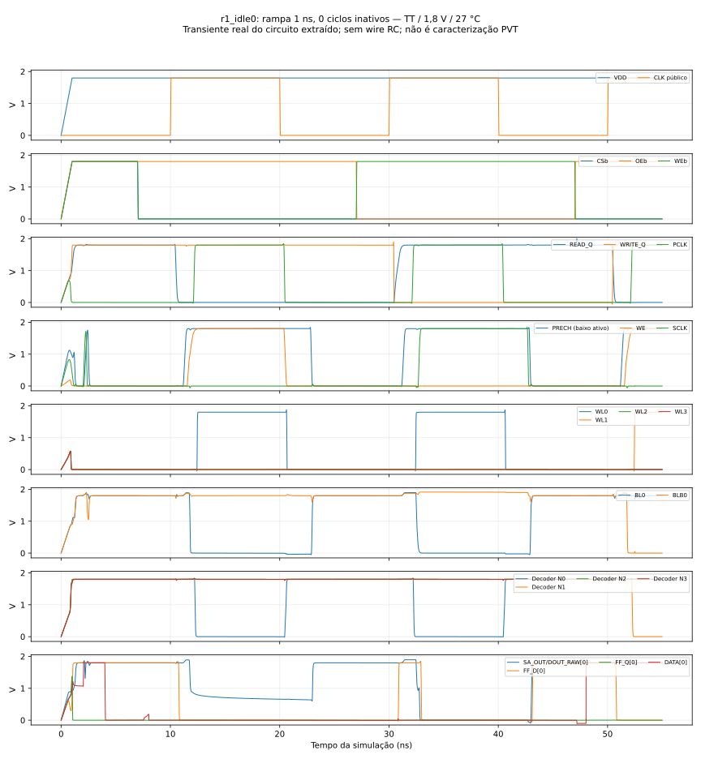
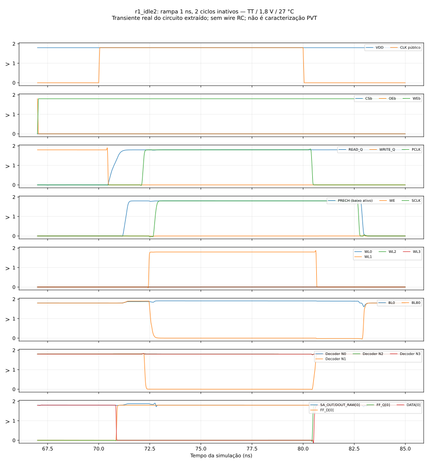
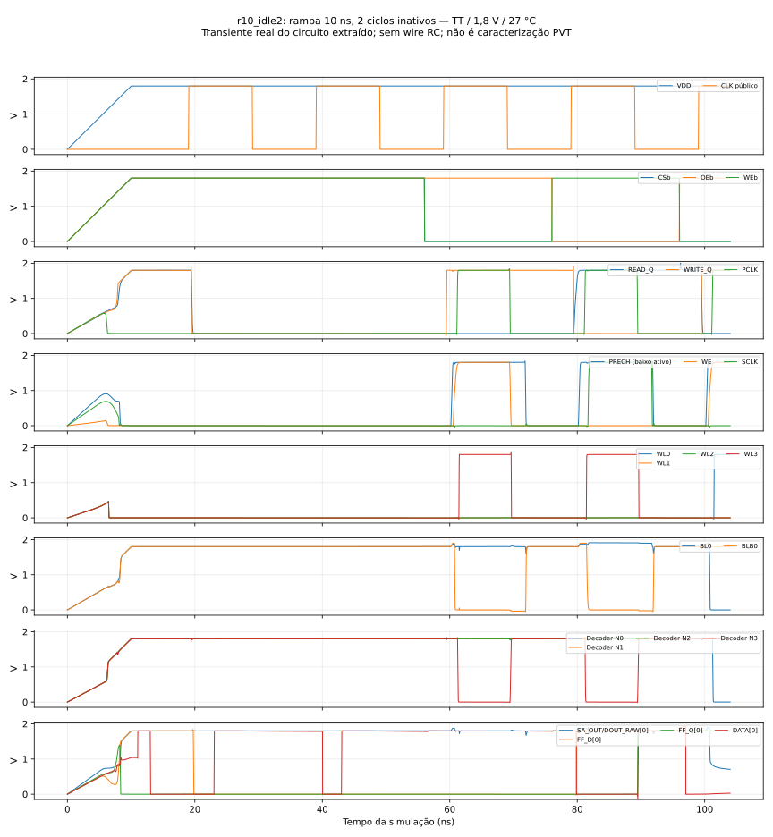

# Fase 2 — contrato temporal e partida sem reset

Rodada complementar à [auditoria de 2026-11-04](phase2_review_20261104.md).
**Parecer atualizado: APROVADO COM RESSALVAS — para revisão da equipe.**
As duas melhorias foram concluídas; os cinco cenários e sua reanálise bruta
passaram. Não é aprovação formal dos orientadores nem caracterização completa.

## Objetivo e preservação

O escopo desta rodada é formalizar o contrato temporal público e ampliar a
verificação de partida. Não foram modificados arquitetura, topologia, sizing,
reset, interface, células congeladas, registradores ou o controlador de fases.
Foram reutilizados os 1.493 MOS do SPICE extraído e selado. Não houve novo
place/route, DRC/LVS, PEX RC, sweep PVT, Monte Carlo, busca de Fmax ou Liberty
caracterizada. Nenhum commit ou push foi realizado.

Branch `integration/phase2-4x8`, HEAD `3b0675b6fe42c79561be6e710e328ce95b8b6f81`.
O [snapshot inicial](../reports/phase2/final_polish_20261104/initial.json)
registrou Git e hashes de 182 arquivos, sem divergências nos 171 arquivos do
aceite anterior. As versões anteriores da matriz, quadro de aceite, execução
e interfaces estão em `reports/phase2/final_polish_20261104/source_before/`.
Os manifestos de entrega/checkpoints e os resultados anteriores permanecem
selecionados e preservados. Esta evidência adicional não reescreve o histórico.

## Fontes examinadas e contrato criado

Foram examinados a especificação técnica, o contrato digital, o binding físico,
as interfaces e a execução, os quatro documentos da auditoria anterior, os
manifestos, `rtl/sram_controller.v`, `rtl/sram_4x8_wrapper.v`,
`physical/phase2/macro_binding.v`, as bancadas e os scripts de captura.
Os pinos observados derivam da conectividade real e dos terminais MOS, sem
inserir fontes/capacitores nos nós internos. A biblioteca dfxtp_1 e seus
modelos HD são os mesmos da implementação anterior.

O [contrato temporal público](../specs/sram_4x8_timing_contract.md) define
operações 001/010, capturas, resultado antigo durante leitura consecutiva,
retenção, máscara viva do barramento e handoff com o mestre. Separa SA_OUT,
DOUT_RAW, FF_D, FF_Q e DATA; SA_OUT/DOUT_RAW compartilham nó neste binding,
enquanto os demais pontos têm caminhos físicos diferentes.

Período de 20 ns, fases de 10 ns e 50 MHz são condições experimentais, não
limites garantidos. Não foram atribuídos números a setup/hold públicos,
tREAD_VALID, enable/disable, turnaround ou tempo mínimo de partida.

## Medições existentes conferidas

Os transientes completos e seus hashes foram usados em nova análise das
janelas; o CSV ilustrativo não substituiu os dados completos:

| Fonte | RAW válido antes da captura local | FF_D válido antes da captura local | Estabilidade posterior |
|---|---:|---:|---:|
| [Original reanalisada](../reports/phase2/final_polish_20261104/capture_baseline/results.json) | 7,438005478 ns | 7,240390655 ns | ≥2 ns |
| [Dirigida reanalisada](../reports/phase2/final_polish_20261104/capture_directed/results.json) | 7,439470500 ns | 7,248137784 ns | ≥2 ns |

São janelas disponíveis, discretizadas pelo transiente, não requisitos mínimos.
O período de observação posterior foi limitado a 2 ns: o resultado é limite
inferior, não hold mínimo. Bits já válidos no início têm flags próprias no CSV.
A Liberty identificada usa `time_unit="1ns"`, 25 °C e 1,8 V; suas referências
máximas setup/hold são 0,6206849/0,1409486 ns. A simulação elétrica é a 27 °C.
Essa comparação não é STA qualificado nem requisito de entrada da SRAM.
[Registro de unidades](../reports/phase2/final_polish_20261104/reference_units.json).

O histórico de WE versus PRECH foi preservado: −232,897 ps no piloto rejeitado
e +167,388 ps no piloto com tap 40. Os taps 24/40/60/80 atuais não foram
alterados. Esses números de piloto não são margens da macro final ou de PVT.

## O que a partida original demonstrava

A bancada original tem rampa de alimentação de 1 ns. Os controles 111 seguem
a rampa, CLK permanece baixo até 10 ns e captura dois comandos inativos em
10/30 ns. O primeiro acesso é uma **leitura nunca escrita em 50 ns**, sem
expectativa de dado conhecido. A primeira escrita ocorre em 70 ns. Portanto,
"dois ciclos inativos" não significava primeira escrita imediata após eles.

Ela demonstra recuperação e acessos posteriores naquela sequência, sem IC ou
nodeset. Não demonstra tempo mínimo, distribuição de estados iniciais,
tolerância a toda rampa, brownout, alimentação parcial ou clock durante a rampa.
O ponto de operação inicial a alimentação zero do simulador não é uma amostra
estatística de todos os possíveis estados de energização.

## Campanha adicional e critérios

Cada cenário inicia um processo ngspice novo, com rampa linear de 0 a 1,8 V.
As três entradas de controle inativas acompanham a alimentação. CLK fica
baixo e há **9 ns de espera após o fim da rampa até a primeira subida**.
Depois vêm N capturas de 111 e a primeira escrita. Mantêm-se TT/27 °C,
clock 20 ns/50%, transições de 50 ps, passo máximo de 10 ps, integração Gear
e KLU. Não há reset, IC/nodeset ou forçamento interno, nem armazenamento ou
sense comportamental. O mestre e probes externos conectam-se apenas a DATA.

| Cenário | Rampa | Capturas inativas iniciais | Primeira linha/dado | Subida nominal da primeira escrita | Checks / estado |
|---|---:|---:|---|---:|---|
| r1_idle0 | 1 ns | 0 | 0 / 00 | 10 ns | 637 / PASS |
| r1_idle2 | 1 ns | 2 | 1 / FF | 50 ns | 681 / PASS |
| r5_idle2 | 5 ns | 2 | 2 / AA | 54 ns | 681 / PASS |
| r10_idle2 | 10 ns | 2 | 3 / 55 | 59 ns | 681 / PASS |
| r1_idle3 | 1 ns | 3 | 0 / FF | 70 ns | 703 / PASS |

Foram 5 processos independentes, 69 ciclos, 25 escritas e 30 leituras de
palavra. As **3.383 verificações totais incluem os 240 bits lidos**; não se
soma esse subconjunto novamente. Há ainda 1.560 checks do armazenamento
conhecido, 240 de FF_Q e 240 do envelope de captura interno, entre os demais.
Nenhum cenário apresentou falha física/funcional ou de execução. O
[auditor dos raws](../reports/phase2/final_polish_20261104/startup_verification/results.json)
reconstituiu as bancadas e reconciliou os resultados, sem reutilizar somente
os contadores dos runners.

É uma seleção dirigida, sem produto cartesiano e sem inferência causal
isolada: linha/dado da primeira escrita também variam para ampliar a cobertura.
Uma falha exigiria comparação pareada antes de atribuí-la apenas à rampa ou
ao condicionamento. Não foi feito sweep para procurar o limite de partida.

Após a primeira escrita há leitura imediata, três escritas nas demais linhas,
reescrita complementar da primeira, leitura das quatro linhas, idle e nova
leitura da primeira. A escrita de assinaturas distintas e a reescrita
complementar ajudam a detectar aliasing e corrupção de linhas conhecidas.
O primeiro dado pode coincidir com o estado analógico inicial; sua escrita
não prova sozinha uma inversão de todos os bits. A reescrita complementar
efetivamente exige as transições opostas nos mesmos nós.

Os critérios incluem alimentação pronta, ausência de WL/PCLK/WE/SCLK
indevidos após a espera de observação, pré-carga dos quatro nós dinâmicos e
dos 16 BL/BLB antes do acesso, exclusão WE/WL versus PRECH, seleção da linha,
captura do pedido, setup/hold interno de referência, estado das palavras já
escritas, FF_Q, DATA e recuperação. Barramento desabilitado é verificado
com probes alto/baixo de 1 kΩ; tensão flutuante não é interpretada como Z.

Não se impõe conteúdo a uma palavra não escrita. Depois de escrita, cada
palavra conhecida é observada após cada operação; assim se distingue
preservação demonstrada de uma alegação sobre estados iniciais desconhecidos.

Os limiares fixos de 1,8 V não são aplicados durante a rampa. A janela inicial
de segurança começa 2 ns depois do plateau e termina antes do setup do
primeiro comando ativo; isso delimita a observação, não garante ausência de
qualquer transiente antes dessa janela. O condicionamento/precharge final é
conferido de novo entre 0,8 e 0,2 ns antes do primeiro acesso. Os critérios
foram definidos antes da execução e não foram reduzidos para obter PASS.

## Evidências, testes e formas de onda

- [Cenário sem ciclos inativos](../reports/phase2/final_polish_20261104/startup_reduced/results.json).
- [Campanha adicional](../reports/phase2/final_polish_20261104/startup_extended/results.json).
- [Reanálise dos cinco transientes](../reports/phase2/final_polish_20261104/startup_verification/results.json).
- [Testes dos verificadores](../reports/phase2/final_polish_20261104/checker_tests/results.json):
  20 métodos aprovados, incluindo sete novos. Os 13 restantes já existiam;
  não se somam novamente aos 117 da auditoria anterior.
- [Quatro adulterações em cópias reais](../reports/phase2/final_polish_20261104/startup_evidence_negatives_width/results.json):
  contador forjado, configuração trocada, W do MOS X0 alterada de 0,42 para
  0,504 µm com hashes posteriores/pré-run atualizados na cópia, e transiente
  incompleto foram rejeitados. O primeiro ensaio de identidade por comentário
  de netlist permanece em `startup_evidence_negatives/`; ele não era uma
  alteração física do circuito e não é contado como novo defeito estrutural.

Os [eventos medidos](../reports/phase2/final_polish_20261104/events/results.json)
usam cruzamentos interpolados de 20%/80% nos 55 ciclos ativos:

| Observação nominal do top extraído | Mínimo | Máximo |
|---|---:|---:|
| PRECH liberado a 80% antes de WE atingir 20% | 0,211682 ns | 0,213332 ns |
| WL abaixo de 20% antes de PRECH cair a 80% | 2,196910 ns | 2,198232 ns |
| WE abaixo de 20% antes de PRECH cair a 80% | 2,290378 ns | 2,290809 ns |
| WL selecionada a 80% antes de SCLK atingir 20% | 0,237618 ns | 0,243742 ns |
| Menor diferencial BL/BLB com sinal esperado por leitura, em SCLK20% | 1,735510 V | 1,750400 V |

São valores desta campanha, distintos dos pilotos antigos e da campanha
walking-data anterior. Não se definem novos limites garantidos ou offset
mínimo do sense. O CSV identifica cenário/ciclo; sem RC de interconexão,
esses números não são margens de fabricação ou all-corner.

As imagens abaixo são geradas do transiente completo identificado por hash,
sem desenhar pulsos ideais como se fossem evidência. Exibem somente parte
dos sinais/ciclos para legibilidade; os checks usam todas as amostras.







## Procedimento experimental recomendado e menor condição ensaiada

A menor condição aprovada **entre as ensaiadas** foi rampa de 1 ns, CLK baixo
e controles 111, espera de 9 ns depois do plateau e primeira escrita na
subida nominal de 10 ns, sem capturas inativas anteriores. Não houve condição
ensaiada que falhou; portanto não há limite de falha inferior conhecido.
As esperas plateau→primeira escrita foram 9, 49 e 69 ns em pontos discretos,
não uma demonstração contínua de todos os intervalos entre eles.

Para reproduzir o procedimento nominal estabelecido, recomenda-se manter a
rampa de 1 ns, primeira subida em 10 ns e **duas capturas inativas 111** antes
do primeiro comando ativo em 50 ns, com clock de 20 ns. A nova campanha
confirma que esse primeiro comando pode ser escrita, sem uma leitura nunca
escrita intermediária. Rampas de 5/10 ns também passaram com primeira subida
9 ns depois do plateau e duas capturas inativas.

Manter duas capturas é continuidade do procedimento experimental; não foi
medido um ganho estatístico de robustez em relação a zero ciclos. Não se
transforma a condição curta em `tSTARTUP_min`, nem se modifica o contrato
para exigir um reset inexistente. Clock durante rampa, brownout, estados
iniciais estatísticos e outras formas de rampa permanecem não avaliados.

## Reprodução e armazenamento

Na raiz do repositório, escolher diretórios novos:

```sh
./tools/sram-eda python3 tools/run_phase2_startup_review.py --output reports/phase2/local/startup_new
./tools/sram-eda python3 -m unittest discover -s tools/tests -p test_phase2_startup.py -v
# Com uma campanha nova contendo os cinco cenários:
./tools/sram-eda python3 tools/verify_phase2_startup_review.py --sources reports/phase2/local/startup_new --output reports/phase2/local/startup_verify_new
```

O runner recusa diretório existente, registra fontes/modelos/estímulos e
confere hashes antes/depois. Usa o SPICE selado e um processo por cenário,
sem reconstruir layout. Falha de simulador/tempo limite não vira PASS.
O verificador reconstitui a bancada, confere circuito e design roteado com
o original, exige o transiente completo e recalcula os checks/contadores.

Logs, bancadas, checks e excerpts ficam nos reports. Os raws completos
permanecem nos diretórios únicos ignorados em `build/phase2`, identificados
nos receipts; não foram adicionados dumps extensos ao Git. Se esses builds
não existirem, é preciso repetir a campanha; excerpt não substitui o raw.
O gzip portável anterior contém a campanha original, não estes cinco ensaios.

## Alterações e impacto no aceite

Novos arquivos: contrato temporal; runner de partida; auditor de resultados;
analisador de eventos; plotter de ondas reais; sete testes negativos/unitários; este documento e
relatórios complementares. Interfaces, execução, matriz e quadro de aceite
recebem links/estados atuais. As versões anteriores ficam preservadas.

| Arquivo | Alteração desta rodada |
|---|---|
| `specs/sram_4x8_timing_contract.md` | Novo contrato funcional e classificação dos números |
| `tools/run_phase2_startup_review.py` | Novo runner e observador, cenários novos e logs sem overwrite |
| `tools/verify_phase2_startup_review.py` | Nova reconciliação da bancada/identidade/trace/checks/counters |
| `tools/analyze_phase2_startup_events.py` | Novas medidas interpoladas sem definir limites |
| `tools/plot_phase2_startup_review.py` | Novos gráficos dos dados reais identificados por hash |
| `tools/tests/test_phase2_startup.py` | Sete regressões dirigidas dos critérios e da preservação de output |
| `docs/phase2_final_polish.md` | Este relatório e procedimentos de reprodução |
| `docs/phase2_review_20261104_requirements.md` | D09/D10/D16 subdivididos; mínimos e timing completo continuam abertos |
| `docs/phase2_review_20261104_acceptance.md` | Ressalvas reduzidas, com escopo de aceite preservado |
| `docs/sram_4x8_interfaces.md` | Link público ao contrato e à nova campanha |
| `docs/phase2_execution.md` | Registro da rodada complementar |

Como não houve mudança de circuito, conexão ou ferramenta de geração física,
não se invalidaram os DRC/LVS e GLS anteriores. Os produtores/verificadores
antigos também ficaram intactos; seu selo continua verificável. A rodada
acrescenta evidência, sem substituir os counts e transientes anteriores.

## Parecer e ressalvas

**APROVADO COM RESSALVAS.** F2-DIG mantém o aceite funcional mapeado/GLS.
F2-FIS mantém o aceite físico experimental TT/1,8 V/27 °C, agora com partida
ampliada a cinco cenários. Não foi demonstrado defeito no procedimento nominal
nem foi necessário corrigir circuito ou afrouxar critério. A documentação do
protocolo é uma melhoria de clareza; não torna tempos desconhecidos garantidos.

Permanecem sem qualificação: setup/hold e delays externos, turnaround,
tempo mínimo de partida, rampas/estados/PVT estatísticos, Fmax, RC completo,
potência/yield/confiabilidade e a limitação de cobertura de modelos da Fase 1.
O contrato funcional e qualquer procedimento experimental dependem da revisão
da equipe; não constituem aprovação formal dos orientadores.
