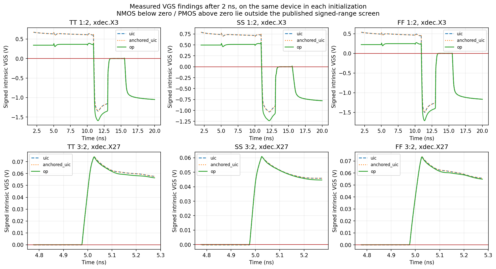
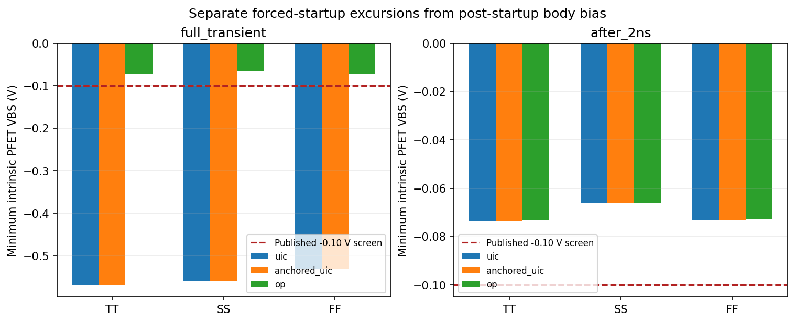
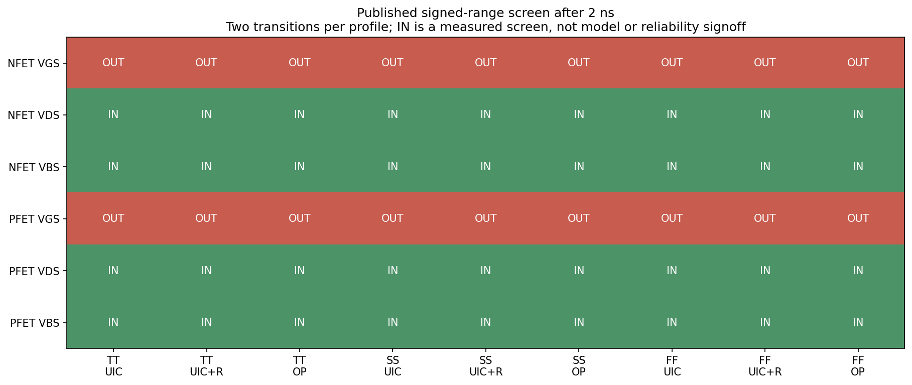

# Frozen decoder/WL intrinsic-state review and acceptance proposal

Date: 2026-10-28. **Status: measured; signed-model-domain disposition remains
open.** No schematic, sizing, layout or retained PEX has been changed.

## Scope and result

The selected 29-MOS decoder plus four selected 1.68/5.04 µm WL drivers were
probed at their actual BSIM4 primitive instances, rather than inferring all
channel voltages from external wrapper terminals. The study covers 45 MOS,
transitions `1→2` and `3→2`, and TT/1.8 V/27 °C, SS/1.62 V/−40 °C,
FF/1.8 V/125 °C. It retains the
[local timing proposal](row_decoder_canonical_timing_limits_20261028.md):
low/high 3/2.5 ns, 2.1 ns address lead, 50 ps ramps, 102.873935496 fF/WL,
Gear with 5 ps maximum timestep and the experimental 250 ps literal guard.

The 18 main simulations cover three initializations per profile/transition:
unaltered UIC, UIC with a passive-island DC reference, and operating-point
initialization with that reference. Every case passes 29 local timing/selection
checks: **522/522**. Two additional resistance-sensitivity runs pass **58/58**.
The accepted 20 runs have no simulator/query warnings. Six earlier unregularized
DC attempts are separately retained as rejected diagnostics; completed
transients did not establish converged DC operating points in those attempts.

**Measured:** after 2 ns, VDS and VBS remain within the published signed-range
screen in the 18 main probes. NFET VGS reaches **−1.710505 V**, and PFET VGS
reaches **+0.074380 V** across the three initializations. These signs remain
outside that screen with operating-point initialization. The largest monitored
intrinsic |VGS/VGD/VDS/VGB| is **1.872751 V**, below the separate experimental
1.95 V magnitude screen. These results answer different questions.

The intrinsic probe is a focused subset, not all 16 address pairs or a full
crossed PVT qualification. The earlier 48-case selected-reference-point matrix
remains the all-transition functional evidence. Nominal characterization
temperature, macro frequency, noise/mismatch budgets and model/reliability
acceptance have not been silently finalized here.

CSV range comparisons use the exact stated endpoints; tiny near-zero
crossings can change device/metric counts between initializations. No
undocumented tolerance clears a finding. The interval-duration columns are
sample-derived diagnostics, not bounds on unobserved sub-timestep trajectories.

## Published ranges and the state convention

The [official SKY130 device documentation](https://skywater-pdk.readthedocs.io/en/main/rules/device-details.html#spice-model-information)
lists model operating ranges:

| Device | VGS | VDS | VBS |
|---|---|---|---|
| nfet_01v8 | 0 … +1.95 V | 0 … +1.95 V | −1.95 … +0.30 V |
| pfet_01v8 | −1.95 … 0 V | −1.95 … 0 V | −0.10 … +1.95 V |

This table is not an absolute oxide-reliability rating. It also does not supply
an approved decoder-specific rule for comparing every reverse-mode intrinsic
state to those endpoints. That mapping remains an engineering screen; an
OUT result is a documented domain question, not proof of device damage.

The installed native PM3 wrappers identify BSIM4.5 primitives. Each
`@m.…[vgs/vds/vbs]` is saved directly. The
[ngspice query implementation](https://github.com/imr/ngspice/blob/ngspice-44.2/src/spicelib/devices/bsim4v5/b4v5ask.c#L192-L200)
returns polarity-normalized stored states. The
[load implementation](https://github.com/imr/ngspice/blob/ngspice-44.2/src/spicelib/devices/bsim4v5/b4v5ld.c#L364-L372)
constructs them from internal prime nodes; its
[reverse-mode branch](https://github.com/imr/ngspice/blob/ngspice-44.2/src/spicelib/devices/bsim4v5/b4v5ld.c#L983-L997)
uses gate/drain and body/drain differences when normalized VDS is negative.

For normalized states `ng`, `nd`, `nb` and polarity `p=+1` (NFET), `p=−1`
(PFET), the postprocessor uses:

```text
VGS = p * (ng - min(nd, 0))
VDS = p * abs(nd)
VBS = p * (nb - min(nd, 0))
```

It does not clamp negative/positive VGS to force acceptance. These are the
queried BSIM channel-state differences, not oxide field measurements or a
complete analysis of separate body-junction internal nodes. Native wrapper,
model include and executable hashes are archived; external primary-source
URLs/content hashes are in
[primary_sources.json](../sims/row_decoder/results/canonical_intrinsic_review_20261028/primary_sources.json).

## DC singularity and controlled regularization

The PEX contains one passive island, `xdec.m1_160_n1740#`, coupled through
27.3372 fF in total. Resistor-component analysis confirms that it touches no
leaf port or MOS D/G/S/B terminal. There are no corresponding passive islands
in the four WL-driver leaves. A purely capacitive node has no DC conductance,
which caused singular-matrix and failed gmin/source-stepping warnings in the
unregularized operating-point attempts.

The testbench supplies a **simulation-only 10^12 Ω reference to ground on that
single passive island** for anchored UIC and OP. The frozen PEX remains
byte-identical. No evaluation node, gate, MOS diffusion or body is anchored.
The R·C time constant is approximately **27.34 ms**, compared with the
20.5 ns transient. This is an explicit initialization/regularization assumption,
not a new fabricated resistor or a repair hidden in the extracted netlist.

A matched unmodified-UIC control retains the original circuit. Its 1,800 saved
plot samples for each of six cases are bitwise equal to the corresponding
archived reference samples after adding the intrinsic queries. This verifies
those retained samples, not equality of every unsaved internal trace.

Two OP sensitivity probes (`SS 3→2`, `FF 1→2`) increase the reference resistance
to **10^15 Ω**. Their largest after-2-ns signed-extremum changes are
**0.10144 mV** and **0.09964 mV**, respectively. Interpolated WL90 changes are
below 0.01 ps; this is below the 5 ps maximum timestep and is not an
independent timing-accuracy claim. The signed-range findings persist.
The detailed deltas are in
[dc_anchor_sensitivity.csv](../sims/row_decoder/results/canonical_intrinsic_review_20261028/dc_anchor_sensitivity.csv).

The [six rejected DC logs/decks](../sims/row_decoder/results/canonical_intrinsic_review_20261028/rejected_unregularized_op/attempts.json)
remain evidence. Do not relabel their fallback transients as successful DC
initialization, or remove their passive coupling capacitances to obtain PASS.
Preflights and the original rejected-attempt archives remain in the local
SRAM characterization cache.

## Measured states and circuit interpretation

The table below uses the two **anchored-OP** cases per profile, after 2 ns.
The [summary CSV](../sims/row_decoder/results/canonical_intrinsic_review_20261028/summary.csv)
also contains UIC, anchored UIC and full-transient measurements.

| Profile | NFET VGS (V) | PFET VGS (V) | NFET VDS (V) | PFET VDS (V) | NFET VBS (V) | PFET VBS (V) |
|---|---:|---:|---:|---:|---:|---:|
| TT | -1.593202 … 1.869814 | -1.857514 … 0.074071 | 0.000000 … 1.862176 | -1.831905 … -0.000000 | -1.710799 … 0.042641 | -0.073307 … 0.054466 |
| SS | -1.234250 … 1.677929 | -1.688631 … 0.060922 | 0.000000 … 1.691497 | -1.682808 … -0.000000 | -1.342515 … 0.069202 | -0.066163 … 0.026089 |
| FF | -1.710505 … 1.868686 | -1.858711 … 0.073388 | 0.000000 … 1.864540 | -1.831084 … -0.000000 | -1.800270 … 0.034155 | -0.072896 … 0.073123 |

The worst negative NFET example is `FF 1→2`, `xdec.X3`, at 11.4033 ns during
precharge. Its external gate is 0.003031 V; its diffusion terminals are
1.713535 V and 1.799944 V. Reverse orientation therefore gives intrinsic
VGS = −1.710505 V. The primitive's drain-current query is approximately
9.55×10^−31 A at that sample. **Inferred:** an off evaluation-stack transistor
has charged diffusion nodes while its gate is low. The queried current is a
model output outside the screened VGS domain, not a validated leakage estimate.

The OP PFET example is `TT 3→2`, `xdec.X27`, at 5.0260 ns. Its gate is
1.874390 V and its effective source is 1.800319 V, giving VGS = +0.074071 V.
**Inferred:** dynamic-node feedthrough takes an unselected output-inverter
gate slightly above its local supply-side diffusion. The terminal names in
the extracted primitive can be reversed; the effective-source convention is
necessary for interpreting this sample.

UIC and OP change some stored-charge trajectories and the depth of negative
VGS, but neither removes the post-startup sign findings. The forced UIC
startup also produces a separate large PFET VBS excursion. That startup
excursion disappears with OP initialization; after 2 ns the lowest PFET VBS
across all main probes is **−0.073722 V**, leaving **26.278 mV** to the
published −0.10 V screening endpoint. This deterministic distance is not a
noise/mismatch guardband. The 2 ns cutoff is diagnostic, not a new project
power-up specification; arbitrary startup is still unqualified.







## Recommended disposition — pending explicit acceptance

Retain the selected decoder and WL sizing/geometry. The measured evidence
supports local functionality and the stated timing reference point. It does
not support changing wiring or resizing solely to force off-state VGS into
this rectangular published-range screen.

The recommended Phase 1 disposition is a **bounded experimental leaf-cell
handoff with the signed-model-domain caveat explicitly open**, supported by
its frozen physical checks and measured electrical conditions. This would
close an experimental deliverable only if the team accepts that scope;
it must not be described as full model-domain, fabrication or reliability
qualification. No such acceptance is assumed in this report.

If Phase 1 instead requires a fully qualified intrinsic operating domain,
the present evidence cannot close that requirement. Seek a model/provider or
advisor interpretation of off-state/reverse-mode validity and required
margins before commissioning a topology or layout revision. Any approved
geometry change would invalidate the affected frozen physical/PEX bindings.

Further macro read/write/readback, physical PCLK/capture circuitry, continuous
cycle operation and full crossed-PVT/statistical work remain separate scope.
No new parasitic extraction is required to review the current findings.

## Reproduction and retained evidence

```bash
./tools/sram-eda python3 -m unittest discover -s sims/row_decoder \
  -p 'test_canonical_intrinsic_bias.py' -v

for profile in tt ss ff; do
  ./tools/sram-eda python3 sims/row_decoder/run_canonical_intrinsic_bias.py \
    --profiles "$profile" --keep-raw \
    --output-dir "sims/row_decoder/results/canonical_intrinsic_${profile}_repro"
done
```

The default runner uses `uic anchored_uic op`, all 45 devices and the two
stated transitions. Complete the sensitivity/review commands as follows:

```bash
./tools/sram-eda python3 sims/row_decoder/run_canonical_intrinsic_bias.py \
  --profiles ss --transitions 3:2 --initializations op --dc-anchor-ohm 1e15 \
  --keep-raw --output-dir sims/row_decoder/results/canonical_intrinsic_sensitivity_ss_repro
./tools/sram-eda python3 sims/row_decoder/run_canonical_intrinsic_bias.py \
  --profiles ff --transitions 1:2 --initializations op --dc-anchor-ohm 1e15 \
  --keep-raw --output-dir sims/row_decoder/results/canonical_intrinsic_sensitivity_ff_repro
./tools/sram-eda python3 sims/row_decoder/review_canonical_intrinsic_bias.py \
  --campaigns sims/row_decoder/results/canonical_intrinsic_tt_repro \
    sims/row_decoder/results/canonical_intrinsic_ss_repro \
    sims/row_decoder/results/canonical_intrinsic_ff_repro \
  --sensitivity-campaigns sims/row_decoder/results/canonical_intrinsic_sensitivity_ss_repro \
    sims/row_decoder/results/canonical_intrinsic_sensitivity_ff_repro \
  --output-dir sims/row_decoder/results/canonical_intrinsic_review_repro
```

The review verifies raw hashes locally, reproduces all signed-bias/event CSVs
from those raw traces, rechecks all local functional measurements and the
six reference matches, and verifies native-model/runner/helper/PEX bindings.
Raw files are retained locally as ignored `waveform.raw` files; their hashes
are committed. Another machine must rerun `--keep-raw` before raw reanalysis.
Committed artifacts retain source snapshots, decks, logs, 4,860 main signed
metric rows (full/after-2-ns windows), dense event windows and plotted CSVs.
The [review summary](../sims/row_decoder/results/canonical_intrinsic_review_20261028/summary.json)
records 18 main cases and two sensitivity cases separately. Eleven unit tests
cover polarity/reverse-mode conversion, unclipped signs, missing/nonfinite
probes, sampled duration intervals, and rejection of active terminals as DC
anchor targets. All 211 frozen physical-package files remain unchanged.
