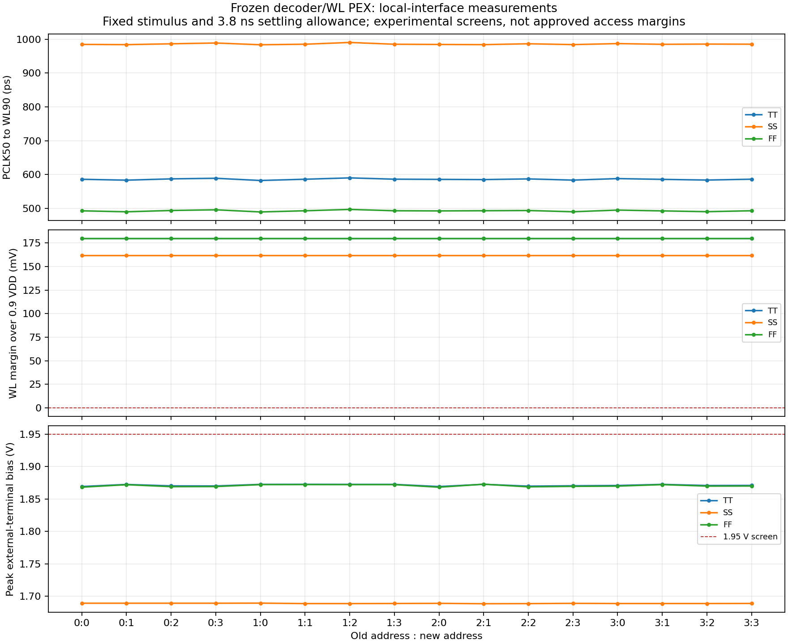
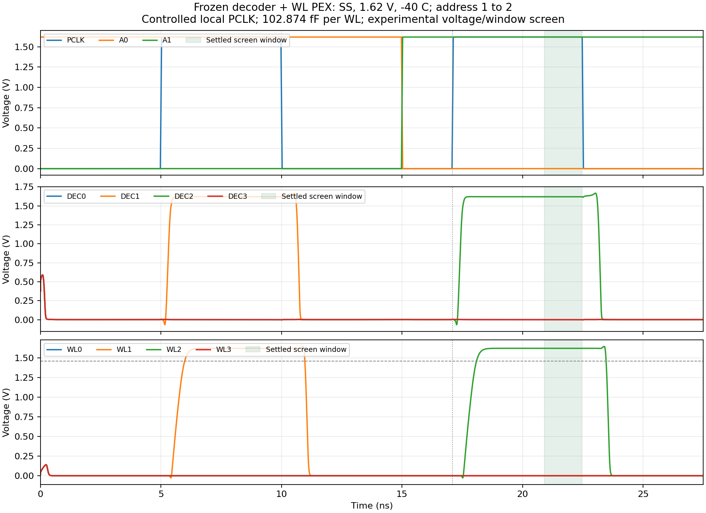

# Frozen decoder/WL PEX local-interface requalification

Date: 2026-10-28. This campaign addresses the changed wordline-driver selection
in the six-cell Phase 1 delivery. The earlier captured-interface matrix used
the 0.42/0.84 µm WL stages. The release selects 1.68/5.04 µm stages, changing
both the load presented to DEC and the WL drive strength. Previous captured-path
results remain evidence for their original hashes and stimulus.

## Exact circuit and scope

The new runner reads `release/phase1/manifest.json`, checks the frozen release
hashes and instantiates its unmodified decoder and WL R-C PEX files:

| Leaf | PEX SHA256 | Instances |
|---|---|---:|
| Leonardo's 29-MOS decoder | `8ee6b99aabf94bde9a1de2a13f0c040cda41dd55bb9568672e38a7f6bb54a6dc` | 1 |
| Selected WL driver, stages 1.68/5.04 µm | `c6d099c1c7db764b88eb357bcde0bba9b1a53de91466b912442e8c1a767935f6` | 4 |

Subcircuit port order is read from each PEX declaration. In particular, the
decoder retains `DEC3` before `DEC2`. There are 45 transistor instances with
external D/G/S/B terminal monitoring. No source schematic, layout or PEX is
changed. No new parasitic extraction is performed.

Address and PCLK are controlled local stimuli. This is the Phase 1 leaf
interface: no flip-flops, phase-generator chain, bitline precharge, sense
amplifier or physical bitcell data access is included. Comparison against the
older captured-path matrix requires matched stimulus and loading; its timing
numbers are not a direct before/after comparison for this campaign.

## Experimental conditions and checks

| Profile | Native SKY130 corner | Supply | Temperature |
|---|---|---:|---:|
| tt | tt | 1.80 V | 27 °C |
| ss | ss | 1.62 V | −40 °C |
| ff | ff | 1.80 V | 125 °C |

These repeat existing experimental profiles; they do not approve a nominal
characterization temperature or a complete crossed voltage/temperature range.
The runner uses the native `libs.tech/ngspice/sky130.lib.spice`, records its
recursive include hashes, and invokes ngspice with `-n`.

Each WL has 102.873935496 fF of lumped row load. The pinned 60-case row-Ceff CSV
and its upstream provenance are retained under `sims/row_decoder/inputs/`.
This represents the entire eight-bit row; no duplicate explicit bitcell gate
load is added. The WL driver's own distributed parasitics remain in its PEX.

- PCLK edge ramp: 50 ps; first evaluation 5–10 ns with the old address.
- Address transition center: 15 ns, with a 50 ps ramp.
- Second evaluation: 17.1–22.5 ns with the new address.
- Transient: Gear, maximum timestep 5 ps, ending at 27.5 ns.
- Internal nodes start from UIC zero initialization, followed by a full
  precharge before the first evaluation. Arbitrary power-up states are not
  qualified by that initialization.
- All DEC/WL outputs must be below 0.1·VDD in the three precharge/recovery
  windows, and unselected WLs must remain below 0.1·VDD during evaluation.
- Selected DEC/WL minima must reach 0.9·VDD in the stated settled windows.
  The second settled window starts 3.8 ns after PCLK rise and ends before
  the falling ramp. This measurement allowance is not an approved access time.
- Signed external VGS, VGD, VDS and VGB are measured from 2 to 27 ns. Their
  absolute magnitudes are screened against the experimental 1.95 V envelope.
  This scalar screen does not establish intrinsic BSIM4 bias validity or
  foundry reliability acceptance.

Each case has 43 functional window/selection checks. Functional PASS and the
external-terminal voltage screen are separate results. The CSV/JSON evidence
records propagation crossings, WL rise slew, settled WL minimum and bias
extrema. A complete campaign with findings returns nonzero instead of treating
logic PASS as full electrical approval.

## Measured results

All 48 cases completed: 16 old/new address pairs in each of the three profiles.
The functional checks passed **2,064/2,064**, and all 48 cases passed the
separate terminal-magnitude screen. All 48 ngspice logs have no warning/error
lines. The per-case measurements are in the
[summary CSV](../sims/row_decoder/results/canonical_pair_matrix_20261028/summary.csv)
and [functional checks](../sims/row_decoder/results/canonical_pair_matrix_20261028/checks.csv).

| Profile | Cases passing | PCLK50 to WL90 (ps) | Minimum settled WL (V) | Largest monitored external-terminal magnitude (V) |
|---|---:|---:|---:|---:|
| TT / 1.80 V / 27 °C | 16/16 | 582.53–590.23 | 1.800000 | 1.872768 |
| SS / 1.62 V / −40 °C | 16/16 | 983.81–990.60 | 1.620000 | 1.689450 |
| FF / 1.80 V / 125 °C | 16/16 | 489.48–496.96 | 1.799998 | 1.872857 |

The slowest measured WL90 crossing is SS `1→2`, at 990.599 ps. The lowest
settled-WL difference above the 0.9·VDD screen is about 162 mV in SS. That
minimum is measured after a fixed 3.8 ns allowance, well after the WL rise;
it is not a bitcell access margin or a minimum safe evaluation duration.
The smallest distance to the scalar 1.95 V screen is about 77.14 mV.
Signed intrinsic-bias/model qualification remains open despite this pass.

The figures retain the initial UIC charge transients before 2 ns. Acceptance
applies to the declared precharge/evaluation windows; this is not evidence of
glitch-free arbitrary power-up. First access follows a complete precharge.





Additional [TT](../sims/row_decoder/results/canonical_pair_matrix_20261028/waveforms_tt_1_to_2.png)
and [FF](../sims/row_decoder/results/canonical_pair_matrix_20261028/waveforms_ff_1_to_2.png)
waveforms are exported with plot/data hashes in
[plots.json](../sims/row_decoder/results/canonical_pair_matrix_20261028/plots.json).

## Reproduction and evidence

```bash
./tools/sram-eda python3 -m unittest discover -s sims/row_decoder \
  -p 'test_run_canonical_decoder_wl.py' -v
./tools/sram-eda python3 sims/row_decoder/run_canonical_decoder_wl.py \
  --output-dir sims/row_decoder/results/canonical_pair_matrix_repro
./tools/sram-eda python3 sims/row_decoder/plot_canonical_decoder_wl.py \
  sims/row_decoder/results/canonical_pair_matrix_repro
```

The [campaign directory](../sims/row_decoder/results/canonical_pair_matrix_20261028/)
retains the executed runner, helper snapshots, manifest, native-model hashes,
per-case decks, ngspice logs, checks, voltage extrema and selected waveform CSVs.
Raw files are discarded by default. Eight regression tests cover port-order
mapping, changed evidence, wrong-row activation, late WL settling, incomplete
records and separation of functional/bias results.

## Remaining Phase 1 electrical acceptance

Use the fixed-pair measurements to continue the local PCLK/address contract:
minimum precharge, address settling lead, evaluation duration/retention and
acceptable electrical margin. Resolve the existing signed model-domain
findings before calling the decoder electrically closed. Capture/PCLK-source
physical implementation and complete macro read/write/readback remain Phase 2
tasks under the agreed six-cell boundary.
