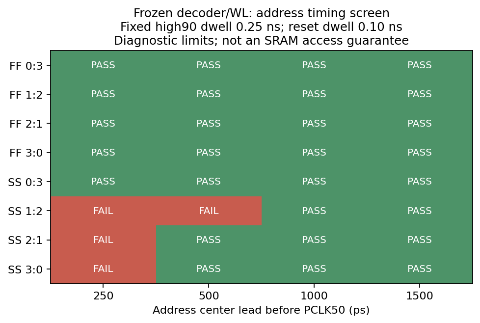
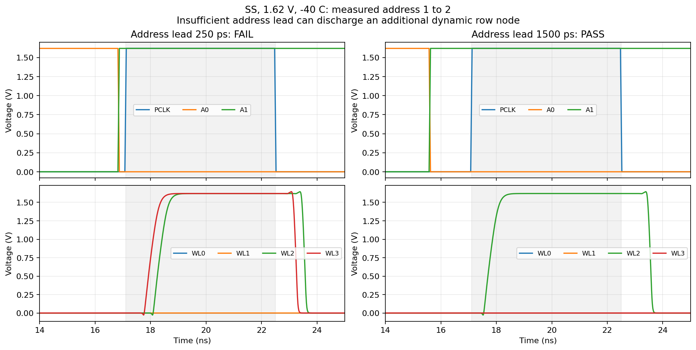
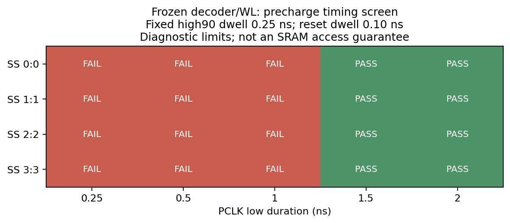
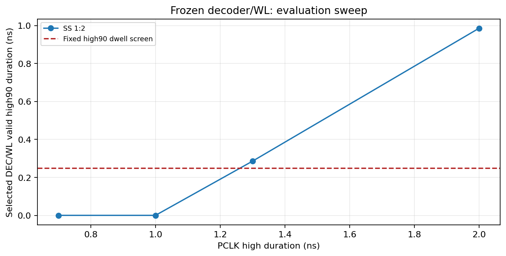
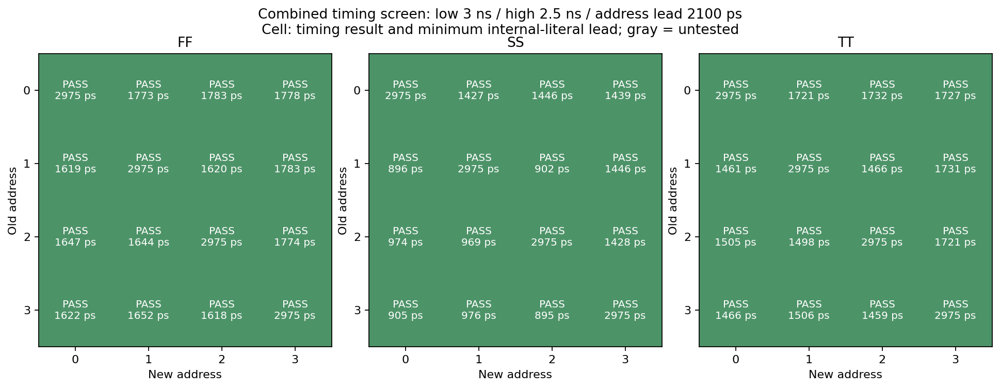
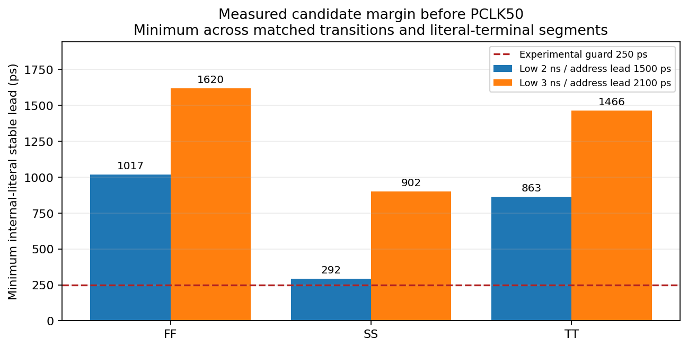

# Frozen decoder/WL local timing boundary measurements

Date: 2026-10-28. These experiments follow the
[48-case selected-pair requalification](row_decoder_canonical_pair_requalification_20261028.md).
They use the same unchanged release decoder PEX, four selected 1.68/5.04 µm
WL-driver PEX instances and 102.873935496 fF full-row lumped load per WL.
No schematic, sizing, geometry or extracted R/C is changed.

## What the measurements establish

The objective is a measured local PCLK/address operating proposal for the
Phase 1 leaf interface. A rejected sweep point is retained as measured data:
it does not mean ngspice failed. A completed boundary campaign is therefore
labelled `COMPLETE_BOUNDARY_SCREEN`, with separate timing PASS/FAIL and
external-terminal voltage-screen results.

Profiles remain TT/1.80 V/27 °C, SS/1.62 V/−40 °C and FF/1.80 V/125 °C.
They are experimental profiles, not a full crossed PVT guarantee. Each ideal
PCLK/address transition has a 50 ps linear ramp. Gear integration has a 5 ps
maximum step. A first 5–10 ns evaluation primes the old selected row. The
second evaluation follows a swept low phase, with the new address held
through evaluation and recovery. UIC zero initialization followed by full
initial precharge does not qualify arbitrary power-up.

Durations use PCLK 50% crossing centers. Address lead is the time between the
new external address ramp center and the second PCLK rising center. It is
not the setup time of an address-capture flip-flop. Positive external lead
does not by itself prove that all internal complemented/true literals have
settled.

The fixed diagnostic criteria are:

- The first evaluation must select only the old row in its fixed settled window.
- Just before the second PCLK rising ramp, every probed internal dynamic-row
  segment must be at least 0.9·VDD.
- All eight DEC/WL outputs must have a continuous low tail of at least
  **0.10 ns** before that ramp, with levels inside ±0.1·VDD.
- Every unselected DEC/WL must stay below 0.1·VDD throughout evaluation,
  including the clock ramps. A later correct selected row cannot hide a
  previously discharged wrong dynamic row.
- Selected DEC and WL must simultaneously remain above 0.9·VDD for one
  continuous interval of at least **0.25 ns**, inside the PCLK ≥90% plateau.
  Separate spikes are not added together.
- All outputs must return below 0.1·VDD in the fixed 2–4.5 ns recovery window
  after the second falling center.
- An additional candidate check measures the final continuously settled tail
  of every saved A0/A1, A0B/A1B and A0T/A1T device-terminal segment. The
  experimental **250 ps internal-literal guard** is relative to PCLK50 and
  requires stability through the evaluation phase.

The 0.10/0.25 ns dwells and 250 ps guard are stated analysis criteria, not
approved bitcell read/write pulse requirements. The separate 1.95 V screen
uses external MOS-terminal |VGS|, |VGD|, |VDS| and |VGB| from 2 ns onward.
Passing it does not establish signed intrinsic BSIM4 validity or reliability.

## Sweeps and measured boundaries

| Sweep | Measured coverage | Timing PASS / FAIL | Observed boundary |
|---|---|---:|---|
| [Address lead](../sims/row_decoder/results/canonical_address_limits_20261028/summary.csv) | Four two-bit transitions × SS/FF × 250/500/1000/1500 ps | 28 / 4 | All tested transitions pass at 1000 ps; smaller leads are transition-dependent |
| [Decoder precharge](../sims/row_decoder/results/canonical_precharge_limits_20261028/summary.csv) | Four same-row pairs × SS × 0.25/0.5/1/1.5/2 ns | 8 / 12 | All four rows fail at 1 ns and pass at 1.5 ns |
| [Evaluation duration](../sims/row_decoder/results/canonical_evaluation_limits_20261028/summary.csv) | SS `1→2`, high 0.7/1/1.3/2 ns | 2 / 2 | 1 ns fails; 1.3 ns passes the 0.25 ns high90 dwell screen |
| [Finite evaluation hold](../sims/row_decoder/results/canonical_retention_limits_20261028/summary.csv) | FF `1→2`, high 20/50 ns | 2 / 0 | Both points pass; no upper failure boundary was found in this range |

Detailed address results, holding low/high durations at 7.1/5.4 ns:

| Profile / transition | 250 ps | 500 ps | 1000 ps | 1500 ps |
|---|---|---|---|---|
| SS `0→3` | PASS | PASS | PASS | PASS |
| SS `3→0` | FAIL | PASS | PASS | PASS |
| SS `1→2` | FAIL | FAIL | PASS | PASS |
| SS `2→1` | FAIL | PASS | PASS | PASS |
| FF, all four transitions | PASS | PASS | PASS | PASS |

For SS `1→2`, insufficient lead discharges the additional row-3 dynamic node:
DEC3/WL3 reach approximately 1.62 V as well as the intended row. SS `2→1`
at 250 ps instead fails at DEC3 (approximately 0.494 V), although its WL
driver filters the short excursion below the WL screen. All unselected DEC
outputs are checked as well as WL outputs. The separate two-case one-thread
preflight also retains failing SS `1→2` leads of 0 and 250 ps; it is not
silently counted as new address-grid coverage.

The sampled SS `1→2` functional boundary lies between the failing 500 ps and
passing 1000 ps points, under this exact stimulus. It is not an independently
measured internal-literal setup limit. There is no failing positive lead in
the sampled FF range, so its lower boundary remains unknown.

At 0.25/0.5 ns precharge, the previously selected internal node also fails
the 0.9·VDD screen. At 1 ns that node passes, but the old WL has not completed
reset. At 1.5 ns the continuous all-output-low tail is 0.3520–0.3530 ns;
at 2 ns it is 0.8538–0.8561 ns. Thus the sampled reset-screen boundary is
between 1 and 1.5 ns, not a claimed exact minimum.

SS `1→2` provides no valid high90 dwell within a 0.7/1 ns evaluation pulse.
With high 1.3 ns, the measured dwell is 0.28555 ns, only 35.55 ps beyond
the diagnostic criterion. High 2 ns gives 0.98565 ns. FF holds of 20 and
50 ns provide 19.479 and 49.479 ns of simultaneous selected DEC/WL high90
without unselected-row activation. This is a finite FF hold test, not a
maximum retention or noise/mismatch guarantee.









### Combined proposals and robustness selection

The first combined proposal uses low/high **2/2.5 ns** and external address
lead **1.5 ns**. All 12 critical-transition cases pass, but its worst SS
internal-literal lead is **291.773 ps**, only **41.773 ps** beyond the
experimental 250 ps guard. A functional pass alone would hide that limited
margin. That dataset remains a valid, narrower-coverage comparison.

The selected engineering reference point follows the user's robustness
priority: **3 ns low, 2.5 ns high, address center 2.1 ns before PCLK50**.
The longer low phase accommodates the earlier address transition after the
previous evaluation has ended. The 2.1 ns lead also retains the reference
lead already exercised by the earlier full-pair campaign. This is a measured
reference point, not a declaration of exact minimum low/high/setup times or
an optimum clock rate.

All **48/48** ordered-pair/profile cases pass, including the optional internal
literal criterion: **1,392/1,392 checks**, with all 48 separate external-bias
screens passing. The four two-bit transitions are retained in the primary
robust campaign; SS/TT one-bit and same-row cases are in separate campaigns.
The 12 remaining FF cases were split into three four-case, one-thread lots.
They have identical circuit, schedule, criteria and model inputs. Coverage is
checked for missing or duplicate address pairs before accepting the summary.

| Profile | Cases | Minimum internal-literal lead (ps) | Minimum all-output reset dwell (ns) | Minimum selected high90 dwell (ns) | PCLK50→WL90 range (ps) | Largest external magnitude (V) |
|---|---:|---:|---:|---:|---:|---:|
| TT | 16/16 | 1459.261 | 2.383474 | 1.888436 | 581.34–587.12 | 1.872613 |
| SS | 16/16 | 895.224 | 1.848752 | 1.492404 | 977.77–985.16 | 1.689324 |
| FF | 16/16 | 1617.750 | 2.513507 | 1.981441 | 488.37–493.74 | 1.872271 |

The smallest literal guard margin is **645.224 ps** in SS. The measured
minimum reset dwell exceeds its 0.10 ns criterion by about **1.749 ns**;
the minimum selected high90 dwell exceeds its 0.25 ns criterion by about
**1.242 ns**. These are margins to the declared analysis screens, not to an
approved bitcell-access requirement. The largest selected-candidate external
magnitude leaves about **77.39 mV** to the scalar 1.95 V screen; this does
not resolve signed intrinsic model validity.

The complete proposal, profiles, measurements and source-manifest links are
in [operating_point_proposal.json](../sims/row_decoder/results/canonical_timing_review_20261028/operating_point_proposal.json).
The table reports all 48 selected-candidate cases. The comparison chart below
uses the same four two-bit transitions in both proposals, avoiding a coverage
change in the plotted comparison. Gray cells in the shorter-lead matrix are
untested, rather than passing. For unchanged-address diagonal cells, the
reported 2,975 ps literal lead is limited by the post-priming observation
window; it is not a newly measured input-transition setup time.





Across all 120 retained cases, **100** pass the timing screen and **20** are
measured rejections from the boundary/preflight studies. There are no simulator
errors. All cases pass the separate 1.95 V external screen; the largest
magnitude, **1.919520 V**, belongs to the rejected address-boundary study.
A voltage-screen pass therefore cannot substitute for correct row selection.
The artifact check retains the exact passed/failed assertion counts.


The precharge sweep repeats the same address on both pulses. This isolates
reset: an output that stays high continuously must fail even if it would be
the selected output again. Address sweeps instead exercise all four
two-bit transitions, including opposite-direction changes, with a long
7.1 ns low phase and 5.4 ns evaluation. This separates literal races from
incomplete precharge. Different axes are combined only in the final candidate
screen; individual sweep passes are not silently multiplied into a guarantee.

## Evidence and reproduction

The runner checks all frozen release hashes before simulation, reads the
actual PEX port order, and archives its executed source, helper sources,
recursive native-model hashes, decks, simulator logs, per-case checks,
terminal extrema and downsampled waveform CSVs. Checks and extrema use the
full transient samples; plotting downsampling is not used for acceptance.

The installed ngspice startup file sets eight frontend threads. Environment
variables and a deck `.options` entry did not override that setting. The
final runner sets `num_threads=1` inside `.control` before `run` and requires
the corresponding log marker. At most three one-thread jobs were used concurrently;
no extraction or global tool-configuration change was required. Earlier
resource-control attempts remain outside the checkout in the local
characterization cache, with aborted/superseded status, rather than being
presented as final campaign evidence.

The [artifact consistency check](../sims/row_decoder/results/canonical_timing_review_20261028/inspect_evidence.py)
checks the expected case sets, archived runner/helper and PEX hashes, simulator
thread markers, CSV threshold decisions, counts, terminal extrema, internal
guard summaries and waveform sample ordering. Its result and file index are
[evidence_audit.json](../sims/row_decoder/results/canonical_timing_review_20261028/evidence_audit.json)
and [checksums.json](../sims/row_decoder/results/canonical_timing_review_20261028/checksums.json).
This is artifact consistency verification, not independent reanalysis of the
discarded full raw transients or intrinsic model signoff. Nine analyzer unit
tests cover reset tails, isolated pulses, late literal glitches and invalid
stimulus schedules. Seven additional inspection regressions use temporary
copies of actual negative-boundary cases: valid rejected points remain
acceptable evidence, while forged logic/check/bias conclusions, changed
runner snapshots, missing cases and incomplete campaigns are rejected.
These seven tests pass in normal, `-O` and `-OO` Python, giving 30 test
executions in total with the nine analyzer tests. Their
[execution log](../sims/row_decoder/results/canonical_timing_review_20261028/regression_tests.txt)
is retained. Eight figures were exported from retained CSVs, with
input/image hashes in [plots.json](../sims/row_decoder/results/canonical_timing_review_20261028/plots.json).

```bash
./tools/sram-eda python3 -m unittest discover -s sims/row_decoder \
  -p 'test_run_canonical_timing_limits.py' -v

./tools/sram-eda python3 sims/row_decoder/run_canonical_timing_limits.py \
  --axis address --profiles ss ff --transitions 0:3 3:0 1:2 2:1 \
  --values 250 500 1000 1500 \
  --output-dir sims/row_decoder/results/canonical_address_limits_repro

./tools/sram-eda python3 sims/row_decoder/run_canonical_timing_limits.py \
  --axis precharge --profiles ss --transitions 0:0 1:1 2:2 3:3 \
  --values 0.25 0.5 1 1.5 2 \
  --output-dir sims/row_decoder/results/canonical_precharge_limits_repro

./tools/sram-eda python3 sims/row_decoder/run_canonical_timing_limits.py \
  --axis evaluation --profiles ss --transitions 1:2 --values 0.7 1 1.3 2 \
  --output-dir sims/row_decoder/results/canonical_evaluation_limits_repro

./tools/sram-eda python3 sims/row_decoder/run_canonical_timing_limits.py \
  --axis retention --profiles ff --transitions 1:2 --values 20 50 \
  --output-dir sims/row_decoder/results/canonical_retention_limits_repro

./tools/sram-eda python3 sims/row_decoder/run_canonical_timing_limits.py \
  --axis confirm --profiles ss tt ff --transitions 0:3 3:0 1:2 2:1 \
  --precharge-ns 2 --evaluation-ns 2.5 --address-lead-ps 1500 \
  --literal-guard-ps 250 \
  --output-dir sims/row_decoder/results/canonical_contract_candidate_repro

./tools/sram-eda python3 sims/row_decoder/run_canonical_timing_limits.py \
  --axis confirm --profiles ss tt ff --transitions 0:3 3:0 1:2 2:1 \
  --precharge-ns 3 --evaluation-ns 2.5 --address-lead-ps 2100 \
  --literal-guard-ps 250 \
  --output-dir sims/row_decoder/results/canonical_contract_robust_repro

for profile in ss tt ff; do
  ./tools/sram-eda python3 sims/row_decoder/run_canonical_timing_limits.py \
    --axis confirm --profiles "$profile" \
    --transitions 0:0 0:1 0:2 1:0 1:1 1:3 2:0 2:2 2:3 3:1 3:2 3:3 \
    --precharge-ns 3 --evaluation-ns 2.5 --address-lead-ps 2100 \
    --literal-guard-ps 250 \
    --output-dir "sims/row_decoder/results/canonical_contract_robust_${profile}_remaining_repro"
done
```

## Remaining acceptance decisions

This local decoder contract is distinct from the bitline precharge time,
bitcell access pulse and complete macro clock budget. A locally passing
decoder low/high pair must not be inverted into a supported SRAM frequency.
The future captured-address/PCLK generator must reproduce the tested
literal guard, edge quality and load, and include its own physical delay.
These are two-pulse handoff tests, not a sustained-cycle or arbitrary startup
qualification. The shorter-lead proposal covers four two-bit transitions per
profile. The selected, larger-margin proposal additionally covers all one-bit
and same-row pairs, giving all 16 ordered pairs per profile. The earlier
48-case matrix retains its independent, longer reference schedule.

The existing signed intrinsic-model-domain findings still need model-owner
resolution or explicit bounded acceptance. The team must also approve the
relevant timing/margin criteria and operating conditions. A finite hold sweep
does not prove indefinite clock stopping or replace a noise/mismatch policy.
Capture/phase-source layout and full 4×8 write/read/readback remain Phase 2.
