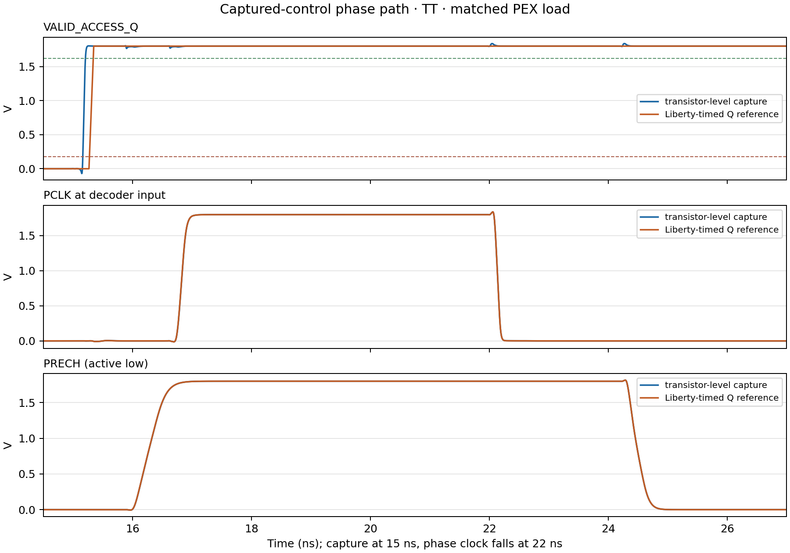
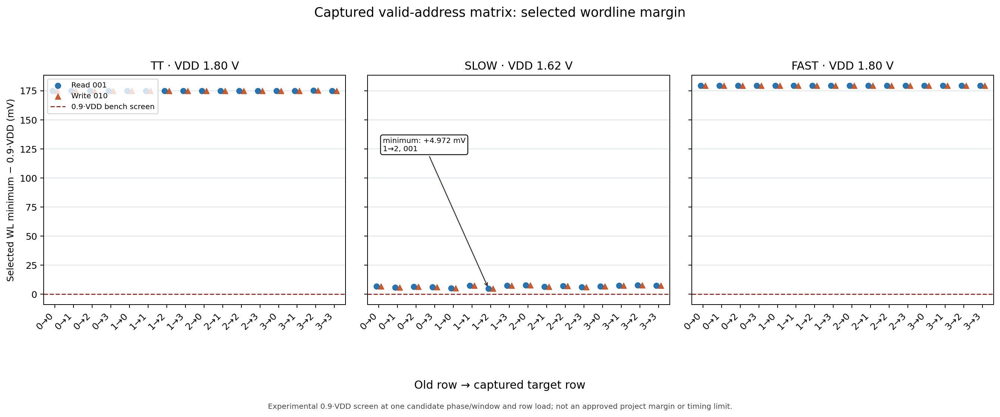

# Captured control to PCLK/PRECH interface screen — 2026-10-09

**Source-selection note, 2026-10-28:** this archived campaign uses the
0.42/0.84 µm WL driver identified in its manifests. The six-cell release now
selects 1.68/5.04 µm stages. See the
[canonical-pair local-interface report](row_decoder_canonical_pair_requalification_20261028.md)
for measurements with that selected pair. The captured-path passing counts
below remain tied to their original sources and controlled schedule.

## Result

The initial paired screen combined the captured qualifier and transistor-level
phase source into one electrical path for two representative SKY130 conditions
at TT, 1.80 V and 27 °C: valid read vector `001` with address transition
`0→3`, and invalid
vector `000`. Each was compared with a Liberty-timed `dfxtp_1` Q waveform
feeding the same transistor-level phase source and downstream PEX. The valid
read pair passed **342/342 checks**; the invalid pair passed **66/66 checks**.
There were no ngspice errors or screen rejections in either run.

The valid-read measurement shows close agreement with the Liberty reference at
this one TT operating point. The invalid-vector measurement shows that the
captured Q remains low at its post-capture sample points, `PCLK` stays below
5.0 mV, and active-low `PRECH` stays below 0.385 mV, so the phase source
continues to hold precharge active. These are representative screens, not a
completed PVT qualification.

| Measurement | Captured transistor-level path | Liberty-timed Q reference | Difference |
|---|---:|---:|---:|
| CLK capture edge to PCLK 50% rise | 1,828.682 ps | 1,827.562 ps | +1.120 ps |
| PRECH 75% rise to PCLK 50% rise | 391.913 ps | 391.968 ps | −0.054 ps |
| PCLK 50% fall to PRECH 75% falling crossing | 2,253.998 ps | 2,253.994 ps | +0.004 ps |
| Valid-read Q 50% clock-to-Q rise | 184.009 ps | 307.041 ps | −123.032 ps |

The comparison reference uses the nominal `dfxtp_1` Liberty lookup load of
3.434554 fF and 53.1329 ps clock slew to shape Q. That Liberty TT table is
characterized at 25 °C, while the native-PM3 circuit deck runs at 27 °C. It is
a timing-table reference, not a transistor-level DFF instance or an exact
extracted-load match to the qualifier's phase-logic input.



## Follow-up: registered row address connected to PEX

The earlier paired runs above used transistor-level capture of the qualified
access bit but supplied the row address from a Liberty-timed PWL source. A
follow-up run now uses `captured_row_decoder_control.sch`, which composes the
two-bit rising-edge row-address register with the captured access qualifier
and the existing PCLK/PRECH source. Its `A0_Q/A1_Q` outputs directly drive the
current dynamic decoder PEX. The same decoder/WL/precharge network is used in
the Liberty-timed reference mode.

For the TT valid-read `001`, address `0→3` case, the input address is presented
500 ps before the 15 ns rising edge and inverted at 15.8 ns while CLK remains
high. The captured A0/A1 values remain high at the post-capture and live-input
change samples. Both paired modes pass all **350 checks** in the run; the
actual-mode register-to-decoder path passes its four sampled address checks.

| Measurement | Captured address/control/phase path | Liberty-timed reference | Difference |
|---|---:|---:|---:|
| CLK capture edge to PCLK 50% rise | 1,828.679 ps | 1,827.562 ps | +1.117 ps |
| PRECH 75% release to PCLK 50% rise | 391.916 ps | 391.968 ps | −0.052 ps |
| PCLK 50% fall to PRECH 75% assertion | 2,254.000 ps | 2,253.994 ps | +0.006 ps |
| Valid-access Q 50% clock-to-Q rise | 184.009 ps | 307.041 ps | −123.032 ps |

This advances the address path from a structural/functional wrapper check to
one loaded transistor-level PEX case. It is not an address setup/hold sweep or
a PVT/control/address qualification. The wrapper still has no reset, no
captured write-data path, and no attached physical bitcell row. The
[dedicated address report](row_decoder_address_capture_20261009.md) and
[integrated manifest](../sims/row_decoder/results/captured_row_address_interface_tt_20261009/manifest.json)
contain the detailed evidence. No extraction was performed for this run.

## Follow-up: valid-write control with captured address — 2026-10-10

Added a second paired TT case with valid-write control `010` and address
transition `3→0`. It uses the current transistor-level PCLK/PRECH source,
captured row-address and access-control registers, decoder/WL PEX, four
wordline-driver PEX instances, the pinned read-only Danilo precharge PEX, and
the existing lumped bitline residual. The test applies the input address
500 ps before capture and changes the live address during the high phase.
This is a write-control/row-selection screen; no physical bitcell data is
written or read back.

The actual and Liberty-reference modes each passed **175/175 checks**, for
350/350 checks total, with no simulation errors or screen rejections. The
actual captured `VALID_ACCESS_Q` remained asserted for write vector `010`, and
`A0_Q/A1_Q` captured row 0 and held it after the live inputs changed. No WL was
asserted while PRECH was active. The measured phase comparisons are:

| Measurement | Captured transistor-level path | Liberty-timed reference | Difference |
|---|---:|---:|---:|
| CLK capture edge to PCLK 50% rise | 1,828.672 ps | 1,827.548 ps | +1.124 ps |
| PRECH 75% release to PCLK 50% rise | 391.907 ps | 391.954 ps | −0.048 ps |
| PCLK 50% fall to PRECH 75% assertion | 2,253.999 ps | 2,254.000 ps | −0.001 ps |
| Valid-access Q 50% clock-to-Q rise | 184.010 ps | 307.041 ps | −123.031 ps |

The captured qualifier reaches −72.195 mV and 1.947143 V in the actual run.
The bench has no accepted rail-excursion criterion; this remains an electrical
and model review item even though the sampled logic checks pass. Both ngspice
logs report `No compatibility mode selected!`, with no missing OSDI library
or fatal model error. No extraction was performed.

The [run manifest](../sims/row_decoder/results/captured_address_write_tt_20261010/manifest.json),
[350 paired checks](../sims/row_decoder/results/captured_address_write_tt_20261010/checks.csv),
[summary metrics](../sims/row_decoder/results/captured_address_write_tt_20261010/summary.csv),
and [matched timing comparison](../sims/row_decoder/results/captured_address_write_tt_20261010/matched_comparison.csv)
preserve the evidence and provenance.

## Follow-up: valid-read selection of all four rows at TT — 2026-10-10

Two additional runs select read targets 1 and 2 from old address 0, and a
third selects target 0 from old address 0. Together with the earlier read
case targeting row 3, valid-read control `001` now selects each of the four
decoder outputs in a representative TT case at 1.80 V/27 °C. The three new
paired cases pass **1,050/1,050 checks** (175 actual plus 175 reference
checks per case), with no simulation errors or screen rejections. Across all
four read targets, the paired count is **1,400/1,400**. The earlier valid-write
control `010`, address `3→0`, adds one more representative case, for
**1,750/1,750 checks** across the five valid cases now recorded here.

For the three new cases, the actual PCLK rising edge occurs 1,828.677–1,828.678
ps after capture, 1.111–1.117 ps later than the Liberty-timed reference. The
actual `VALID_ACCESS_Q` spans −72.202 mV to 1.947177 V. There is no accepted
rail-excursion criterion, so the voltage/model review remains open despite
the sampled logic checks passing. Logs report `No compatibility mode
selected!`; none reports a missing OSDI library or fatal model error.

This covers target selection from old address 0, including the `0→0` hold
case; it is **not** the full set of 16 ordered old/new row-address pairs. The
write control still has only the `3→0` case, and none of these tests writes
data into or reads back a physical bitcell. The [row 1/2 manifest](../sims/row_decoder/results/captured_address_read_rows1_2_tt_20261010/manifest.json),
[row 1/2 checks](../sims/row_decoder/results/captured_address_read_rows1_2_tt_20261010/checks.csv),
[row 0 manifest](../sims/row_decoder/results/captured_address_read_row0_tt_20261010/manifest.json),
and [row 0 checks](../sims/row_decoder/results/captured_address_read_row0_tt_20261010/checks.csv)
preserve both runs.

## Simulated path and setup

The actual case freshly netlists `captured_pclk_phase_source.sch`, which
connects the SKY130 FD SC HD standard-cell qualifier to the existing
transistor-level `pclk_phase_source.sch`. The phase equations and selected
24/60/80-stage inverter taps are unchanged. The simulations use the native
SKY130 PM3 models for the phase logic, qualifier standard cells, decoder,
wordline drivers, and precharge devices.

Downstream loading consists of the current row-decoder R-C PEX, four
wordline-driver R-C PEX instances at 102.873935496 fF per row, eight pinned
read-only copies of Danilo's `precharge_w2p52_flat` PEX, and 583.992055 fF of
lumped bitline residual per side. The effective bitline target is 597.056241
fF. This is not a distributed bitline or a physical 6T read/write path.

Controls start disabled at `111`; a priming clock edge captures an invalid
value before the test applies the selected control vector and captures it on
the next rising edge at 15 ns. The controls then change to the opposite
validity class during the high phase to check that the captured Q holds.
The transient maximum step is 5 ps. Experimental 250 ps PRECH-release and
1,800 ps WL-turnoff guards are used by the testbench; neither is a requirement
from the project specification.

## 2026-10-11 UTC: initial three-profile matrix with a short evaluation window

Ran both valid operations (`001` read and `010` write) from old row 0 to all
four row targets in TT, SS, and FF. Each logical case has an actual
transistor-level path and a matched Liberty-timed reference, for 24 paired
cases and 48 completed ngspice runs. The current decoder and four WL-driver
PEX instances, the pinned read-only Danilo precharge PEX, and the same lumped
bitline residual were used throughout. No new extraction was performed.

The final manifest is `complete=true`, with 48/48 simulations completed and
zero simulation errors. Its overall `status` is **REVIEW_REQUIRED**: 16 of the
48 actual/reference results are rejected by the defined experimental screens.
The combined check file has 8,400 rows: 8,352 PASS and 48 FAIL.

| Profile | Actual path | Liberty reference | Notes |
|---|---:|---:|---|
| TT | 8/8 PASS | 8/8 PASS | 16 paired results passed |
| SS | 0/8 PASS | 0/8 PASS | All 16 results are `REJECTED_SCREEN` |
| FF | 8/8 PASS | 8/8 PASS | 16 paired results passed |

The 48 SS check failures split into two findings:

1. **Loaded WL response: 32 failures.** The selected WL does not meet the
   bench's 0.9·VDD end-level and settled-minimum screens in either path. Across
   the SS cases, the failing end-level measurements are 1.43783–1.44059 V and
   the settled minima are 1.37357–1.37642 V; the experimental floor is 1.458 V
   at the 1.62 V supply. This is an observed loaded-path/timing-screen failure,
   not by itself proof of a project-specification violation: the specification
   does not define this waveform's PCLK high time or a WL settling deadline.
2. **Liberty-reference sample timing: 16 failures.** The reference Q is sampled
   700 ps after capture. At SS, its Liberty clock-to-Q 50% crossing is about
   677.1 ps, leaving only about 23 ps before the sample. The output is then
   1.045 V, below the bench's 1.458 V high threshold. Eight failures are
   `VALID_ACCESS_Q_capture` samples and eight are high-valued A0_Q/A1_Q
   samples. This is a sampling-point limitation in the reference monitor; the
   current measurement does not establish that the reference register has
   settled to a valid high level at the chosen sample.

The actual SS `VALID_ACCESS_Q` also reaches −0.11279 V and 1.81175 V at the
1.62 V supply. The bench defines no accepted rail-excursion limit, so these
measured excursions remain an electrical/model review item; they are not
accepted as reliable operation based on the logic samples alone.

A retained SS row-3 waveform diagnostic resolves the loaded WL timing. With
1.62 V, −40 °C and 102.873935496 fF per row, actual PCLK crosses falling 90% at
22.184933 ns and WL3 reaches rising 90% at 22.283966 ns, a 99.033 ps delay.
The Liberty-reference path measures 22.184824 ns and 22.278566 ns,
respectively (93.742 ps). At the actual PCLK falling 50% crossing, WL3 is only
1.45059 V, slightly below the 1.458 V screen. The close actual/reference
waveforms indicate that the slow loaded evaluation path is present in both
models; they do not make the screen pass or define an accepted timing limit.
See the [waveform plot](../sims/row_decoder/results/captured_phase_interface_ss_waveform_diag_20261010/ss_row3_pclk_wl3_timing.png),
[selected waveform samples](../sims/row_decoder/results/captured_phase_interface_ss_waveform_diag_20261010/ss_row3_selected_waveforms.csv),
and [crossing summary](../sims/row_decoder/results/captured_phase_interface_ss_waveform_diag_20261010/ss_row3_wl_timing_summary.json).
The PNG/SVG can be regenerated from the retained CSV without the removed RAW
files using
`./tools/sram-eda python3 sims/row_decoder/plot_captured_phase_ss_diagnostic.py --case-dir sims/row_decoder/results/captured_phase_interface_ss_waveform_diag_20261010/cases/slow_ctl001_a0_to_3_p2100 --waveform-csv sims/row_decoder/results/captured_phase_interface_ss_waveform_diag_20261010/ss_row3_selected_waveforms.csv --output-dir sims/row_decoder/results/captured_phase_interface_ss_waveform_diag_20261010`.

The initial full-matrix attempt exposed a runner bug: measured phase edges
were written into a shared schedule and then reused for the Liberty-reference
simulation. The runner now creates a mode-local schedule copy, preserving the
external `PHASE_CLK` reference in both modes. The aborted attempt is not used
as evidence; all counts above come from the complete run with the corrected
runner.

The PCLK capture-to-rise difference between actual and reference was
1.109–1.117 ps in TT, 2.588–2.595 ps in SS, and 0.731–0.743 ps in FF. The
experimental 250 ps PRECH-release screen passed in all profiles; it is not a
specification limit. All 48 logs completed without missing OSDI-library or
fatal model-resolution errors, though they print `No compatibility mode
selected!`.

This run is retained as the initial diagnostic. It is superseded for the
selected-row valid matrix by the retest below, which uses a longer experimental
window and later settled-Q sampling. The initial results remain useful evidence
of why the earlier SS screens rejected the candidate settings.

The [manifest](../sims/row_decoder/results/captured_phase_interface_valid_3profile/manifest.json),
[summary](../sims/row_decoder/results/captured_phase_interface_valid_3profile/summary.csv),
[matched timing comparison](../sims/row_decoder/results/captured_phase_interface_valid_3profile/matched_comparison.csv),
and [per-check CSV](../sims/row_decoder/results/captured_phase_interface_valid_3profile/checks.csv)
contain the matrix evidence. Reproduce it with:

```bash
./tools/sram-eda python3 sims/row_decoder/run_captured_phase_interface.py \
  --profiles tt slow fast --control-vectors 001 010 \
  --transitions 0:0 0:1 0:2 0:3 --transitions-per-vector \
  --phase-ps 2100 --clk-fall-ps 22000 \
  --settling-allowance-ns 3.4 --q-sample-ps 700 \
  --hold-challenge-ps 800 --wl-cap-ff 102.873935496 --step-ps 5 \
  --output-dir sims/row_decoder/results/captured_phase_interface_valid_3profile
```

## 2026-10-11 UTC: retest with later Q sampling and a longer candidate window

Reran the same 24 logical cases after changing the experimental schedule and
reference monitor: `phase_ps=2100`, external `CLK` falling edge at 22.50 ns,
3.8 ns settling allowance, captured-Q sample at +900 ps, and live-input hold
challenge at +1100 ps. The selected row load remains 102.873935496 fF and the
transient step remains 5 ps. These are test settings only; the specification
does not approve this clock period, PCLK phase, or settling deadline.

All 48 actual/reference ngspice runs completed with zero simulation errors.
The manifest reports `complete=true`, `status=PASS`, and no screen rejections.
All **8,400/8,400 checks pass**:

| Profile | Actual path | Liberty reference | Selected-WL result |
|---|---:|---:|---|
| TT | 8/8 PASS | 8/8 PASS | All selected WL checks pass |
| SS | 8/8 PASS | 8/8 PASS | Minimum end level 1.52050 V; minimum settled level 1.46393 V |
| FF | 8/8 PASS | 8/8 PASS | All selected WL checks pass |

At SS the experimental 0.9·VDD floor is 1.458 V. The minimum selected-WL
settled level is 5.93 mV above that screen, so the measured margin is narrow.
This passes the present testbench criterion at the tested load and schedule;
it does not establish an approved SRAM timing limit or adequate design margin.
The later +900 ps Q sample avoids the earlier premature Liberty-reference
sample, and the +1100 ps live-input change still exercises capture/hold.

The reference is a PWL shaped from `dfxtp_1` Liberty timing arcs, not a
transistor-level flip-flop in the same supply condition: the slow Liberty
table is characterized at 1.60 V while the native-PM3 slow test deck uses
1.62 V; the fast Liberty table uses 1.65 V while its native-PM3 deck uses
1.80 V. TT uses 1.80 V in both. Interpret the comparison as a timing reference
for the captured-Q interface, not a same-voltage validation of the standard
cell.

The actual captured control/address path continues to show rail excursions:
`VALID_ACCESS_Q` ranges from −72.20 mV to 1.94718 V in TT, −112.79 mV to
1.81175 V in SS, and −36.93 mV to 1.90417 V in FF. The bench has no accepted
excursion criterion. Passing sampled logic checks does not close electrical,
model-domain, or reliability review. The run used the native SKY130 PM3 models;
all 48 ngspice logs completed without missing OSDI libraries or fatal model
errors and include the informational `No compatibility mode selected!`
message.

The simulation used the current decoder and four WL-driver R-C PEX instances,
the pinned read-only Danilo precharge PEX, and the existing lumped bitline
residual. No new extraction was performed. It covers valid read `001` and
valid write `010`, each from old address 0 to targets 0–3. The write cases
select rows; no physical bitcell data is written or read back. The matrix is
not the complete set of 16 ordered address pairs and does not cover invalid or
idle controls, startup, or integrated setup/hold.

Evidence: [passing manifest](../sims/row_decoder/results/captured_phase_interface_valid_3profile_fall22500_settle3800_q900_20261011/manifest.json),
[summary](../sims/row_decoder/results/captured_phase_interface_valid_3profile_fall22500_settle3800_q900_20261011/summary.csv),
[matched comparison](../sims/row_decoder/results/captured_phase_interface_valid_3profile_fall22500_settle3800_q900_20261011/matched_comparison.csv),
[8,400 per-check results](../sims/row_decoder/results/captured_phase_interface_valid_3profile_fall22500_settle3800_q900_20261011/checks.csv),
and [representative TT waveforms](../sims/row_decoder/results/captured_phase_interface_valid_3profile_fall22500_settle3800_q900_20261011/captured_phase_vs_liberty_tt_read_a0_to_3.png).
Reproduce with:

```bash
./tools/sram-eda python3 sims/row_decoder/run_captured_phase_interface.py \
  --profiles tt slow fast --control-vectors 001 010 \
  --transitions 0:0 0:1 0:2 0:3 --transitions-per-vector \
  --phase-ps 2100 --clk-fall-ps 22500 \
  --settling-allowance-ns 3.8 --q-sample-ps 900 \
  --hold-challenge-ps 1100 --wl-cap-ff 102.873935496 \
  --step-ps 5 \
  --output-dir sims/row_decoder/results/captured_phase_interface_valid_3profile_fall22500_settle3800_q900_20261011
```

## Limits and review items

- The passing matrix covers valid-read `001` and valid-write `010` from old
  address 0 to each of four rows in TT/SS/FF, under the experimental schedule
  recorded above. Agree timing and margin criteria before treating it as a
  qualified operating point or using it to claim frequency closure.
- The captured Q reaches −72.2 mV and 1.9471 V in the valid run, and −7.2 mV
  and 1.9471 V in the invalid run. This bench has no rail-excursion acceptance
  criterion; the overshoot remains for electrical/model review. Passing the
  sampled logic and timing checks does not close that review.
- In the passing matrix, actual `VALID_ACCESS_Q` ranges from −112.79 mV to
  1.81175 V at the SS supply. This bench has no accepted rail-excursion limit.
- The phase-source chain has no layout, DRC, LVS, or PEX. The test does not
  establish metastability behavior, startup before a valid clock edge, clock
  frequency, a complete row read/write/readback, or reliability/signoff.
- The representative and matrix ngspice logs print `No compatibility mode
  selected!`. The 48 runs in the passing matrix report no missing OSDI
  libraries or fatal model-resolution errors. This informational notice stays
  part of the model-environment record.
- Danilo's precharge PEX is consumed read-only and pinned to commit `5dc00fe`
  with SHA-256
  `cf0fa457b4ab84a1d19e6202541b6a43149b575e492a108e36d0de62489cc423`.
  This test does not replace or revise the shared precharge source.

## Reproduction

Run the default representative valid-read case:

```bash
./tools/sram-eda python3 sims/row_decoder/run_captured_phase_interface.py \
  --output-dir sims/row_decoder/results/captured_phase_interface_tt_read_repro
```

Run the representative invalid-vector case:

```bash
./tools/sram-eda python3 sims/row_decoder/run_captured_phase_interface.py \
  --output-dir sims/row_decoder/results/captured_phase_interface_invalid_repro \
  --profiles tt --control-vectors 000 --transitions 0:3
```

Both result directories contain manifests, exact simulation input netlists,
case JSON, checks, and ngspice logs. The valid-read directory also contains
representative waveform CSVs and the comparison plot. Large transient RAW
files are not retained by default; use `--keep-raw` only when detailed
waveform inspection is needed.

## Remaining matrix and next steps

The initial review items that rejected SS in the short-window run were
resolved for this testbench run: the selected-WL screens pass at the longer
candidate window, and the Q monitor samples after settling. The broader
qualification is still open. Next, agree an acceptable PCLK/system timing and
margin with the project team, then sweep around the passing candidate to
measure margin rather than adopting this point as a timing limit. The invalid
control vectors and all 16 ordered valid address pairs have now been screened
at the same candidate schedule. The SS selected-WL result remains close to the
bench threshold, so passing this screen does not establish the required
electrical margin or an approved clock. These screens still do not replace
physical bitcell row read/write/readback, startup, or integrated setup/hold
tests.

The initial short-window matrix command is retained for historical reproduction
(24 paired cases, 48 actual/reference runs; superseded by the passing retest):

```bash
./tools/sram-eda python3 sims/row_decoder/run_captured_phase_interface.py \
  --profiles tt slow fast --control-vectors 001 010 \
  --transitions 0:0 0:1 0:2 0:3 --transitions-per-vector \
  --output-dir sims/row_decoder/results/captured_phase_interface_valid_3profile
```

## 2026-10-13 UTC: captured invalid-control matrix

Ran all six invalid/idle control vectors (`000`, `011`, `100`, `101`, `110`,
`111`) with the captured address transition `0→3` in TT, SS, and FF. The
candidate schedule matches the passing valid matrix (`phase_ps=2100`, external
`CLK` falling at 22.50 ns, 3.8 ns settling allowance, Q sample at +900 ps,
live-input challenge at +1100 ps, 102.873935496 fF WL load, and 5 ps maximum
transient step). This remains an experimental test condition, not an accepted
clock or interface requirement.

All 18 logical cases completed in actual and Liberty-reference modes: 36/36
simulations passed with zero simulation errors, and all 1,332/1,332 checks
passed (444 per corner). No run reported a missing OSDI library. Across the
matrix, the worst measured peaks were 6.01 mV on PCLK, 3.34 mV on active-low
PRECH, 2.03 mV on any DEC output, and 0.537 mV on any WL output. The lowest
internal dynamic-node voltage was 1.57583 V in SS, above the test's 0.9·VDD
floor of 1.458 V. These values establish behavior only for the tested load,
transition, model profiles, and schedule; they are not reliability limits.

The test checked that invalid access leaves `VALID_ACCESS_Q` low, keeps PCLK
and PRECH in the inactive phase, leaves all four dynamic nodes precharged, and
does not assert any DEC or WL output. It also checked the bitline end state and
that captured control/address values hold after the live inputs change. The
actual path uses the current decoder/WL PEX, the pinned read-only Danilo
precharge PEX, and lumped bitline residual capacitance. No new extraction was
run; no physical bitcell data write/readback or pre-first-clock startup test
was included. The Liberty path remains a PWL reference, not a transistor-level
flip-flop at matched SS/FF supply.

Evidence: [manifest](../sims/row_decoder/results/captured_phase_interface_invalid_3profile_fall22500_settle3800_q900_20261013/manifest.json),
[summary](../sims/row_decoder/results/captured_phase_interface_invalid_3profile_fall22500_settle3800_q900_20261013/summary.csv),
[matched comparison](../sims/row_decoder/results/captured_phase_interface_invalid_3profile_fall22500_settle3800_q900_20261013/matched_comparison.csv),
and [all checks](../sims/row_decoder/results/captured_phase_interface_invalid_3profile_fall22500_settle3800_q900_20261013/checks.csv).

Reproduce in the project container with:

```bash
./tools/sram-eda python3 sims/row_decoder/run_captured_phase_interface.py \
  --profiles tt slow fast --control-vectors 000 011 100 101 110 111 \
  --transitions 0:3 --phase-ps 2100 --clk-fall-ps 22500 \
  --settling-allowance-ns 3.8 --q-sample-ps 900 \
  --hold-challenge-ps 1100 --wl-cap-ff 102.873935496 --step-ps 5 \
  --output-dir sims/row_decoder/results/captured_phase_interface_invalid_3profile_fall22500_settle3800_q900_20261013
```

The valid screen from 2026-10-11 covers the four ordered pairs from old
address 0. The 2026-10-14 campaign below covers the other 12 pairs, completing
all 16 ordered old/new pairs for both valid operations and all three profiles.
These row-selection tests do not substitute for a physical bitcell
read/write/readback path.

```bash
./tools/sram-eda python3 sims/row_decoder/run_captured_phase_interface.py \
  --profiles tt slow fast --control-vectors 001 010 \
  --transitions 1:0 1:1 1:2 1:3 2:0 2:1 2:2 2:3 3:0 3:1 3:2 3:3 \
  --transitions-per-vector \
  --output-dir sims/row_decoder/results/captured_phase_interface_valid_remaining_ordered_3profile
```

That remaining valid-operation matrix contains 72 logical cases (144 actual/
reference ngspice runs) and is now complete. Its detailed result follows.

The simulations do not sweep setup/hold skew, phase placement, clock period,
or supply/temperature within a model profile; those need separate scoped runs
after the acceptance conditions are agreed.

## 2026-10-14 UTC: complete ordered valid-address matrix

Completed the 12 remaining ordered transitions (`1→0` through `3→3`, including
same-row captures) for valid read control `001` and valid write control `010`
in TT, SS, and FF. The candidate conditions were `phase_ps=2100`, external
`CLK` falling at 22.50 ns, a 3.8 ns evaluation/settling window, Q sampling at
capture +900 ps, live-input challenge at +1100 ps, 102.873935496 fF WL load,
and a 5 ps maximum transient step. These are experimental bench settings, not
approved interface timing or a supported frequency.

All 72 logical cases completed in actual transistor-level and Liberty-timed
reference modes: **144/144 simulations PASS**, with no screen rejections or
ngspice errors, and **25,200/25,200 checks PASS** (4,200 checks per profile).
There were no missing OSDI libraries or other warning/error lines in the 144
ngspice logs. The prior old-address-0 matrix contributes 24 logical cases,
48 actual/reference simulations, and 8,400/8,400 checks. Together the two
campaigns cover all 16 ordered address pairs × two valid control vectors ×
three profiles: **96 logical cases, 192 actual/reference simulations, and
33,600/33,600 checks**.

The lowest selected-WL settled minimum in this added matrix is 1.462972 V in
SS at 1.62 V supply, only **4.972 mV above** the bench's 0.9·VDD screen
(1.458 V). This is a narrow measured pass, not a project-approved margin. The
monitored captured-control Q still spans −72.202 mV to 1.947143 V in TT,
−112.786 mV to 1.811754 V in SS, and −36.924 mV to 1.904168 V in FF. The
project has not accepted a rail-excursion criterion for Q, so these observations
remain open for electrical and model-domain review.

For the paired timing reference, actual capture-to-PCLK delay is 1.104–1.134 ps
later in TT, 2.589–2.600 ps later in SS, and 0.730–0.750 ps later in FF. The
reference uses Liberty-derived PWL timing and does not model a transistor-level
capture flip-flop at the same SS/FF supplies; these deltas are comparison
evidence, not timing signoff.

The actual path reused the current decoder/WL PEX, the pinned read-only Danilo
precharge PEX, and the documented lumped bitline residual. **No new extraction
was run.** The test verifies captured row selection and control/phase behavior;
write control `010` does not write data into a physical 6T cell or read it back.
Startup before the first capture edge, integrated setup/hold, approved clock
timing, phase-source layout/PEX, and physical-row read/write/readback remain
open.

During the first campaign attempt, a 180 s per-run timeout stopped one slow
ngspice case and exposed a runner bug: `TimeoutExpired` output could be bytes,
causing the handler to fail while concatenating it with text. The runner now
decodes timeout output, supports `--ngspice-timeout-s` and safe `--resume`, and
checks the recorded simulation inputs before reusing completed cases. The
completed manifest records both execution attempts. Its top-level result list
was reconstructed from the 144 per-mode `case.json` files after a resume-path
bug left that list empty; the manifest records that repair. No simulation data
was edited.

Evidence: [repaired campaign manifest](../sims/row_decoder/results/captured_phase_interface_valid_remaining_ordered_3profile_fall22500_settle3800_q900_20261013/manifest.json),
[summary](../sims/row_decoder/results/captured_phase_interface_valid_remaining_ordered_3profile_fall22500_settle3800_q900_20261013/summary.csv),
[matched actual/reference comparison](../sims/row_decoder/results/captured_phase_interface_valid_remaining_ordered_3profile_fall22500_settle3800_q900_20261013/matched_comparison.csv),
and [25,200 per-check results](../sims/row_decoder/results/captured_phase_interface_valid_remaining_ordered_3profile_fall22500_settle3800_q900_20261013/checks.csv).
The [selected-WL margin plot](../sims/row_decoder/results/captured_phase_interface_valid_remaining_ordered_3profile_fall22500_settle3800_q900_20261013/full_valid_matrix_selected_wl_margin.png)
combines the old-address-0 and remaining-address campaigns, using the actual
transistor-level checks for all 96 valid cases:



Recreate the derived plot from the retained per-mode check CSVs with:

```bash
./tools/sram-eda python3 sims/row_decoder/plot_captured_valid_matrix_margin.py
```

To reproduce from scratch in a fresh output directory (this is a long-running
campaign):

```bash
./tools/sram-eda python3 sims/row_decoder/run_captured_phase_interface.py \
  --profiles tt slow fast --control-vectors 001 010 \
  --transitions 1:0 1:1 1:2 1:3 2:0 2:1 2:2 2:3 3:0 3:1 3:2 3:3 \
  --transitions-per-vector --phase-ps 2100 --clk-fall-ps 22500 \
  --settling-allowance-ns 3.8 --q-sample-ps 900 \
  --hold-challenge-ps 1100 --wl-cap-ff 102.873935496 --step-ps 5 \
  --ngspice-timeout-s 600 \
  --output-dir sims/row_decoder/results/captured_phase_interface_valid_remaining_ordered_3profile_repro
```

## 2026-10-14 UTC: SS selected-WL settling-window exploration

To investigate the narrow SS selected-wordline screen, the worst observed
transition (`1→2`) was rerun for valid read (`001`) and write (`010`) at the
same 2.10 ns phase, 1.62 V SS supply, captured address, and 102.873935496 fF
WL load. Each campaign includes the transistor-level path and its
Liberty-timed reference.

| External CLK fall | Settling allowance | Actual read WL2 minimum | Actual write WL2 minimum | Margin over 0.9·VDD |
|---:|---:|---:|---:|---:|
| 22.5 ns | 3.8 ns | 1.462972 V | 1.462972 V | +4.972 mV |
| 24.0 ns | 3.8 ns | 1.462972 V | 1.462972 V | +4.972 mV |
| 25.0 ns | 3.8 ns | 1.462972 V | 1.462972 V | +4.972 mV |
| 24.0 ns | 5.5 ns | 1.602516 V | 1.602516 V | +144.516 mV |
| 25.0 ns | 5.5 ns | 1.602516 V | 1.602516 V | +144.516 mV |

The screen's settled minimum is taken from `PCLK` rising plus the requested
settling allowance through the measured `PCLK` falling edge. At a fixed 3.8 ns
allowance, moving the external CLK fall from 22.5 to 25 ns did not change the
measured minimum. At fixed CLK fall (24 or 25 ns), changing the allowance from
3.8 to 5.5 ns moved the beginning of the measurement window later and raised
the measured minimum by about 139.544 mV. Paired Liberty-reference deltas were
1.406 mV at 3.8 ns and 0.177 mV at 5.5 ns.

This is a measurement-window effect, not evidence that transistor sizing or
the physical circuit improved. The metric deliberately excludes the earlier
part of WL's rise when the allowance is increased; it does not report the
minimum over the full active pulse or prove the bitcell's required access
time. The required settling time and available access interval still need an
accepted system timing target and a controlled sweep.

The three additional campaigns (24 ns/5.5 ns, 25 ns/3.8 ns, and 25 ns/5.5 ns)
completed **12/12 runs and 2,100/2,100 checks** with no simulation errors or
warning/error lines. The two 5.5 ns campaigns measured 1.602516 V on the
actual path and 1.602693 V on the Liberty reference for both operations. The
experimental floor was 1.458 V. This is waveform-screen evidence only, not
bitcell access margin, SNM, reliability signoff, approved clock timing, or an
Fmax claim.

The first 24 ns/5.5 ns attempt completed ngspice but post-processing rejected
the recovery window because the generated `.tran` stopped before that window
ended. This was a truncated-record testbench error, not an electrical
failure. The runner now extends its transient tail to at least 500 ps beyond
the requested recovery check and records the stop policy in the campaign
manifest. The corrected 24 ns/5.5 ns retest and the 25 ns/5.5 ns run both pass.
The incomplete first-attempt output is excluded from the qualified evidence
set; the failure and correction are recorded here.

Evidence: [25 ns/5.5 ns manifest](../sims/row_decoder/results/captured_phase_interface_ss_margin_fall25000_settle5500_20261014/manifest.json),
[24 ns/5.5 ns retest manifest](../sims/row_decoder/results/captured_phase_interface_ss_margin_fall24000_settle5500_20261014_retest/manifest.json),
[25 ns/3.8 ns manifest](../sims/row_decoder/results/captured_phase_interface_ss_margin_fall25000_settle3800_20261014/manifest.json),
[window comparison plot](../sims/row_decoder/results/captured_phase_interface_ss_margin_fall25000_settle5500_20261014/ss_selected_wl_window_comparison.png),
[checks at 25 ns/5.5 ns](../sims/row_decoder/results/captured_phase_interface_ss_margin_fall25000_settle5500_20261014/checks.csv),
and the [plot generator](../sims/row_decoder/plot_ss_margin_window_exploration.py).
Recreate the plot with:

```bash
./tools/sram-eda python3 sims/row_decoder/plot_ss_margin_window_exploration.py
```
