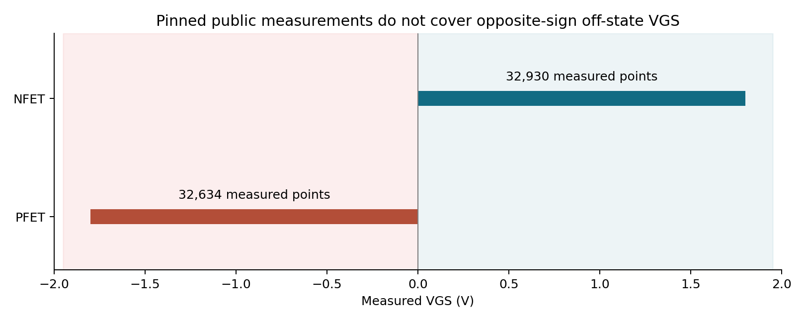
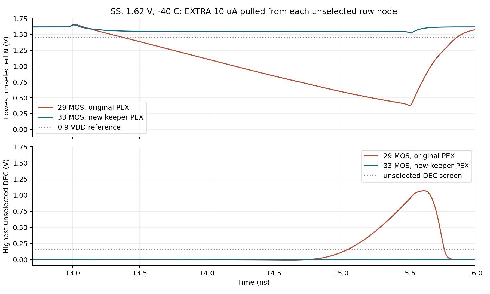
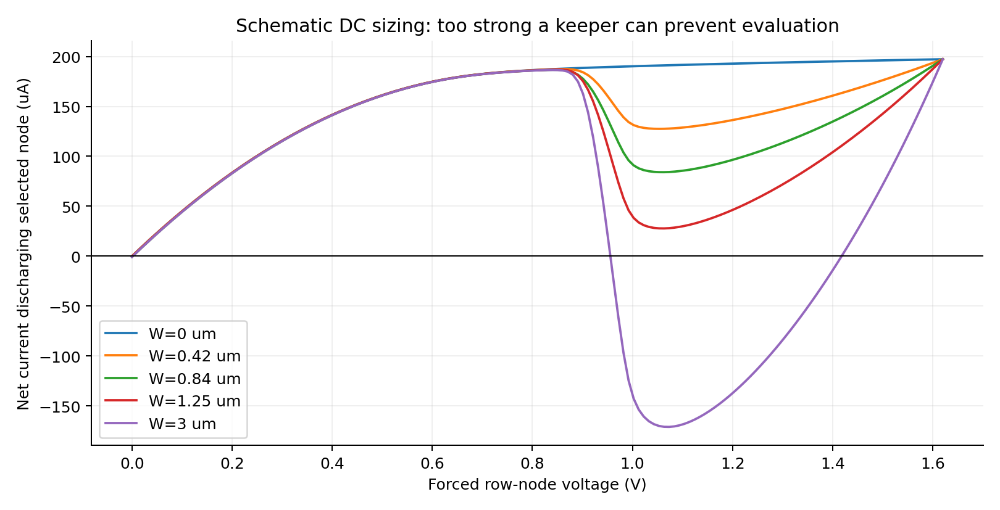
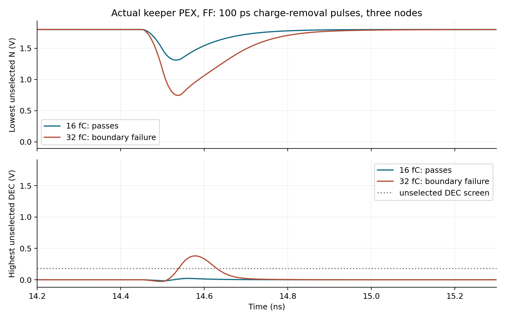
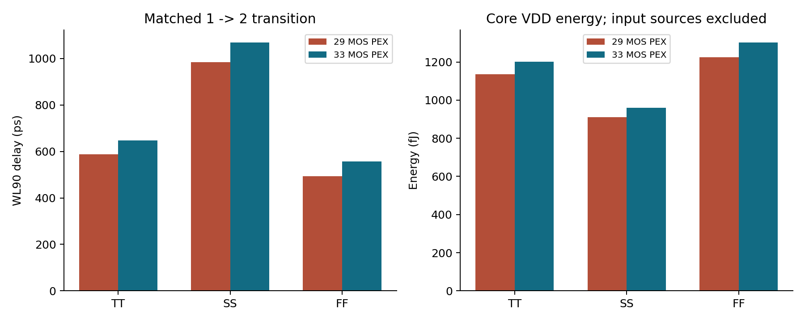

# Dynamic decoder: model coverage and feedback-keeper revision

Date: 2026-10-29. Owner: Leonardo, `feature/peripherals`.

The request was to investigate the intrinsic-bias qualification limitation in
full and change the circuit if the evidence justified it. The dynamic NAND
architecture, PCLK polarity and external pins remain unchanged. Danilo's
original circuits, reports and masks are read-only.

## What the original warning means

The previous [intrinsic-state review](row_decoder_canonical_intrinsic_review_20261028.md)
correctly found that off NFETs can have negative effective VGS, and off PFETs
can have small positive effective VGS. These states extend beyond the signed
gate-bias intervals tabulated in the
[official model documentation](https://skywater-pdk.readthedocs.io/en/main/rules/device-details.html#spice-model-information).
The table establishes a published characterization boundary. It is not a
decoder-specific functional rejection rule or an oxide/reliability verdict.
The separate 1.95 V absolute-terminal-magnitude screen used in our experiments
is also not a foundry reliability signoff rule.

As a control, the unchanged frozen 6T bitcell and an unchanged native SKY130
NAND2 were evaluated at TT/SS/FF. All 18 static logic controls passed. The
bitcell's ordinary off access-transistor state reaches **VGS = -1.800000 V**:
WL is low while both diffusions are high. Applying a nonnegative-VGS rule to
every off NFET would therefore also flag ordinary required SRAM operation.
This control does not independently validate the BSIM4 model; it prevents
misclassifying a generic coverage gap as a decoder-specific wiring fault.

Evidence: [control summary](../sims/row_decoder/results/offstate_reference_controls_20261029/summary.json),
[device states](../sims/row_decoder/results/offstate_reference_controls_20261029/bias.csv),
and `run_offstate_reference_controls.py`.

## Independent measured-data audit

The official
[SKY130 raw measurement repository](https://github.com/google/skywater-pdk-sky130-raw-data)
was pinned to commit `1f7214f2f81a0629303947a07e1ec00a28ae8a33`, root tree
`3a541a65f1c09567b32cf957d04ca8b281d44e95`. All 208 core 1.8 V NFET/PFET MDM
files were downloaded and checked against their Git blob SHA-1 and SHA-256.
The upstream license and source documentation are preserved alongside the data.

| Device | Files | Measured rows | Measured VGS coverage | Opposite-sign VGS rows |
|---|---:|---:|---|---:|
| NFET | 110 | 32,930 | 0 to +1.8 V | 0 |
| PFET | 98 | 32,634 | -1.8 to 0 V | 0 |

The **65,564 measured points do not close the off-state gate-bias gap**.
Temperature/corner metadata and the complete physical test tile are not
established by these records. The `m>1` filename labels are preserved but are
not divided into purported single-device currents without wiring evidence.
Signed current residuals are retained; neither absolute values nor clipping
are used to hide the low-current measurement limitations.

Evidence: [pinned input manifest](../sims/row_decoder/inputs/sky130_measured_20261029/manifest.json),
[file coverage](../sims/row_decoder/inputs/sky130_measured_20261029/file_coverage.csv),
and `audit_sky130_measurements.py`.

## Design response: reduce dependence on tiny off-current predictions

The original precharged row nodes are dynamic storage nodes. A selected row
discharges its node through the address stack and shared evaluation footer;
the other nodes must retain charge while PCLK is high. The original circuit
has no restoring feedback during this interval. This is a real sensitivity
that can be tested without trusting an extrapolated 10^-30 A model current.

Four feedback PMOS keepers are added, one per row:

| Device | Drain | Gate | Source/body | W/L |
|---|---|---|---|---|
| M30 | N0 | DEC0 | VDD | 0.84/0.15 µm |
| M31 | N1 | DEC1 | VDD | 0.84/0.15 µm |
| M32 | N2 | DEC2 | VDD | 0.84/0.15 µm |
| M33 | N3 | DEC3 | VDD | 0.84/0.15 µm |

An unselected output remains low, keeping its PMOS on and restoring the
internal high node. A selected branch initially competes with its keeper;
as its node falls, DEC rises and turns the keeper off. Keeper width must
therefore balance **retention** against **the ability to evaluate**. This
remains a dynamic decoder: precharge and the PCLK-controlled footer are still
necessary. A keeper is not a DC anchor resistor or a new control input.

The candidate is separate from the immutable 29-MOS baseline:

- schematic: `cells/row_decoder/variants/keeper_0p84/row_decoder.sch`;
- symbol/netlist: the same directory;
- masks and new PEX: `layout/row_decoder_keeper/`;
- original 29-MOS six-cell snapshot: `release/phase1/`.

The existing 29 device positions are retained. Keepers occupy unused P-row
positions above the lower-stack NFETs; separate drain escape columns prevent
shorting the dynamic and intermediate stack nodes. The other five leaf
selections, including the frozen WL driver, are unchanged.

## Current and width references

Two references were calculated before choosing imposed fault currents:

1. For single-device measured records at L=0.15 µm, VGS=VBS=0, the broad
   off-port/gate-current reference is **0.3988951 µA per row**. Source-port
   current is inferred from the signed measured terminal sum. Measurement
   residuals and missing temperature metadata prevent treating this as an
   independently certified leakage bound.
2. Native-model DC reference configurations at 18 crossed TT/SS/FF, voltage
   and temperature points give a maximum broad reference of **0.4568424 µA**.
   This deliberately envelopes widths from both frozen decoder and driver.
   It predicts supported reference configurations, not the actual negative-VGS
   off state.

The reference formula is `2 × NFET off-port + PFET off-port + inverter NFET
gate + inverter PFET gate`. It is an engineering sizing reference, not a
statistical or physical upper bound. The imposed **10 µA EXTRA per node** is
about **21.9 times** the larger reference, in addition to modeled leakage.
It is applied simultaneously to all three unselected nodes during evaluation.

At N=0.9 VDD, a 0.42 µm keeper supplies 10.69–30.48 µA in the 18 DC reference
conditions. The 0.84 µm candidate supplies **22.83–55.78 µA**. The latter gives
more than twice the imposed 10 µA stress at the weakest sampled reference.
This is a local engineering screen, not an advisor-approved leakage budget.

A separate schematic selected-branch sweep samples 161 node voltages at each
of 30 PVT points: TT/SS/FF/SF/FS × {1.62, 1.8 V} × {-40, 27, 125 °C}.
It includes the actual W2/W2 address stack, W1.5 shared footer and W3/W2
output inverter. It does not replace transient or post-layout tests.

| Keeper W | Lowest sampled net discharge above 0.1 VDD | Interpretation |
|---|---:|---|
| absent | 73.414 µA | Baseline discharge reference |
| 0.42 µm | 73.346 µA | Smallest candidate; less restoring-current margin |
| **0.84 µm** | **72.878 µA** | Selected two-sided retention/evaluation tradeoff |
| 1.25 µm | 27.760 µA | Much smaller evaluation-current margin |
| 3.0 µm | -193.777 µA | Rejected: keeper can dominate discharge |

The 3 µm candidate has negative sampled discharge in 16 of the 30 PVT
conditions. Larger keepers are not automatically more robust. The 0.84 µm
choice strengthens retention while largely preserving the sampled selected
pull-down margin; no global optimum or yield target is claimed.

Evidence: [terminal-current references](../sims/row_decoder/results/offstate_current_references_20261029/summary.json),
[contention summary](../sims/row_decoder/results/keeper_contention_20261029/summary.csv),
and [full DC curves](../sims/row_decoder/results/keeper_contention_20261029/curves.csv).

## Matched exploratory and physical tests

The original distributed R-C PEX was compared with explicit schematic keeper
additions. Those results are labeled **hybrid pre-layout candidates**; they
are never represented as a newly extracted 33-MOS circuit.

- Original PEX: all 18 crossed TT/SS/FF no-fault cases pass; all 18 cases with
  10 µA extra per unselected node fail the defined selection/timing checks.
- W0.42 hybrid: all 60 cases pass, covering no-fault and 10 µA stress at all
  30 crossed PVT points, including SF/FS.
- A 16 fC, 100 ps triangular pulse on the three unselected nodes causes a
  failure in the original FF pilot; the W0.42 hybrid passes that pilot.
- W0.84 hybrid: the three focused SS/skew conditions pass both zero stress
  and 20 µA extra per unselected node. Physical qualification uses its own
  masks and newly extracted PEX, not these hybrid results.

The local waveform schedule is deliberately explicit: 3 ns precharge, 2.5 ns
evaluation, 2.1 ns external-address lead, 50 ps input/clock ramps and Gear
maximum step 5 ps. Every WL sees the unchanged full-row **102.873935496 fF**
load in addition to decoder and driver PEX. The functional screen checks
reset, all four row-node precharges, one-hot DEC/WL behavior, a continuous
250 ps selected-high window, final recovery and a 250 ps internal-literal
stability guard. The old 29-MOS timing limits are not silently transferred
to the new revision. These local settings do not establish a macro frequency.

### Physical audit and a corrected import failure

The first wrapper-level match failed to detect cached 0.42 µm keepers paired
with the intended 0.84 µm schematic. Independent primitive-MOS LVS rejected
all four widths. That rejected PEX was archived and never used as qualified
0.84 µm electrical evidence.

The builder now generates PCells in a fresh temporary directory, explicitly
loads an empty current import top, rejects skipped generation, and requires
primitive-MOS LVS **before** detailed R-C extraction. DRC alone cannot catch
an electrical short or a legal but incorrect transistor width. Connectivity
matches that use MOS black boxes are not accepted as sizing evidence.

The corrected revision has **33 MOS, 862 extracted resistors and 458 extracted
capacitors**. Hierarchical and flat DRC report zero; independent W/L/D/G/S/B
LVS matches uniquely, all five intentional faults are rejected, and the PEX
collapsed-resistance connectivity check matches the same schematic. All
extracted capacitances are nonnegative. Magic 8.3.684 was installed from its
official archive; its source archive and executable hashes are retained.

Evidence: [independent physical result](../layout/row_decoder_keeper/qualification/verification/row_decoder/result.json),
[extraction manifest](../layout/row_decoder_keeper/pex/extraction_manifest.json),
[geometry binding](../layout/row_decoder_keeper/pex/provenance.json),
and [rejected width comparison](../layout/row_decoder_keeper/archive/rejected_stale_pcell/dimension_rejection.txt).

## Final post-layout results

The [final review](../sims/row_decoder/results/keeper_review_20261029/summary.json)
passed its input, source-snapshot, model, deck, physical-proof and coverage
audits. Results are **qualified project screens with an explicit external
model-coverage limitation**, not foundry electrical/reliability signoff.

| Post-layout study | Runs | Outcome |
|---|---:|---|
| All 16 old/new address pairs, canonical TT/SS/FF | 48 | 1,392/1,392 checks pass |
| Remaining crossed PVT points, 1→2 | 27 | PASS; combined coverage is 30 unique PVT points |
| Extra 10 µA per unselected node, five focused profiles | 5 | PASS |
| Extra 10 µA into selected node, same profiles | 5 | PASS |
| 16 fC/100 ps charge removal, late in evaluation | 5 | PASS |
| Same 16 fC pulse early in evaluation | 5 | PASS |
| 10 ns evaluation with extra 10 µA/node, TT/SS/FF | 3 | PASS |
| Passive-island-anchored UIC and OP, TT/SS/FF | 6 | PASS |
| Initial TT pilot, repeated by the main matrix | 1 | PASS |
| Deliberate 32 fC charge boundary, five profiles | 5 | FAIL as measured boundary data |

The first nine rows total **105 runs and 3,045 passing checks**; the pilot is
explicitly a repeat. The five stronger boundary perturbations are retained,
not discarded or counted as passing qualification. Noise testing covers the
specified focused profiles and 1→2 transition, not every address/noise/PVT
combination. All-address no-fault testing is the separate 48-run matrix.

Across the passing runs, the shortest simultaneous DEC/WL ≥0.9 VDD interval
is **1.39375 ns** (screen: 0.25 ns); the shortest reset dwell is **1.79487 ns**
(screen: 0.10 ns). The maximum intrinsic |VGS/VGD/VDS/VGB| after 2 ns is
**1.863903 V**, 86.1 mV below the experimental 1.95 V magnitude screen.
There are no post-2 ns signed VDS/VBS range findings, including the boundary
runs. Opposite-sign gate-bias findings remain: NFET VGS reaches **-1.707922 V**
and PFET VGS **+0.064572 V**. These are not clipped or converted into a pass
against the published signed gate-bias intervals.

Matched 1→2 cases, same schedule, WL load and original WL PEX:

| Profile | Original WL90 delay | Keeper PEX WL90 delay | Increase | Core-VDD energy increase |
|---|---:|---:|---:|---:|
| TT, 1.8 V, 27 °C | 587.12 ps | 648.40 ps | 10.44% | 5.83% |
| SS, 1.62 V, -40 °C | 985.16 ps | 1,069.26 ps | 8.54% | 5.35% |
| FF, 1.8 V, 125 °C | 493.74 ps | 556.38 ps | 12.69% | 6.32% |

The full no-fault PVT/functional set reaches at most 1,069.26 ps WL90 delay.
Energy integrates core VDD from 10 ns to evaluation fall +3 ns. Ideal address
and PCLK source energy is excluded; these are not full SRAM energy numbers.

Initialization traces are not identical. During the initial precharge,
the floating footer-side `EVAL_GND` differs by up to **0.3763 V** between
anchored UIC and OP at saved sample times; the first evaluation waveform also
differs. Both methods pass the fixed priming check and second access. The
second WL90 delays differ by **2.13–3.54 ps**. The small DC reference resistor
is connected only to a passive metal island, never to EVAL_GND or a row node.
This does not qualify arbitrary power-up states or allow evaluation before
the defined initial precharge. See the
[initialization comparison](../sims/row_decoder/results/keeper_review_20261029/initialization_comparison.csv).





The SS current-stress failure shown above is at DEC outputs. In this specific
case, the two-inverter WL driver filters the late DEC excursions, so its
unselected WLs remain below the screen. A failed DEC criterion is not
misrepresented as an observed full-bitcell access or data error.







## What this analysis can and cannot close

The keeper addresses a demonstrated dynamic-node retention sensitivity and
adds an on-state restoring path instead of relying only on uncertain tiny
off-current predictions. It does **not** remove every negative off-NFET VGS
or positive off-PFET VGS. The signed-domain findings remain visible in every
new post-layout campaign, independently of functional/magnitude outcomes.

Earlier G7-column and captured-control campaigns remain evidence for their
original inputs. They are not silently transferred to the keeper revision.
Future macro/control integration must instantiate the current selected leaf
and rerun the relevant integration checks. The legacy 29-MOS scripts remain
available for baseline reproduction; `run_keeper_pex.py` selects the checked
33-MOS revision explicitly.

More runs with the same model cannot create independent silicon accuracy
evidence. Closing that particular coverage gap requires a model-provider
statement or independent measurements at the relevant gate/diffusion/body
biases, geometries and temperatures. Fabrication-level reliability and
statistical mismatch/yield are not established by this project flow. The
installed deterministic native wrappers set their statistical slope selectors
to zero; no Monte Carlo yield is inferred from repeated deterministic runs.

For Phase 1, the evidence supports a scoped six-leaf engineering handoff with
the actual measured local screens stated and the external model-data limit
explicit. Final macro timing/clock generation, captured-control physical
implementation and complete bitcell data-access integration remain Phase 2.
Nominal characterization temperature and final timing/margin acceptance still
require the advisor decisions already marked open in the specification.

## Reproduction

Run Python inside the configured EDA container:

```bash
./tools/sram-eda python3 sims/row_decoder/audit_sky130_measurements.py \
  --output-dir /tmp/sky130_measurement_audit_repro
./tools/sram-eda python3 sims/row_decoder/measure_keeper_contention.py \
  --output-dir /tmp/keeper_contention_repro
./tools/sram-eda python3 sims/row_decoder/run_decoder_robustness.py \
  --kind leak_down --values 0 1 10 --keeper-width-um 0 \
  --output-dir /tmp/decoder_original_leak_repro
./tools/sram-eda python3 sims/row_decoder/run_decoder_robustness.py \
  --kind leak_down --values 0 1 10 --keeper-width-um 0.42 \
  --output-dir /tmp/decoder_keeper_hybrid_repro
./tools/sram-eda python3 tools/verify_decoder_keeper.py
./tools/sram-eda python3 sims/row_decoder/run_keeper_pex.py \
  --output-dir sims/row_decoder/results/keeper_pex_repro
```

Do not regenerate the physical masks or PEX merely to read the stored results.
If a layout edit requires new detailed extraction, first notify the owner
because it may be moved to the other machine. All simulation cases use one
ngspice frontend thread, overriding the image's eight-thread initialization.

The separate selected delivery is frozen in `release/phase1_keeper/`; its
read-only audit verifies numerical check flags, all 49 intrinsic probes,
the 48-case address matrix, 30 crossed PVT points and explicit 32 fC boundary
classification. Regression tests reject hidden numeric failures, missing
checks/probes and understated magnitude summaries, including Python `-O/-OO`.
The executed unit regressions passed: **86 decoder tests and 24 tool/audit
tests**, using `python3 -m unittest discover -s sims/row_decoder -p 'test_*.py'`
inside the EDA container and `python3 -m unittest discover -s tools/tests -v`
on the host. These are code/audit regressions, separate from the transistor
simulation run counts above.
Instrument padding, inherited schematic property padding and CSV line endings
are preserved as evidence bytes through scoped `.gitattributes` rules; source
code outside evidence directories retains the normal whitespace checks.
