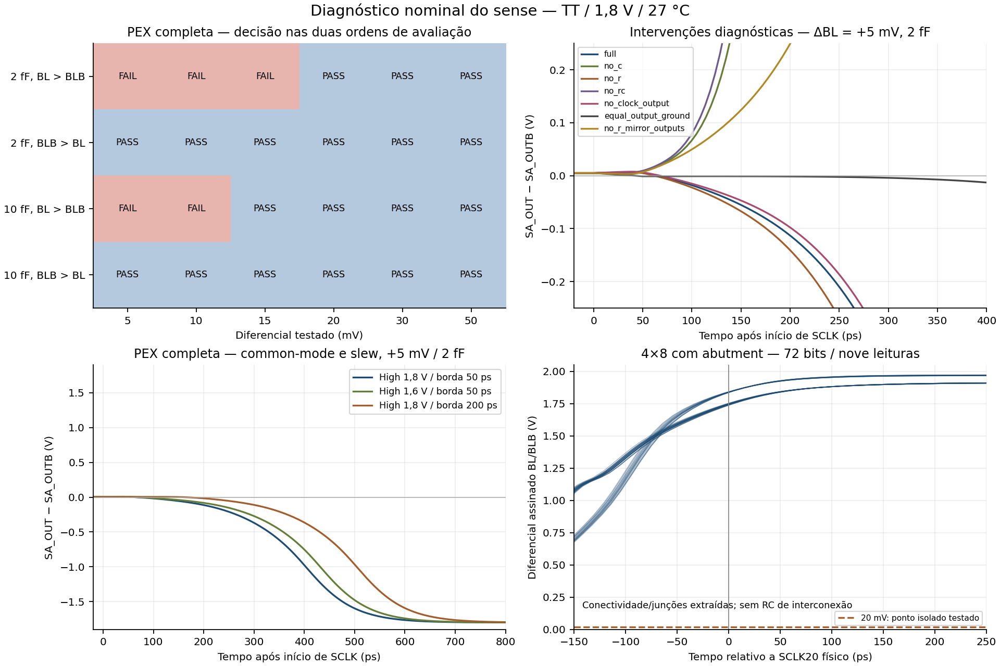

# Sense amplifier PEX: diagnóstico nominal em pequeno diferencial

Data: 11/11/2026. Branch: `investigation/sense-pex-small-signal`.
Base conferida: `ed9fb323a644f479a3e2687b73eecf35432d8c93`, igual à referência
remota de `verification/phase1-final-isolated` no início, com árvore limpa.

**A assimetria da rede capacitiva extraída contribui causalmente para a decisão
preferencial do latch.** A falha não desaparece removendo apenas resistores,
nem removendo apenas o acoplamento explícito clock–saídas. Espelhar a rede
capacitiva, mantendo os MOS, inverte a polaridade favorecida. Não foi demonstrada
necessidade de redesenho para o ponto nominal já ensaiado da SRAM 4×8.
A recomendação é **A: manter a célula e submeter seu domínio nominal documentado
à equipe**, preservando os FAIL em pequeno diferencial. Isso não seleciona uma
nova implementação nem aprova formalmente o fechamento de F1-04.

## 1. Identidade e referências

Foram lidos o [relatório isolado anterior](phase1_final_isolated_20261111.md),
seus recibos, critérios, decks, logs, verificações e transientes completos de
[nominal_v2](../reports/phase1/final_isolated_20261111/nominal_v2/), a
[reprodução com passo refinado](../reports/phase1/final_isolated_20261111/sense_reproduction/),
a [especificação técnica](../specs/technical_specification.md) e os dados de
[timing do candidato com abutment](../reports/phase2/direct_abutment_20261111/audit_v1/timing.json).
O replay anterior confirmou os quatro casos falhos, sem alterar seus resultados.

A seleção continua sendo [phase1_current](../release/phase1_current.json) →
[manifesto keeper](../release/phase1_keeper/manifest.json). O sense de sete MOS
é exatamente a [PEX congelada](../release/phase1/cells/sense_amp/sense_amp_pex.spice),
SHA-256:

`ab60dc3ccfdcd7430ed169db89b6285757f3c035ffe94ec0d5774ecb3f56b653`.

A referência esquemática continua sendo o SPICE de SHA-256
`52f80d154ddddef14438fdb6196fac8adb78ad67cc3173a461c66710616e5147`.
Não foi necessário repetir seus 12 ensaios anteriores aprovados. Os dispositivos
PEX mantêm W/L, junções e conexões originais, inclusive NMOS W = 0,98 µm, sem
trocar a quantização física pela dimensão esquemática de 0,975 µm.

A especificação, seções 12–13, exige resolução do diferencial e habilitação
após seu desenvolvimento suficiente; **não define 5 mV como sensibilidade
obrigatória**. Isso não converte os ensaios falhos em PASS: distingue resultado
de estresse e obrigação arquitetural.

## 2. Condições e critérios mantidos

SKY130A, TT, VDD = 1,8 V, 27 °C, ngspice 44.2/KLU, Gear. A rampa de VDD
permanece 1 ns; passo máximo 5 ps; `reltol=1e-5`. A falha já havia persistido
com passo máximo 1 ps e `reltol=1e-6` na rodada anterior.
Uma simulação por vez, uma thread, limite de 120 s/caso e preflight antes de
cada execução. Inicialmente havia cerca de 3,2 GiB de memória e 5,1 GiB de disco
disponíveis. Não foram instaladas dependências nem apagados dados.

Os critérios funcionais são os mesmos da campanha publicada, importados do
[runner original](../tools/run_phase1_final_isolated.py):

- LOW: −0,18…0,18 V; HIGH: 1,62…1,98 V nas janelas declaradas.
- Amostragem com SCLK baixo: erro máximo de 10 mV por saída e diferencial
  assinado de saída pelo menos igual à metade do diferencial imposto.
- Regeneração: polaridade correta, duas saídas nos níveis requeridos e
  resolução estável até 3 ns após SCLK cruzar 0,9 V.
- Duas avaliações por execução, com inversão do diferencial entre elas e
  teste das duas ordens de polaridade; cargas externas iguais nas duas saídas.

Os prazos são critérios da bancada, não especificações temporais garantidas.
Não houve `.ic`, `.nodeset`, `uic`, reset ou fontes impondo estados internos.
Os FAIL são de **polaridade e ausência de resolução correta**, não meramente
saídas corretas que ultrapassaram um prazo muito curto.

Nos ensaios de referência, a entrada alta é 1,8 V e a baixa é `1,8 − |ΔBL|`;
o common-mode, portanto, é `1,8 − |ΔBL|/2`. SCLK inicia a subida aos 5 e 13 ns,
com duração total de 50 ps. As saídas são verificadas em 8…8,5 e 16…16,5 ns.
Os cenários de operação alternativos explicitam entrada alta de 1,6 V ou borda
de 200 ps; **VDD e os critérios de decisão não mudam**. O campo `criteria`
preserva as condições de referência; `case.high_v` e `case.slew_ps` identificam
as variações de estímulo realmente executadas.

## 3. Limite nominal observado na PEX completa

Foram executados os diferenciais 5, 10, 20, 30 e 50 mV, com ambas as
polaridades iniciais e cargas de 2/10 fF por saída: 20 casos. O intervalo de
transição foi refinado somente em 15 mV, acrescentando quatro casos.

| Diferencial absoluto | Casos aprovados / quatro | Avaliações corretas / oito |
|---:|---:|---:|
| 5 mV | 0/4 | 4/8 |
| 10 mV | 0/4 | 4/8 |
| 15 mV | 2/4 | 6/8 |
| 20 mV | 4/4 | 8/8 |
| 30 mV | 4/4 | 8/8 |
| 50 mV | 4/4 | 8/8 |

Cada caso só passa se ambas as avaliações passarem. A tabela por polaridade,
considerando as duas ordens de avaliação, é:

| Carga por saída | Polaridade | Menor ponto testado aprovado | Maior ponto falho abaixo dele |
|---:|---|---:|---:|
| 2 fF | BL > BLB; SA_OUT esperado HIGH | 20 mV | 15 mV |
| 10 fF | BL > BLB; SA_OUT esperado HIGH | 15 mV | 10 mV |
| 2 fF | BLB > BL; SA_OUTB esperado HIGH | 5 mV | Não encontrado nos pontos testados |
| 10 fF | BLB > BL; SA_OUTB esperado HIGH | 5 mV | Não encontrado nos pontos testados |

Para 2 fF, a mudança de resultado foi observada entre os pontos 15 e 20 mV;
para 10 fF, entre 10 e 15 mV. **Não se mediu o limiar exato nem se garante o
comportamento de todo o intervalo contínuo.** 5 mV é apenas o menor ponto
ensaiado na polaridade favorecida. Não é especificação de offset ou yield.

Dados: [casos](../reports/phase1/sense_pex_small_signal_20261111/analysis_v1/cases.csv),
[avaliações individuais](../reports/phase1/sense_pex_small_signal_20261111/analysis_v1/events.csv)
e [limites observados](../reports/phase1/sense_pex_small_signal_20261111/analysis_v1/decision_limits.csv).

## 4. Intervenções controladas sobre os parasitas

Todas as intervenções estão em **cópias diagnósticas**, identificadas como
`diagnostic_only`, fora da biblioteca. A PEX completa tem 76 resistores e
61 capacitores explícitos. Cada transformação preserva o grafo de terminais,
modelos e parâmetros dos sete MOS após contrair os resistores em cada rede.
O código rejeita uma transformação que una pinos formais distintos.

Ao retirar resistores, seus nós são identificados por componentes conectados,
em vez de simplesmente apagar os resistores e deixar terminais desconectados.
O registro de cada caso lista exatamente os elementos removidos e os
capacitores alterados, em `transformation.json`.

| Modelo diagnóstico, todos em 5 mV | Operação feita | 2 fF: BL>BLB / BLB>BL | 10 fF: BL>BLB / BLB>BL |
|---|---|---|---|
| `full` | PEX original, sem alterações | FAIL / PASS | FAIL / PASS |
| `no_c` | Retirados os 61 C; mantidos os 76 R | PASS / PASS | PASS / PASS |
| `no_r` | Contraídos os 76 R; mantidos os 61 C | FAIL / PASS | FAIL / PASS |
| `no_rc` | R contraídos e C retirados | PASS / PASS | PASS / PASS |
| `no_clock_output` | Retirados somente C6 e C8, entre SCLK e saídas | FAIL / PASS | FAIL / PASS |
| `equal_output_ground` | Escalados os 20 C das duas redes de saída para VSS, igualando seus totais e conservando a soma | FAIL / PASS | PASS / PASS |
| `no_r_mirror_outputs` | R contraídos; trocadas apenas as conexões dos C a SA_OUT/SA_OUTB, sem trocar MOS ou estímulos | **PASS / FAIL** | **PASS / FAIL** |

As entradas de cada linha foram exercitadas nas duas ordens. Os modelos
modificados **não são propostas aprovadas de implementação** e não possuem
alegação de DRC/LVS ou correspondência a uma nova geometria fabricável.

### Evidência causal e seus limites

1. Os resistores **não são necessários** para produzir a falha: ela persiste
   em `no_r`. Manter somente os resistores, sem C explícitos, não reproduz a
   falha. Isso não significa que resistências sejam irrelevantes para os atrasos.
2. A assimetria capacitiva não é inferida apenas de formas de onda diferentes:
   **espelhar somente a rede capacitiva inverte a preferência do latch**,
   mantendo os dispositivos. A direção do erro acompanha essa intervenção.
3. Há contribuição das cargas para VSS: sua equalização faz passar o ensaio
   de 10 fF antes falho. Ela **não basta em 2 fF**, mostrando contribuição do
   restante da rede e de sua distribuição. Não foi identificado um único
   capacitor cuja correção isolada seja suficiente em todos os casos.
4. Remover apenas C6/C8 não resolve: o acoplamento explícito SCLK–saídas não
   é a causa única. A injeção/acoplamento intrínseco dos MOS continua presente
   mesmo em `no_c`, que passa; não se afirma que todo efeito de clock foi removido.
5. `no_rc` preserva os dispositivos extraídos, inclusive W = 0,98 µm, e passa.
   Portanto, a quantização 0,975→0,98 µm ou a geometria de junções, sozinhas,
   não explicam o erro observado na PEX completa.

## 5. Mecanismo físico provável

Somando apenas os C explícitos ligados às duas redes de saída e VSS, após
identificar suas redes resistivas, obtêm-se:

- SA_OUT: **8,51196 fF**.
- SA_OUTB: **9,80196 fF**.
- Diferença: **1,29000 fF**, além das cargas externas iguais.

Esses totais não incluem toda a capacitância efetiva do nó: há acoplamentos
com clock, alimentação, bitlines, outra saída e capacitâncias intrínsecas dos
MOS. Os acoplamentos explícitos SCLK→SA_OUT e SCLK→SA_OUTB são, respectivamente,
1,47766 e 1,57224 fF. As capacitâncias distribuídas continuam nos pontos
originais nos modelos que mantêm R.

Em uma observação da PEX completa, ΔBL = +5 mV / 2 fF, a amostragem produz
aproximadamente +5,004 mV nas saídas antes da subida. A diferença inverte o
sinal por volta de **5,064 ns**, cerca de 39 ps depois de SCLK cruzar 0,9 V,
e termina com SA_OUT LOW / SA_OUTB HIGH. Não é uma saída correta capturada
cedo demais. Os cruzamentos de 0,9 V nos gates de clock internos chegam cerca
de 0,5 ps depois do pino no tail e 1,4 ps nos PMOS de amostragem; esses números
são observações interpoladas, não limites de ativação dos dispositivos.

**Interpretação provável:** durante o início da descarga/regeneração, as cargas
e acoplamentos desiguais produzem evolução assimétrica das tensões. Em pequeno
diferencial, esse desequilíbrio pode superar a condição inicial amostrada e a
realimentação positiva fixa a decisão oposta. O maior total explícito para VSS
em SA_OUTB é consistente com sua descarga mais lenta e sua preferência por
HIGH, mas os controles mostram que o mecanismo não se resume a esse total.

Há, portanto, **contribuição causal demonstrada da assimetria capacitiva** e
uma explicação física provável da evolução dinâmica. Não se atribuiu uma
fração exata do erro a cada capacitor, nem se mediu offset estático/estatístico.

## 6. Common-mode, clock e memória da avaliação anterior

Foram executados oito casos adicionais na PEX original, todos em 5 mV:

| Variação de estímulo | Casos aprovados / quatro | Resultado observado |
|---|---:|---|
| Entrada alta 1,6 V, baixa 1,595 V; borda de SCLK 50 ps | 0/4 | Mantida a preferência por SA_OUTB HIGH |
| Entrada alta 1,8 V, baixa 1,795 V; borda de SCLK 200 ps | 0/4 | Mantida a preferência por SA_OUTB HIGH |

Todos mantêm VDD = 1,8 V. A segunda variação foi escolhida porque 200 ps
de duração total equivalem a 160 ps entre 10% e 90%, próximo dos cerca de
158 ps medidos no SCLK físico do top. Esses ensaios não eliminam toda possível
dependência de common-mode ou slew; mostram que **essas duas mudanças específicas
não são uma solução demonstrada** para 5 mV.

As amostragens passaram, tanto na primeira quanto na segunda avaliação. O
erro acompanha a polaridade, não a ordem inicial, e ocorre também após nova
amostragem de aproximadamente quatro ns. Isso exclui o estado residual como
explicação necessária para os casos ensaiados. Um estudo universal de estados
iniciais não foi realizado.

## 7. Relevância para a SRAM 4×8 com abutment

O [extrator de contexto](../tools/extract_sense_top_context.py) verificou a
identidade do raw original, SHA-256
`f5c19a6db9293edd792d73c4fe306c7782f9ad718fd66dfd0fa56872b75feb95`, e sua relação
com `qualification_v1/results.json` e `audit_v1/timing.json`.

A correspondência dos pinos foi reconstruída por identidade dos MOS e
equivalências do `.ext`, para **cada instância**
`macro_core.array_and_peripherals.sense_amp_0…7.BL/BLB/SCLK`.
Os probes BL/BLB registrados coincidem com esses pinos; o vetor usado como
SCLK coincide com o pino de habilitação de todos os oito senses. Não se usou
apenas um nome de rede semelhante ou a posição presumida de uma coluna.

As medidas foram refeitas no raw completo, em nove leituras / 72 bits,
usando a polaridade esperada de cada palavra conhecida:

| Referência física | Menor diferencial assinado entre os 72 bits | Common-mode observado nos 72 bits |
|---|---:|---:|
| 50 ps antes de SCLK cruzar 20% de VDD | **1,571 V** | 1,007…1,057 V |
| SCLK em 20% de VDD (0,36 V) | **1,737 V** | 0,961…0,998 V |
| SCLK em 50% de VDD (0,9 V) | **1,833 V** | 0,973…0,981 V |
| SCLK em 80% de VDD (1,44 V) | **1,884 V** | 0,966…0,986 V |

Os campos históricos `minimum_signed_bl_at_sense_v` são mínimos **por ciclo**:
1,737077…1,835836 V em nove registros. O máximo entre todos os valores
individuais de bits pode ser diferente; a nova tabela preserva ambos os
significados e reconcilia exatamente os mínimos anteriores. O slew SCLK
10–90% foi 157,789…158,206 ps.

As bitlines apresentam overshoot nas formas de onda originais; os valores
medidos não foram limitados artificialmente a 1,8 V. As tensões individuais,
pontos de referência e polaridades estão em
[pins_at_sense.csv](../reports/phase1/sense_pex_small_signal_20261111/top_context_v1/pins_at_sense.csv).

**O ponto de 5 mV não é uma condição operacional necessária demonstrada para
esse cenário nominal do 4×8.** Os sinais chegam com diferencial muito maior e
common-mode distinto. Isso não autoriza dividir 1,571 V pelo limiar isolado e
chamar o resultado de margem garantida, nem generalizar para PVT.

Limitação relevante: o top ensaiado contém MOS e geometria de junções extraídos,
**sem os RC distribuídos das interconexões/folhas**. Essa campanha não constitui
uma simulação integrada contendo a PEX RC completa do sense. Portanto, o
comparativo sustenta a ausência de uma necessidade de 5 mV no cenário observado;
não substitui a futura caracterização pós-layout completa.

Foram preservadas todas as amostras nativas nas nove janelas ao redor da
habilitação, sem decimação, em
[top_edge_windows.npz](../reports/phase1/sense_pex_small_signal_20261111/top_context_v1/top_edge_windows.npz).
O analisador refez os cruzamentos e as 288 observações de pinos a partir dessas
janelas, sem precisar do raw completo de aproximadamente 100 MB. Isso permite
auditar **essas medidas específicas** em um clone; não equivale a regenerar a
campanha elétrica completa.

## 8. Alternativas e recomendação

| Alternativa | Evidência favorável e condições | Recomendação |
|---|---|---|
| **A — Manter e documentar domínio nominal** | A especificação não exige 5 mV; função isolada passa nos pontos 20/30/50 mV em ambas as cargas e polaridades; o top nominal observado apresenta diferencial muito maior | **Caminho recomendado para a entrega atual, sujeito à aprovação explícita da equipe**. Publicar todos os pontos, cargas, common-modes e falhas, sem converter o menor PASS em sensibilidade garantida |
| **B — Mudar sequenciamento/condições** | As mudanças de common-mode e slew testadas não eliminaram a falha. Aumentar o tempo de desenvolvimento das bitlines pode mudar o diferencial real, mas o top já apresenta grande diferencial nas leituras observadas | Não há justificativa demonstrada para alterar os taps ou o clock agora. Qualquer outra sequência exigiria nova verificação integrada |
| **C — Revisar geometria/circuito do sense** | A assimetria capacitiva é demonstrável. Uma revisão física balanceando as redes de saída/clock poderia ser investigada se pequeno diferencial passar a ser requisito ou se houver falha nas condições efetivas de uso | Proposta condicional, **não necessária por evidência do cenário nominal atual**. Exigiria nova revisão física, DRC/LVS, PEX e ensaios; nenhuma cópia diagnóstica deve ser promovida como solução |

Não se introduz aqui um novo valor mínimo obrigatório na especificação. Como
referência histórica, a campanha G7 consultada utilizava alvo de 200 mV; isso
também não é um limite garantido da célula. A equipe deve decidir se aceita o
domínio nominal demonstrado para o encerramento atual, em vez de exigir
retroativamente 5 mV ou declarar robustez que não foi medida.

### F1-04

A cadeia isolada de identidade→netlist executada→resultado das variantes finais
foi suprida na rodada anterior e aprofundada aqui. Os quatro FAIL originais
do sense PEX em 5 mV continuam intactos; o WL driver não foi reavaliado ou alterado.

**Recomenda-se encerrar a lacuna de comprovação de F1-04 com ressalva operacional,
caso a equipe aprove a alternativa A.** Sob o critério anterior de aprovação
de todos os casos de 5 mV, o item continua sem aprovação integral. Esta
investigação não muda esse critério, não registra aceite por terceiros e não
fecha o item automaticamente. Não há evidência que obrigue redesenho para
concluir a entrega nominal já ensaiada.

## 9. Execução, verificadores e reprodução

[Índice dos novos resultados](../reports/phase1/sense_pex_small_signal_20261111/README.md).
O [runner dirigido](../tools/investigate_sense_pex.py) preserva modelos,
hashes de entradas, snapshot da versão executada, plano anterior à execução,
decks, logs nativos, transformação exata, transientes completos comprimidos,
verificações por avaliação e observações internas. Sucesso de execução e
integridade são separados do estado funcional; os FAIL não provocam ocultação
dos resultados seguintes.

Foram analisados **56 casos completos / 112 avaliações**:
24 de varredura/refinamento da PEX original, oito de condições operacionais
alternativas e 24 de modelos modificados exclusivamente para diagnóstico.
São **24 casos PASS e 32 FAIL**, sem interpretar os modelos diagnósticos
deliberadamente alterados como taxa de falha da biblioteca.
Há 728 verificações individuais, 664 PASS e 64 FAIL; esses números não medem
robustez estatística. Os 112 controles de saída errada são adulterações em
memória, não novas simulações SPICE.

Uma tentativa inicial `ablation_v1` teve erro de observação: após contrair R,
os pinos formais passaram a ser nós globais, mas o probe ainda usava prefixo
hierárquico. O ngspice completou o transiente e recusou o `wrdata`, sem produzir
os dados exigidos. O runner classificou **FAIL_EXECUTION**, sem PASS artificial.
Foram preservados o log e o código com hash correspondente; a correção foi
somente de nomes de probes. `ablation_v2` repetiu a matriz completa. Essa
tentativa inclui quatro execuções preliminares e uma incompleta, excluídas da
contagem de 56 casos; houve **61 invocações ngspice novas** ao todo.

Os oito testes de proteção das transformações/verificador incluem preservação
dos MOS, remoção exata de R/C, seleção de C6/C8, conservação da capacitância
total na equalização, espelhamento, rejeição de gate trocado e nomes de probes
após contração. O replay rederiva decisões dos transientes e aceita uma versão
histórica do runner somente se seu snapshot corresponder ao hash registrado
e se o deck/circuito e os critérios esperados continuarem reconciliados.

Reprodução em diretórios **novos** (nenhuma saída existente é sobrescrita):

```sh
./tools/sram-eda python3 tools/investigate_sense_pex.py --suite sweep \
  --output reports/phase1/sense_diagnostic_fresh/sweep
./tools/sram-eda python3 tools/investigate_sense_pex.py --suite sweep \
  --deltas-mv 15 --output reports/phase1/sense_diagnostic_fresh/refine
./tools/sram-eda python3 tools/investigate_sense_pex.py --suite ablation \
  --output reports/phase1/sense_diagnostic_fresh/ablation
./tools/sram-eda python3 tools/investigate_sense_pex.py --suite ablation \
  --modes no_clock_output equal_output_ground no_r_mirror_outputs \
  --output reports/phase1/sense_diagnostic_fresh/focused
./tools/sram-eda python3 tools/investigate_sense_pex.py --suite operating \
  --output reports/phase1/sense_diagnostic_fresh/operating
```

O estado `execution_status=COMPLETED` significa que os dados foram obtidos,
inclusive se `functional_status=FAIL`. Não significa aprovação da célula.
Para auditar um estágio sem simular:

```sh
./tools/sram-eda python3 tools/investigate_sense_pex.py \
  --output reports/phase1/sense_pex_small_signal_20261111/sweep_v1 --verify
./tools/sram-eda python3 tools/test_sense_pex_diagnostics.py
```



Figuras e tabelas vêm exclusivamente dos dados preservados. Não houve mudança
em biblioteca, SRAM com abutment, seletores, taps, documentação histórica,
manifestos ou resultados anteriores. Não houve PVT extenso, Monte Carlo,
nova extração física, busca de Fmax ou caracterização Liberty.
