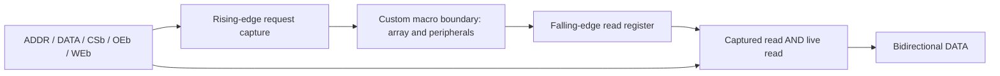

# Phase 2 digital interfaces and reproduction

The [digital contract](../specs/sram_4x8_digital.md) and
[technical specification](../specs/technical_specification.md) define behavior.
This implementation is functional verification, not an integrated transistor
macro or a compiler-generated physical view.
The [dated implementation review](phase2_digital_implementation_20261030.md)
records the reproduced checks and preservation audit.

## Implementation hierarchy



| Module | Purpose | Included in synthesis file list? |
|---|---|---|
| `sram_model` | Standalone public model, depths 4/8/16/32 | No |
| `sram_controller` | Registered 4x8 request; no FSM or reset | Yes |
| `sram_4x8_wrapper` | Shared bus, controller, macro and read register | Yes |
| `sram_4x8_macro` simulation definition | Functional substitute for custom storage/peripherals | No |
| `sram_4x8_macro` black-box definition | Future physical binding boundary | Yes |
| `row_decoder_2to4` | Logical selection reference for unit verification | No |

## Internal macro boundary

| Pin | Direction | Meaning |
|---|---|---|
| `CLK` | input | Functional transaction clock; not a qualified PCLK waveform |
| `ADDR_Q[1:0]` | input | Captured row address, stable during access |
| `DIN_Q[7:0]` | input | Captured write word |
| `READ_Q`, `WRITE_Q` | input | Mutually exclusive captured access requests |
| `DOUT_RAW[7:0]` | output | Resolved raw read word before falling-edge capture |
| `VDD`, `VSS` | supply | Explicit connectivity |

The raw output must meet the wrapper register's setup/hold limits once the
physical macro is integrated. It is not itself the public registered output.
The functional substitute may show storage data outside read mode; only a
captured read can transfer it to the public output register.

`READ_Q`/`WRITE_Q` may remain high during the following low phase. Physical
row and write activation must additionally respect clock/phase qualification.
The logical unit test gates row selection with `CLK`; it does not prove the
transistor-level PCLK/PRECH implementation.

Use **one** of these file lists, never both macro definitions together:

- `rtl/model.f`: public model only.
- `rtl/wrapper_sim.f`: wrapper with functional macro substitute.
- `rtl/wrapper_synth.f`: wrapper with macro black box; no FF-based array.

These lists contain repository-root-relative paths. They are parsed from the
repository root by the regression runner. Actual SKY130HD synthesis, timing
constraints and GLS are the next front; compilation of the black box does not
establish a physical binding or a synthesis result.

## Run and inspect

From the repository root:

```bash
./scripts/run_rtl.sh
./scripts/run_rtl.sh --seed 0x5A17 --output reports/digital/local_review
./scripts/run_rtl.sh --output reports/digital/local_review --verify-evidence
./tools/sram-eda gtkwave reports/digital/latest/waveforms/wrapper_4x8.vcd
./tools/sram-eda python3 -m unittest discover -s tools/tests -p 'test_digital_regression*.py' -v
```

The script delegates to `tools/sram-eda`, so it uses the configured container
tools rather than assuming Icarus is installed on the host. The Python runner
uses only the standard library. Default random count is 2,048 per memory run;
`--random-ops` may increase it but cannot reduce the acceptance minimum.

Default reports are ignored under `reports/digital/latest/`. Current review
evidence is stored in [phase2_log_reconciliation](../reports/digital/phase2_log_reconciliation/summary.md);
[phase2_final_review](../reports/digital/phase2_final_review/summary.md) retains
the preceding 32-guard-test campaign;
[phase2_review_fixes](../reports/digital/phase2_review_fixes/summary.md) retains
the first hardened runner's 21-guard-test campaign;
[phase2_baseline](../reports/digital/phase2_baseline/summary.md) retains the initial
historical run and the former runner's hashes.
Each accepted run has a unique directory under ignored `build/digital/run-*/`,
containing its executables, full VCDs, mutants and read-only input snapshot.
`run_directory`, `snapshot_directory` and `full_waveforms` in `results.json`
identify those paths relative to the repository root. Commands also record
their working directory, which is the captured snapshot rather than live sources.
Small real waveform excerpts (0..180 ns, including startup, writes and readback)
are retained with selected evidence. Their timestamps are testbench scheduling,
not characterized delays. In GTKWave add `CLK`, `ADDR`, `CSb`, `OEb`, `WEb`,
`DATA`, `host_drive`, and DUT captured address/read/write/output registers.
The runner does not change delivered RTL. Use a fresh output directory to
preserve an older report. An interrupted/failed run must not be treated as PASS.
Output directories must stay under `reports/digital/`; the runner rejects
source and frozen-release locations before writing any result.
An exclusive `.run.lock` protects each output directory. A second invocation
using the same output is rejected without modifying the owner's receipt;
different outputs may run concurrently with independent build directories.
The lock file is intentionally retained and ignored by Git; the OS releases
the lock when its process exits, including abnormal termination.

`results.json` records individual case counts, controller checks, unsupported
depth rejection, detected mutants, versions, commands and SHA-256 identities
of the tested inputs. Before compilation, `source_manifest.json` records hashes
of the captured read-only files. Compilation, simulation file lists, source
audits and mutation generation all use that snapshot. Original and captured
inputs must still match those hashes before PASS is published; edits or file
set changes fail the run. Its Git commit is the base revision, not
proof that uncommitted files already exist in that commit. A future commit
must be checked against these recorded source hashes.
Log and selected waveform hashes bind the retained numerical and waveform
evidence. After acquiring the output lock, a run atomically marks the receipt
RUNNING before checking tools. Exceptions, missing tools and detected source
edits publish FAIL; an uncatchable interruption may leave RUNNING, never a new
PASS. JSON is the authoritative completion marker and is published last.

Each new accepted core run also invalidates `verification_checks.json` as
`NOT_CURRENT`, before changing the main receipt. Even a successful rerun
requires a fresh consolidated verification. A failed rerun cannot leave a
consolidated PASS looking current. A rejected competing writer changes neither
receipt because invalidation happens only after acquiring the output lock.

After a core PASS, `--verify-evidence` takes the same lock, checks captured/live
source identities and transcript/waveform hashes, runs the Python tools and
reconciliation suites, and audits stored Phase 1 evidence. It verifies complete
unittest method inventories with no skips, then rechecks input and core-receipt
identities before publishing a new consolidated PASS. Failures publish a
consolidated FAIL without replacing the core simulation result. This mode does
not rerun electrical simulation, extraction, DRC or LVS.

Consolidation also reparses each required raw `RESULT`/`CONTROL_RESULT` record,
validates its configuration and coverage, and compares the entire case matrix
and controller result with the stored summary. It reconciles all depth-guard
and mutant diagnostics with their raw logs. Missing hashes, missing/duplicate
cases, changed scalar types or any metadata difference fail before running the
Python suites. The consolidated `core_checks` total is calculated from these
parsed records, never from unchecked summary counters. `log_reconciliation`
records the verified counts and SHA-256 identities of the 18 primary logs.

Each memory result must report exactly the requested depth, seed and random
count. Coverage vectors must have eight control entries and one entry per
address, with positive integer counts and consistent operation totals. The
controller result must contain all 96 checks across eight controls and four
addresses. Missing/duplicate result records and reserved result fields fail.

Six deliberate defects must fail the scoreboard: wrong capture edge, address
aliasing, missing live bus mask, corrupt write data, invalid-control writes
and use of a live address during access. A detected mutant requires exit code
1 and exactly one formatted bus-mismatch diagnostic from
`tb_sram_4x8.expect_bus`. Depth rejection requires the exact requested-depth
message and `tb_sram_depth_guard.dut.invalid_depth` scope. Watchdogs, unrelated
fatals, ambiguous diagnostics, crashes and other exit codes fail the campaign.
`negative_results` records the accepted cause, scope and message for all 12
negative cases, which are not counted as passing memory runs.
The 43 entry-point/unit/integration tests exercise these guards. Six tests
use real Icarus in disposable project copies: a bench fixed at four words must
fail the eight-word request; editing live RTL after the first compile must
fail while subsequent positive cases still use the intact snapshot; two
simultaneous regressions with different seeds must pass with separate build
paths and the correct seed in each retained waveform. The two additional real
tests reject watchdog-only negative runs and invalidate consolidated PASS on
both successful and failed output reuse. Run them through `tools/sram-eda`;
the six real-tool tests are skipped if Icarus is unavailable, and such skips
prevent consolidated PASS. The sixth test alters one counter by one million
after a real core run and requires consolidated FAIL before any test-suite
subprocess starts. The [latest correction record](phase2_digital_log_reconciliation_20261030.md)
links the evidence; [the lifecycle record](phase2_digital_evidence_lifecycle_20261030.md)
and [the first review](phase2_digital_review_fixes_20261030.md) retain earlier findings.

The source audit checks that controller/wrapper procedural processes are
edge-triggered and contain no initial blocks or delays. No Yosys latch report
is claimed. The public model is independently parsed as Verilog 2005.

## Handoff and remaining work

The new `feature/phase2-digital` branch starts from Phase 1 integration commit
`a27dd1e5373d70c546bdfae44decefde64393794`. It depends on PR #7; Phase 2 work
must not be folded into that Phase 1 PR. After #7 is integrated, merge current
`develop` into this feature branch without rewriting shared history, then
review the Phase 2 delta separately.

Next: SKY130HD synthesis of the controller/wrapper with the custom macro kept
as a black box, then reuse the testbench for GLS. Follow with actual macro
binding, capture/output-register implementation, PCLK/PRECH/sense timing,
physical assembly, DRC/LVS and electrical write/readback. No PEX is required
for the digital regression described here. Frequency, timing margins and
analog reliability remain unqualified by these tests.
